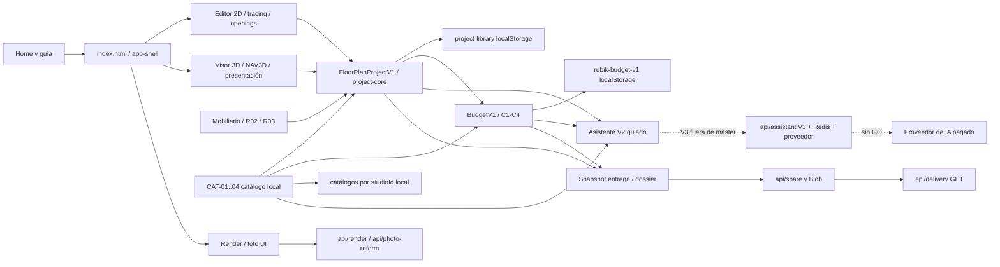

# Arquitectura y dependencias comprobadas

**HEAD:** `46174d6918e336119a79f5bda9fd2733aa5464c4`. El diagrama representa el flujo vigente y las puertas externas, no una propuesta de reescritura.

## Contratos y estado compartido

`FloorPlanProjectV1` (`js/project-core.js`, `js/project-schema.js`, `docs/contracts`) es la escritura geométrica única; milímetros e IDs son invariantes. `FloorPlanBuilding` guarda niveles y un proyecto activo por nivel. R02 usa `x-r02a-ceiling`, R03 `x-r03-cabinet`, catálogo colocado `x-cat03-catalog-link`. El presupuesto es `FloorPlanBudgetV1` y `calculateBudget()` es el único cálculo autorizado. CAT-04 reconcilia enlaces con partidas de ese presupuesto y conserva la unidad comercial; el Asistente consulta el presupuesto, no calcula otro. `client-delivery-core` crea un snapshot mínimo y `api/delivery` lo valida en lectura.

**Estado paralelo real:** `project-library.js` escribe una colección local; `budget-ui.js` escribe `rubik-budget-v1` por `project.id`; `catalog-ui.js` escribe catálogo por `studioId` local; `assistant-ui.js` mantiene historial local; `share-link-ui.js` mantiene registro local de publicaciones. Cada subsistema tiene validación, pero no hay transacción única entre estas claves ni identidad de estudio emitida por servidor. Exportar `project.json`/ZIP no incorpora el precio: `tests/cat04.browser.test.cjs` lo comprueba explícitamente y descarga el presupuesto aparte. Esto debe explicarse en el piloto y probarse al duplicar/importar.

## Juntas sensibles y serialización

`index.html` (markup, scripts, escena Three.js), `js/app-shell.js`, `js/project-core.js`, `js/project-library.js`, `js/budget-ui.js`, `js/budget-draft-core.js`, `js/catalog-budget-core.js`, `js/assistant-domain-tools-core.js`, `js/assistant-ui.js`, `js/delivery-client.js`, `api/share.js` y `api/delivery.js` son puntos de conflicto. #236 toca Home/registro/index; #238 toca Asistente/index/workflow; #166 toca Entregar/index/API. No deben editarse simultáneamente en dos ventanas sin declaración de propiedad. El editor, R02/R03 y CAT-04 pueden revisarse por pruebas separadas, pero se aceptan juntos en un proyecto único. #238 necesita serializarse después de la reconciliación económica de #237. #166 debe portar el lector sobre GOV-08 vigente, no importar la API antigua.

**Dependencias obligatorias:** catálogo→enlace de objeto→cantidad/unidad→precio revisado→presupuesto→Asistente/dossier; proyecto→snapshot mínimo→publicar con token→lector sin sesión→revocar; Home→registro de capacidades→módulo real→despliegue correspondiente. Los laboratorios R01, MCP Etapa 2 y visuales deben permanecer fuera de estas rutas hasta superar sus gates. No hay evidencia que justifique sustituir el núcleo o crear un segundo motor de presupuesto.

## Seguridad de la integración

El servidor V3 remoto valida un código propio y reserva gasto en Redis, pero el `studioId` de catálogo y el contexto de proyecto se originan en el navegador. El código de acceso compartido no es autenticación multiestudio. La UI V3 reinicia conversación/consentimiento al cambiar `studio|project`, lo cual es una guarda local valiosa, pero un backend multiusuario requeriría identidad/autorización propia. Los enlaces de entrega son accesos por posesión de URL; revocación existe, caducidad general no está acreditada. Estos hechos no bloquean un piloto sintético y cerrado, pero sí la exposición de proyectos reales a múltiples estudios.
