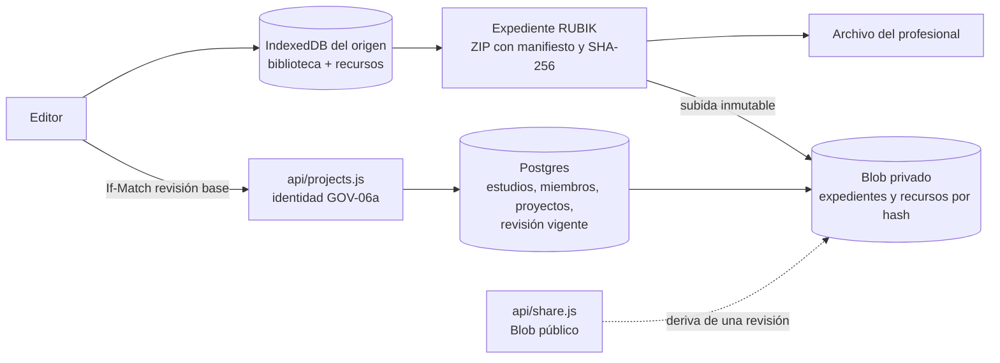

# ADR · Persistencia y continuidad del proyecto profesional

**Estado:** ACEPTADO CONCEPTUALMENTE por el propietario el 18/11/2026 (decisión **D3** del [plan maestro v1.12](PLAN-MAESTRO-RUBIK-SOTA-v1.12.md)). F0 está autorizado por etapas (§9). No autoriza contratar infraestructura, elegir proveedores, activar servicios ni ejecutar F1. **Fecha:** 18/11/2026. **Base:** `master@7dccf7a`. **Autor:** Claude Code.

Este ADR no crea bases de datos ni almacenes, no contrata servicios, no activa proveedores y no cambia código.

## 1. Problema

Un profesional debe poder trabajar un proyecto durante meses y desde varios dispositivos. Debe poder recuperar versiones y no perder trabajo. Hoy todo depende de un navegador en un dominio concreto.

## 2. Lo que existe (inspeccionado en `7dccf7a`)

| Pieza | Qué hace | Sirve para proyectos privados | Responsabilidad real |
|---|---|---|---|
| `js/project-library.js` | Biblioteca de proyectos y edificios, con id propio, variantes (`variantOf`), origen y migración idempotente | **Sí**, es el núcleo | Identidad y colección local |
| `localStorage` | Unas quince claves `rubik-*`. Las que cuelgan de `project.id`: `rubik-budget-v1`, `rubik-construction-v1`, `rubik-review-v1`, `rubik-assistant-v1` | Sí, pero limitado | Cuota de pocos MB por origen; un proyecto queda repartido en varias claves |
| `js/local-images.js` | IndexedDB `rubik-sota-images-v1` con los bytes originales de las imágenes | **Sí** | Recursos grandes locales |
| `js/project-package.js` | ZIP propio sin dependencias: `project.json`, `presentation.json`, vistas e imágenes | **Sí**, base del paquete | Portabilidad |
| Importación JSON y ZIP (`js/guide-core.js:47`) y Guardar JSON (#257) | Entrada y salida manual | Sí | Respaldo manual |
| `PROJECT_VERSIONS` y migraciones de `project-core` | Versionado de esquema | **Sí** | Compatibilidad |
| `api/share.js`, `api/publications.js` | Vercel Blob **público** con sufijo aleatorio, caducidad 7/30/90 | **No** | Entregables publicados para clientes, no proyectos editables |
| `api/_spend-ledger.js` | Libro atómico en Redis | **No** | Gasto y cuotas |
| `api/_beta-controls.js` (#258) | Identidad de tester por huella en variables de entorno | No como almacén | Semilla de GOV-06a |

**Faltan cuatro cosas:**
1. No existe un paquete que reúna todo el expediente. El ZIP no incluye presupuesto, plan de obra, revisiones ni renders.
2. No hay copia fuera del navegador salvo exportación manual.
3. No hay identidad profesional.
4. No hay control de concurrencia entre sesiones.

## 3. Restricción de dominios

Cada dominio tiene su propio almacenamiento de navegador. Los proyectos guardados en `floorplan-3d-alpha.vercel.app` **no existen** en `floorplan-3d-demo.vercel.app`, y viceversa. Beta 01 está **pendiente de identificación**: no consta en el repositorio a qué dominio o despliegue corresponde.

**Regla de preservación:**
- Ninguna fase migra ni borra datos de un dominio de forma automática.
- La migración siempre se hace dentro del mismo origen y se ejecuta en el navegador del profesional.
- El paso entre dominios se hace exportando el expediente en uno e importándolo en otro.
- La importación ya distingue copia interna de importación externa y reidentifica cuando el id está ocupado (`js/project-library.js:12-25`). Con eso no hay duplicados silenciosos.
- La Demo debe rotularse como almacenamiento de demostración. Es una decisión del propietario, D3-c.

## 4. Alternativas

| Criterio | A · Local reforzado + paquete portable | B · Local primero + sincronización privada | C · Centralizado en servidor |
|---|---|---|---|
| Seguridad y privacidad | Alta: nada sale del equipo | Alta si hay identidad y almacén privado | Depende por completo del servidor |
| Integridad | Buena: huella SHA-256 por archivo (detecta alteraciones; no es una firma ni prueba la autoría) | Buena: revisiones inmutables | Buena |
| Pérdida del dispositivo | Solo si hay copia exportada | **Sí** | **Sí** |
| Multidispositivo | Manual | **Sí** | **Sí** |
| Datos locales sin conexión (no es lo mismo que app offline, §16) | **Sí** | **Sí**, con cola | No, o muy limitado |
| Coste | 0 | Bajo y variable | Medio y fijo |
| Dependencia del proveedor | Ninguna | Baja: el paquete es el formato | Alta |
| Complejidad | Baja | Media | Alta: reescribir la persistencia del editor |
| Reutilización | Total | Alta: el paquete de A es la unidad de sincronización | Baja |
| Reversibilidad | Total | Alta: se puede volver a A | Baja |

**Decisión propuesta: B construida sobre A.** A no es una alternativa descartada sino la fase 1, y sigue siendo útil siempre. C se descarta porque exige reescribir el editor, pierde el trabajo sin conexión y no aporta nada que B no dé.

## 5. Arquitectura recomendada

**Principios:**
1. **El expediente es la unidad.** Sirve igual para exportar, respaldar, sincronizar y migrar. Es un formato propio y abierto, sin dependencia de ningún proveedor.
2. **Local primero.** El editor nunca espera a la red. IndexedDB pasa a ser el almacén local. Se solicita `navigator.storage.persist()`, que el navegador puede conceder o no y que no garantiza la conservación: la copia exportable sigue siendo el respaldo real. `localStorage` queda solo para preferencias.
3. **Revisiones inmutables.** Cada guardado remoto crea una revisión nueva. Nunca se sobrescribe una existente.
4. **Concurrencia optimista.** Cada subida declara su revisión base. Si la revisión vigente ya cambió, el servidor responde `409` y el cliente conserva su trabajo como **variante**, con el mecanismo que ya existe en la biblioteca. Si esa distribución ya tiene `MAX_VARIANTS` (2) variantes, el trabajo se conserva como expediente de conflicto visible y exportable; nunca se descarta. Nunca hay sobrescritura silenciosa.
5. **Archivos grandes fuera de la base de datos.** Fotos, renders, PDF y vídeos van al Blob privado por su hash. La base de datos solo guarda metadatos y punteros.
6. **Lo publicado se deriva, no se comparte.** Un enlace de cliente es un artefacto derivado de una revisión. Sigue en su Blob público o en S5. Nunca es el proyecto editable.
7. **Redis no guarda proyectos.** Sigue siendo libro de gasto, cuotas y límites.

### 5.1 Modelo de datos conceptual

| Entidad | Campos esenciales | Notas |
|---|---|---|
| `studio` | id, nombre, región de datos, cuota de almacenamiento | Frontera de aislamiento. GOV-06b añadirá organización y roles sin cambiar esta frontera |
| `member` | studio_id, principal_id, rol mínimo (`owner`, `editor`) | Un profesional solo puede pertenecer a su estudio en la fase B |
| `project` | id = `project.id` de RUBIK, studio_id, título, revisión vigente, borrado lógico | El id lo conserva la biblioteca y no se regenera |
| `revision` | id, project_id, número, revisión padre, autor, fecha, hash del expediente, tamaño | Inmutable |
| `asset` | sha256, studio_id, tipo, tamaño | Se deduplica por hash dentro del estudio, nunca entre estudios |
| `revision_asset` | revision_id, sha256, ruta en el expediente | — |

**Manifiesto del expediente** (`rubik-sota.expediente` v1):
- proyecto o edificio con sus plantas y variantes;
- presupuesto por revisión;
- plan de obra;
- revisiones y comentarios;
- del Asistente, solo lo necesario para continuar el proyecto (§16);
- marca aplicada;
- referencias de catálogo con su revisión;
- presentaciones y dossieres generados;
- renders con su ficha, que reutiliza `rubik-visual-result-sheet/1`;
- cada archivo con su SHA-256 y la versión de esquema.

Los catálogos del estudio viajan como referencia con revisión y no se copian en cada proyecto.

## 6. Seguridad, privacidad y gestión de datos

- **Separación entre estudios:** en Postgres con políticas por fila; en Blob, con rutas `studio/<id>/` y comprobación del estudio en la función antes de leer. Nunca hay URL pública de un recurso privado.
- **Identidad:** depende de GOV-06a. El proveedor de identidad es una decisión aparte, D3-b.
- **Cifrado:** en tránsito y en reposo, del proveedor. El cifrado de extremo a extremo no se propone en B: impediría el render y el Asistente en servidor.
- **Borrado:** borrado lógico con plazo y después borrado del Blob y de las filas. Exportación completa antes de borrar. Requiere el dictamen GOV-05 para fijar plazos.
- **Región:** datos en la UE. **[V]** Hay que verificar la región disponible del proveedor elegido antes de aprobar.

## 7. Recuperación y respaldo

| Capa | Mecanismo | Verificación |
|---|---|---|
| Local | IndexedDB persistente y expediente exportable | Restaurar un expediente en un perfil limpio y comparar hashes |
| Servidor | Revisiones inmutables; copias de Postgres **y**, por separado, del almacén de archivos: una copia de la base de datos no recupera los archivos de Blob | Restaurar una revisión antigua y abrirla en el editor |
| Independencia del proveedor | Exportación completa del estudio en expedientes ZIP | Importarla en una instalación sin servidor, en modo A |

## 8. Costes estimados

Solo con las fuentes oficiales consultadas el 18/11/2026. Son órdenes de magnitud, no presupuesto.

| Servicio | Precio publicado | Fuente |
|---|---|---|
| Vercel Blob, almacenamiento privado | 0,023 USD/GB-mes; operaciones avanzadas 5,00 USD/millón; simples 0,40 USD/millón; mismas tarifas que el público | [Vercel Blob Pricing](https://vercel.com/docs/vercel-blob/usage-and-pricing), actualizada el 23/09/2026 |
| Vercel Blob privado | Disponible de forma general; lectura solo autenticada a través de una función | [Private Storage](https://vercel.com/docs/vercel-blob/private-storage) |
| Neon Launch | Sin mínimo mensual; 0,106 USD/CU-hora; 0,35 USD/GB-mes; restauración 0,20 USD/GB-mes; historia hasta 7 días | [Neon pricing](https://neon.com/pricing) |
| Supabase Pro | Desde 25 USD/mes; 8 GB de base de datos; 100 GB de archivos; copias diarias 7 días; PITR 100 USD/mes | [Supabase pricing](https://supabase.com/pricing) |

**Ejemplo de la beta.** Supuesto: 20 profesionales con 10 proyectos cada uno, 5 MB de proyecto y 50 MB de recursos por proyecto, unos 11 GB en total.

| Servicio | Coste mensual estimado |
|---|---|
| Blob privado, almacenamiento | Menos de 1 USD |
| Neon, cómputo de 50 CU-hora | Unos 5 USD |
| Supabase Pro, si se elige | 25 USD fijos |

La transferencia de lecturas privadas a través de funciones se paga aparte, con tarifas regionales. Sin verificar: el plan de Vercel del equipo y sus créditos incluidos.

**Proveedor de base de datos: decisión D3-a.** No se elige por popularidad.
- **Neon con Blob privado** mantiene la pila Vercel ya en uso: funciones, Blob y OIDC. Paga por uso y obliga a resolver la identidad por separado.
- **Supabase** reúne identidad, políticas por fila y almacenamiento en un proveedor. Tiene coste fijo, más dependencia y sustituiría a Blob para los proyectos.

La arquitectura no cambia con la elección, porque el expediente es el formato.

## 9. Fases

| Fase | Contenido | Imprescindible para | Depende de | Coste |
|---|---|---|---|---|
| **F0.1 · Contrato del expediente** | Núcleo `js/expediente-core.js`: exportar e importar un proyecto o edificio con imágenes, presupuestos y observaciones, sobre el almacenamiento actual; lee también los ZIP y JSON históricos | **Hito A** | — | 0 |
| **F0.2 · Biblioteca en IndexedDB** | IndexedDB como única autoridad, con «guardado» confirmado por transacción (sustituye a la fachada que daba por guardado lo que estaba en memoria); una transacción para biblioteca y documentos; revisión bajo Web Lock con conflictos recuperables; migración en dos fases que no toca `localStorage`; copia de compatibilidad para versiones anteriores; `storage.persist()` solicitado e informado. Cortes F0.2a (#263), F0.2b (editor, coordinado con Codex) y F0.2c (imágenes y diario en la misma base) | **Hito A** | F0.1 | 0 |
| **F0.3 · Experiencia profesional** | Exportar y recuperar el expediente desde la interfaz (reutilizando el control de #257), aviso de copia sin exportar y rótulo de almacenamiento en la Demo | **Hito A** | F0.1, #257 | 0 |
| **F1 · Sincronización privada de un profesional** | `api/projects.js`; tablas de §5.1; Blob privado por hash; `If-Match` y `409` hacia una variante; cola sin conexión; restauración de revisiones | **Hito B** | GOV-06a, D3-a, D3-b, GOV-05 | Bajo |
| **F2 · Artefactos enlazados** | Renders, dossieres y presentaciones como recursos de una revisión; publicación S5 derivada de una revisión | Hito C | F1, GOV-08 S5 | Bajo |
| **F3 · Estudio con varios miembros** | Roles y compartición dentro del estudio | Hito D (GOV-06b) | F1 | Bajo |

## 10. Criterios de aceptación

| Demostración | Prueba |
|---|---|
| El mismo profesional recupera su proyecto en otro dispositivo | Dos perfiles de navegador con la misma identidad: el segundo abre la revisión vigente con hashes idénticos |
| Otro profesional no puede acceder | Pruebas adversarias al nivel de GOV-08 S2: id ajeno, ruta de Blob ajena y token de otro estudio dan `404` o `403`, sin filtrar existencia |
| Dos sesiones no se sobrescriben en silencio | Dos guardados concurrentes con la misma revisión base: uno da `200` y el otro `409`, que termina en una variante visible |
| Un corte de conexión no pierde trabajo | Guardar sin red, cerrar el navegador, reabrir con red: la cola sube la revisión y el contenido coincide |
| Exportable e independiente del proveedor | Exportación completa del estudio importada en modo A sin servidor, con los mismos hashes |
| Migración sin pérdida ni duplicados | Biblioteca sintética en `localStorage` con presupuestos compartidos migrada dos veces: mismos ids, presupuestos bifurcados como hoy y `localStorage` intacto hasta confirmar |

## 11. Riesgos

| Riesgo | Mitigación |
|---|---|
| Cuota de IndexedDB o desalojo por el navegador | `storage.persist()`, aviso de copia y `storage.estimate()` visible |
| Conflictos frecuentes en equipos | En B solo hay un editor por proyecto; los conflictos se convierten en variantes |
| Datos personales en fotos y documentos | GOV-05 antes de F1; borrado verificable |
| Coste de transferencia de lecturas privadas | Caché del navegador con `ETag`, como indica la documentación de Vercel |
| Dominios con datos separados | Regla de §3; sin migración automática entre orígenes |

## 12. Conexión con los programas

| Programa | Lo que desbloquea |
|---|---|
| P1 Studio | Dossieres y presentaciones como artefactos de una revisión (F2); E6 envío remoto |
| P2 IA | Persistir renders (IMG-12, ENT-05) sin un almacén propio; fotos de FOT-01 en almacenamiento privado |
| P3 Identidad | F1 es el primer consumidor real de GOV-06a; S5 reutiliza el Blob privado |
| P4 Beta | Continuidad multidispositivo, que es condición del hito B |

**No se crean almacenes propios** para renders, presupuestos, comparativas o dossieres: todos son entradas del expediente o recursos por hash.

## 13. Reparto

| Trabajo | Agente |
|---|---|
| Contrato `rubik-sota.expediente` v1, manifiesto, migración a IndexedDB y pruebas de ida y vuelta (F0) | Claude Code |
| Exportar e importar el expediente desde la interfaz, reutilizando el control de #257 (F0) | Codex |
| Diseño de seguridad y pruebas adversarias de F1 | Claude Code |
| `api/projects.js`, almacenamiento, cola sin conexión y CI de F1 | Codex |
| Revisión independiente de F1 | ChatGPT |

## 14. Decisiones del propietario

- **D3** **Aprobada conceptualmente el 18/11:** B sobre A. F0 autorizado por etapas; F1 no autorizado.
- **F0.1** **GO técnico el 18/11:** #262 (`69ae552`) con la CI del expediente, la guardia `ci-impact` y el contrato en verde. Sin fusionar.
- **F0.2** **Estrategia aprobada el 18/11 con condiciones** (contrato del expediente, §8): confirmación por transacción, coherencia entre biblioteca y documentos, migración reversible e idempotente sin borrar originales, protección frente a escrituras concurrentes, conflictos recuperables, exportación de emergencia, estado del guardado honesto y una versión anterior que nunca use en silencio una copia desactualizada. F0.2a está en la Draft PR #263 (`docs/contracts/persistencia-v1.md`).
- **D3-a** Elegir proveedor de base de datos.
- **D3-b** Elegir proveedor de identidad para GOV-06a.
- **D3-c** Rotular la Demo como almacenamiento de demostración.
- **D3-d** Identificar Beta 01.
- **D3-e** Fijar cuotas de almacenamiento por estudio.

## 15. Incertidumbres

- Región UE disponible en el proveedor elegido: sin verificar.
- Plan de Vercel del equipo y créditos incluidos: sin verificar.
- Beta 01: sin identificar.
- No se ha medido el tamaño real de los expedientes con renders; el ejemplo de costes es un supuesto.

## 16. Precisiones tras la aprobación conceptual (18/11)

| Tema | Precisión |
|---|---|
| Síncrono frente a asíncrono | `project-library.js` usa `getItem` y `setItem` síncronos y lo consumen el editor, el historial, los presupuestos y la guía. F0.2 no sustituye una tecnología por otra: mantiene la API síncrona sobre una copia en memoria y persiste en IndexedDB de forma asíncrona, con estado «pendiente de guardar» visible |
| Límite de variantes | `MAX_VARIANTS=2`. Un conflicto que no quepa como variante se conserva como expediente de conflicto (§5, principio 4) |
| Compatibilidad del ZIP | El expediente reutiliza las rutas de `project-package` y de `building-core` y añade solo `expediente.json` y `documents/…`. Se siguen leyendo los ZIP y JSON históricos. Se rechazan rutas no autorizadas, duplicados, referencias incompletas y archivos que superan los límites |
| Migración | Idempotente y en dos fases: copiar y verificar, y solo después marcar `localStorage` como migrado. Nunca se borra el original antes de confirmar la recuperación. Resiste cierre del navegador y falta de espacio porque cada fase puede repetirse |
| Persistencia del navegador | `storage.persist()` es una solicitud. La app informa de si se concedió y del espacio estimado, y mantiene el respaldo exportable |
| Integridad | SHA-256 detecta alteraciones accidentales o intencionadas del contenido, pero no autentica a quien lo generó. Los documentos dicen «huella», no «firma» |
| Sin conexión | Conservar datos locales sin red no equivale a una app offline. No se declara modo offline hasta probar que la app se abre sin red y recupera el trabajo; hoy no hay service worker |
| Recuperación en servidor | Postgres y el almacén de archivos se respaldan y restauran juntos, con una prueba que restaura ambos y abre el proyecto |
| Referencias de catálogo | Viajan como referencia con su revisión. Si el catálogo del estudio no está disponible al restaurar, el proyecto se abre con la referencia marcada, sin inventar datos |
| Asistente | `rubik-assistant-v1` guarda un registro de conversaciones que puede contener datos personales. No es necesario para continuar un proyecto: queda fuera del expediente salvo decisión expresa |
| Coherencia de mediciones | La diferencia de área de pared entre el panel (UX-03) y `quantity-core` se corrige reutilizando `quantity-core`, en un corte separado |

**Fronteras que el expediente respeta:** proyecto privado editable; recursos privados; revisión inmutable (F1); identidad profesional (GOV-06a); entregable publicado para clientes (Blob público, GOV-08); libro de gasto y cuotas (Redis). El expediente solo contiene las dos primeras.
