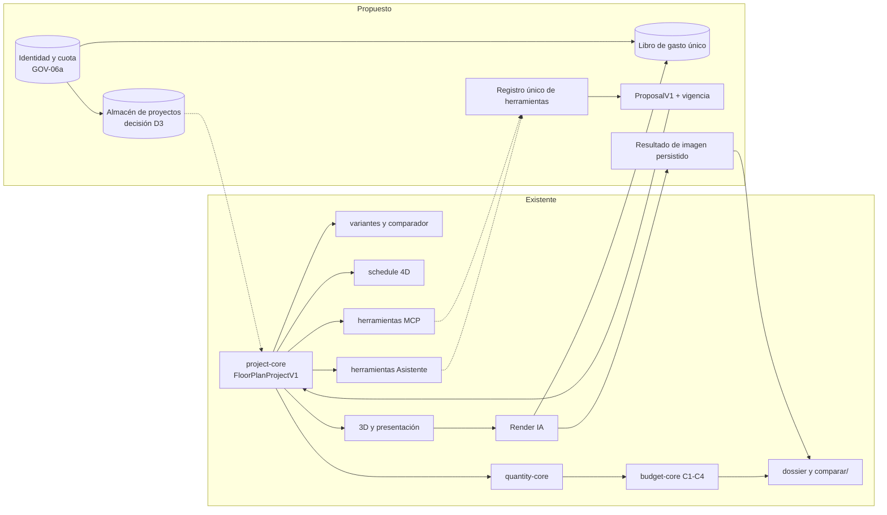
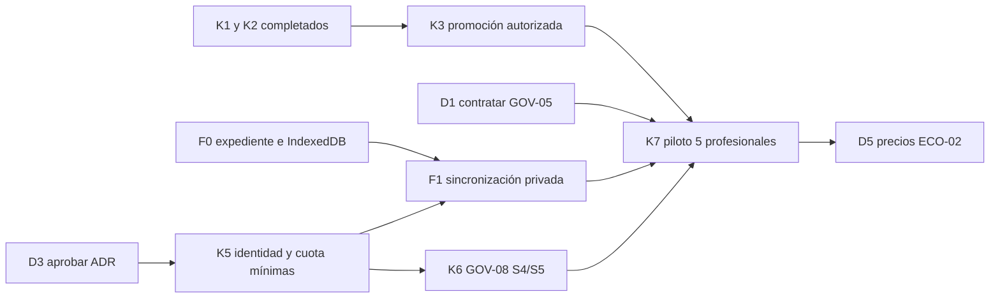

# RUBIK SOTA — Plan maestro de consolidación y comercialización v1.12

**Fecha:** 18/11/2026 · **Corte auditado:** `master@7dccf7a6095e6700b2a6b81161f4172b53c340fb` y PR abiertas #251–#260 en sus SHA del 18/11 · **Autor:** Claude Code, por mandato del propietario · **Estado:** propuesta para decisión del propietario.

Este documento **no autoriza** integración, despliegue, activación de proveedores, gasto ni cambios de alcance. Cada corte propuesto necesita su propia autorización.

**Lugar en la jerarquía documental** (definida en el [protocolo de coordinación](../agents/PROTOCOLO-COORDINACION-MULTIAGENTE.md)):

| Nivel | Fuente canónica | Responde a |
|---|---|---|
| 1. Visión y objetivos | Este plan, §1 y §5 | Para qué existe RUBIK y cuándo es vendible |
| 2. Estado factual | [Estado maestro](ESTADO-MAESTRO-RUBIK-SOTA.md) | Qué hay en master, desplegado y activado |
| 3. Inventario trazable | [Catálogo v1.12](rubik-catalogo-maestro-mejoras-2026-11-09.md) para nombres y olas; [matriz v1.12](MATRIZ-TRAZABILIDAD-v1.12.md) para estado, programa y residual | Qué se pidió y en qué punto está cada ID |
| 4. Plan operativo | Este plan, §6–§9 | Qué se hace, en qué orden y quién |
| 5. Evidencias y decisiones | [Registro de evidencias](../auditorias/reconciliacion-maestra-2026-11-18/REGISTRO-EVIDENCIAS.md) | Qué se comprobó, cómo y con qué SHA |

El [ROADMAP](../ROADMAP.md) conserva la historia y remite aquí.

---

## 1. Respuestas directas

**¿Dónde estamos realmente?** RUBIK es un producto 2D/3D profesional amplio y probado, con entrega segura al cliente y una IA mayoritariamente cerrada. Master está en `7dccf7a`. Hay dos dominios públicos con SHA distintos: **Alpha** (`floorplan-3d-alpha.vercel.app`) sirve `8525025` y la **Demo** compartible (`floorplan-3d-demo.vercel.app`) sirve `7dccf7a`, es decir, master. Beta 01 está pendiente de identificación (§2.1). Hay nueve PR abiertas, siete de ellas reunidas en la candidata conjunta #259. En su SHA, un archivo histórico de navegador tiene una prueba fallida de ocho; Codex la está diagnosticando.

**¿Qué tenemos construido?** Un editor canónico con importación, edificio multiplanta, presentación profesional, variantes, comparador, mediciones, presupuesto C1–C4 con BC3, plan de obra y Evolución 4D, entrega al cliente con caducidad, Render IA de pago activo, Asistente sin LLM y catálogos en piloto. En total, 184 módulos en `js/`, 37 workflows y 387 archivos en `tests/`. Las 136 pruebas puras pasan en local, salvo cinco archivos que fallan por el entorno Windows y no por el producto (§10).

**¿Qué está integrado y qué permanece en ramas?**

| Ubicación | Contenido |
|---|---|
| Alpha | Todo lo anterior hasta `8525025` |
| Demo | #250, concurrencia de Asset Lab y espera de Dibujo vivo |
| Master `163df68` | #250 y #259, con E2 Studio, H01/H02, MCP Etapa 2, detalle arquitectónico, Guardar JSON y controles de Beta IA privada |
| PR abiertas del programa | #262 → #263 → #264 para F0; #260 independiente; #265 G-02 en borrador |
| Laboratorios | Studio Presentation E0–E4 en `lab/studio-presentation-e0e1`; R01 en `lab/sculpt-r01-*`; familias visuales en #165, #167 y #169 archivadas |

**¿Qué mejoras históricas ya están resueltas?** De los 98 IDs, 20 están resueltos y validados y 2 han quedado superados por otra solución. Los 11 integrados con límites incluyen ENT-04 tras #259 y conservan el trabajo residual declarado en la matriz.

**¿Cuántos desarrollos realmente nuevos faltan?** Once IDs exigen desarrollo nuevo, y cinco más son investigación. Ninguno de los once es imprescindible para el hito B. Lo que B necesita es ampliar piezas que ya existen, sobre todo la identidad profesional GOV-06a y la persistencia del [ADR de continuidad](ADR-PERSISTENCIA-CONTINUIDAD-PROYECTO.md). El desarrollo nuevo de mayor valor profesional es la exportación DXF (G-02).

**¿Cuántos necesitan conexiones, ampliaciones o validaciones?** Veinte necesitan conexión de piezas existentes y veintitrés ampliación. Ocho necesitan validación técnica, siete validación profesional y siete activación operativa. Hay una corrección: el área de pared del panel de UX-03. Un mismo ID puede necesitar varios tipos.

**¿Qué podemos resolver reutilizando lo existente?** Siete de las 24 «sin implementación» tienen infraestructura concreta: IMG-07, CAM-01, UX-24, UX-26, LUZ-01, OBR-05 y GEN-01. G-08 queda superado para proyectos nativos. El detalle está en §4.

**¿Qué dependencias desbloquean varias mejoras a la vez?** Cinco, en este orden de impacto:
1. **Identidad profesional (GOV-06a)**, que desbloquea GOV-08 S4/S5, catálogos multiestudio, Asistente generativo, FOT-01 y CAT-01 reales, IMG-04 y AG-0.
2. **Libro común de gasto en Production (IMG-04 + ECO-01)**, que desbloquea IMG-03, IMG-22, ENT-06, AG-4 y todos los servicios IA cobrables.
3. **Contrato único de propuesta y vigencia (PRE-01)**, que desbloquea AG-2, AG-3, GEN-01 y MCP Etapa 3.
4. **Persistencia de resultados de imagen (IMG-12)**, que desbloquea ENT-05, IMG-16, VID-01 y las fichas de Studio E4.
5. **Dictamen jurídico (GOV-05)**, que desbloquea FOT-01, CAT-01, PER-01/02, catálogos de fabricantes y la beta abierta.

**¿Qué necesitamos para comercializar una primera versión?** Tras integrar #259, el hito B requiere promoción autorizada, identidad y cuota mínimas, dictamen jurídico, continuidad del proyecto según el ADR y un piloto con cinco profesionales.

**¿Qué podemos aplazar sin perjudicar el producto?** Personas (PER-01/02/03), panorama conceptual (PAN-01), vídeo generativo (VID-02), foto a espacio métrico (FOT-02), foto a mueble 3D (MUE-02), Move Rooms (UX-14), IMDF (G-07), LUZ-01, G-04, AG-5, GOV-06b y ENT-07.

**¿Cómo deben conectarse los ocho programas?** P3 es la base de P2 y de P4. P1 y P5 aportan el valor visible a P4. P6 y P7 se apoyan en el modelo canónico y en el contrato de propuesta. P8 espera al hito C. El grafo está en §3.

**¿Cuál es la ruta crítica?** Tras #259, expediente completo y biblioteca en IndexedDB (F0) → identidad y cuota mínimas → dictamen GOV-05 → sincronización privada (F1) → piloto de cinco profesionales → precios. Detalle en §6.

**¿Qué riesgos siguen abiertos?** Los de mayor peso son los proyectos guardados solo en el navegador, Studio Presentation como herramienta Node fuera del producto, la ausencia de identidad real, la falta de dictamen jurídico y la falta de validación en dispositivos físicos. Lista completa en §8.

**¿Qué cortes debería ejecutar Claude Code y cuáles Codex?** Reparto propuesto en §7. En resumen, Claude lleva Studio Presentation, el contrato de propuesta y la arquitectura de identidad. Codex lleva la candidata conjunta, la CI, la beta IA y los adaptadores de interoperabilidad.

**¿Qué decisiones necesitan al propietario?** Doce, listadas en §9. Las cinco primeras bloquean el hito B.

**¿Qué debe supervisar ChatGPT?** La coherencia entre matriz, Estado maestro y PR tras cada integración; que ningún estado suba sin evidencia; el gasto IA frente a su tope; y la honestidad de lo anunciado en la Home. Detalle en §7.3.

**¿Cuál es el próximo paso de mayor valor?** Validar la cadena F0 #262 → #263 → #264 antes de conectar el editor. En paralelo, G-02 pasa a revisión del borrador #265.

---

## 2. Dónde estamos: los siete estados no equivalentes

| Capacidad | Integrada en master | Desplegada (Alpha `8525025` / Demo `7dccf7a`) | Activada | Validada | Comercial |
|---|---|---|---|---|---|
| Editor, 3D, presentación, variantes, obra 4D | Sí | Sí, en ambos | Sí | Chromium sintético; sin dispositivos físicos | No acreditado |
| Presupuesto C1–C4, BC3, dossier económico | Sí | Sí | Sí | Pruebas puras ejecutadas | Sin precios reales validados con profesionales |
| Entrega al cliente ENT-01/GOV-08 S1–S3 | Sí | Sí | Sí | 30/30 aislado + aceptación manual [P] | Falta S4/S5 e identidad |
| Render IA D1 | Sí | Sí | Sí, de pago | Una acreditación real del 09/11 | Sin tope global ni cuota por profesional |
| Asistente V2 sin LLM | Sí | Sí | Sí | Pruebas ejecutadas | Piloto |
| Asistente V3 generativo | Sí | Sí | **No** (`503`) | Solo con simuladores | No |
| FOT-01, CAT-01 | Simulación | Sí | **No** | Simuladores | No |
| E2 Studio, H01, H02, MCP Etapa 2, VQ/F02/F03, Guardar JSON, controles de Beta IA | Sí, #259 | Build de master | Beta IA pendiente | Histórico de superficies 8/8 y siete workflows postintegración | No |
| Studio Presentation E3–E7 | **No** (laboratorio) | No | No | QA de laboratorio | No |

### 2.1 Dominios públicos

| Dominio | SHA servido | Deployment | Cómo se acredita |
|---|---|---|---|
| `floorplan-3d-alpha.vercel.app` | `8525025a1470d48d52d8e365070e5a0acf116134` | `dpl_Bx191sBDRSa2nqhm8bwZhZzryvgA`, promovido con autorización el 17/11 | [I] huella de `js/home-demos.js` igual al blob de `8525025`; deployment según el Estado maestro y ChatGPT |
| `floorplan-3d-demo.vercel.app` | `7dccf7a6095e6700b2a6b81161f4172b53c340fb` | `dpl_64ndSF5qoDKDtey7XXwEYRAzYDTF` | [I] `index.html` servido idéntico byte a byte al de `7dccf7a`; deployment, estado READY y destino Production comunicados por ChatGPT tras consultar Vercel |
| Beta 01 | Pendiente de identificación | — | No consta en el repositorio |

Los dos deployments tienen destino Production. La Demo se creó para compartir RUBIK con personas sin cuenta en Vercel ni GitHub. Que un dominio sirva un SHA no indica por sí solo una promoción oficial: puede ser una asignación manual de alias. Esta auditoría no reasigna dominios ni promueve despliegues. Cada dominio tiene su propio almacenamiento de navegador; ver el ADR, §3.

---

## 3. Ecosistema conectado

### 3.1 Autoridades actuales (arquitectura existente)

| Información | Autoridad hoy | Persistencia | Observación |
|---|---|---|---|
| Geometría, estancias, huecos, muebles | `js/project-core.js` + `js/project-schema.js` (FloorPlanProjectV1) | Biblioteca local | Sólida y reutilizada por MCP, Asistente, amueblado y obra |
| Identidad de proyecto, copias y variantes | `js/project-library.js` | `localStorage` `rubik-sota-project-library-v1` | Un solo navegador; exportación JSON como respaldo |
| Mediciones | `js/quantity-core.js` | Derivada | Correcta: no se persiste |
| Presupuesto por revisión | `js/budget-core.js`, `js/revision-budget-core.js` | Biblioteca local, archivo aparte (CON-03) | Proyecto y presupuesto viajan en dos archivos |
| Precios | `js/cost-provider*.js`, `js/cost-catalog-core.js` | Local | BCCA-ES y manual |
| Plan de obra | `js/construction-schedule-core.js` | Local | Exporta JSON propio |
| Catálogos y SKU | `js/catalog-product-core.js` | Local por estudio | Licencia obligatoria por ficha |
| Materiales y licencias | `assets/materials/` + `licenses/` | Repositorio | #255 añade procedencia F03 |
| Marca del estudio | `js/brand-core.js` | `localStorage` | Instantánea en cada entrega |
| Capacidades anunciadas | `js/capability-registry.js` | Repositorio | Solo la Home lo lee |
| Enlaces de cliente | `api/share.js`, `api/delivery.js`, `js/share-registry-core.js` | Vercel Blob público | Caducidad y revocación |
| Gasto IA | `api/_spend-ledger.js` (Asistente); `api/render.js` en memoria | Redis / instancia | No hay libro único en Production |
| Herramientas de lectura del proyecto | `js/assistant-domain-tools-core.js` (12) y `tools/rubik-mcp` (8) | — | Dos registros sobre los mismos núcleos |

### 3.2 Conexiones correctas, incompletas y duplicidades

**Correctas.** MCP, Asistente, amueblado inteligente y propuestas de MCP Etapa 2 reutilizan `project-core`, `tracing-core`, `layout-review` y `furniture-placement`. No hay motores geométricos paralelos. El comparador E2 reutiliza `comparar/`, ENT-04 y `FloorPlanRevisionBudget`. La beta IA de #258 reutiliza `photo-reform/1` y el Redis existente.

**Incompletas.**
- El render IA no usa el libro de gasto común.
- `js/render-cost-core.js` existe, pasa sus pruebas y no se carga.
- El registro de capacidades no alimenta al Asistente ni a la matriz.
- El minimapa muestra la cámara pero no la coloca (CAM-01).
- El 3D tiene día, noche y hora, pero el render IA no los usa (IMG-07).
- El plan de obra solo exporta su JSON propio (OBR-05).

**Duplicidades.**
- **Heurística nombre → tipo de estancia** en dos sitios: `js/nav3d-core.js:13` y `js/presentation-living-drawing-core.js:28`.
- **Tres mecanismos de propuesta y vigencia:** diff del Asistente (`js/assistant-proposals-core.js`), `RubikLayoutProposalV1` de MCP (#254) y la huella de vigencia de E2 (#251). Comparten motores, no contrato.
- **Dos registros de herramientas** de lectura: 12 del Asistente y 8 de MCP, con solapes como el resumen del proyecto y la revisión.
- **Tres secretos de acceso:** código compartido de publicación, código de Render IA y lista de testers de #258.

### 3.3 Arquitectura objetivo (propuesta)

La arquitectura actual es sólida en el núcleo. La propuesta **no crea un motor nuevo**: añade cuatro contratos y una capa de persistencia.

| Conexión propuesta | Componentes existentes | Intercambian | Contrato | Falta | IDs | Riesgo | Validación | Reversión |
|---|---|---|---|---|---|---|---|---|
| C1 Identidad y cuota | `api/_share-auth.js`, `api/_spend-ledger.js`, `api/_beta-controls.js` (#258) | Sujeto, cuota, gasto | Nuevo `RubikPrincipalV1` | Cuentas, sesiones, CSRF, roles mínimos | GOV-06a, GOV-08 S4, AG-0, IMG-04 | Seguridad y privacidad | Pruebas adversarias como GOV-08 S1/S2 | Interruptor y vuelta a código compartido |
| C2 Libro de gasto único | `_spend-ledger`, `render-cost-core`, `api/render.js` | Reserva, liquidación, coste | Ledger de #258 | Que `api/render.js` reserve y liquide | IMG-04, ECO-01, IMG-22, IMG-03, ENT-06 | Bloquear el render activo | Redis real en CI, como `spend-ledger.test` | Variable que desactiva la reserva |
| C3 Registro único de herramientas | `assistant-domain-tools-core.js`, `tools/rubik-mcp/src` | Nombre, esquema, resultado | `AssistantToolCallV1` existente | Adaptador MCP sobre el mismo registro | AG-1, MCP Etapa 3 | Romper la API stdio | Las 137 pruebas de MCP y las del Asistente | Mantener los dos registros |
| C4 ProposalV1 + vigencia | `assistant-proposals-core`, `tools/rubik-mcp/src/proposal.cjs`, huella de E2 | Cambio, revisión base, impacto | Nuevo, derivado del diff AG-2 | Unificar los tres | PRE-01, AG-2, AG-3, GEN-01, UX-12 | Medio | Oráculos ya existentes de cada uno | Adaptadores con el formato anterior |
| C5 Resultado de imagen persistido | `ai-render-ui.js`, `delivery-image.js`, biblioteca | Imagen, vista, cámara, revisión, coste | Ficha de resultado, como `rubik-visual-result-sheet/1` | Persistencia y vínculo al proyecto | IMG-12, ENT-05, IMG-16, VID-01 | Tamaño en `localStorage` | Pruebas de cuota de almacenamiento | Retirar el vínculo |
| C6 Continuidad del proyecto | `project-library.js`, `project-package.js`, `local-images.js` | Expediente completo | `rubik-sota.expediente` v1, propuesto en el [ADR](ADR-PERSISTENCIA-CONTINUIDAD-PROYECTO.md) | F0 local y F1 sincronización privada | Beta, ENT-01, IMG-12, ENT-05, catálogos | Coste y RGPD | Criterios de aceptación del ADR, §10 | Volver al modo local, que se conserva siempre |

---

## 4. Las 24 supuestas pendientes, una a una

| ID | Estado v1.12 | Hallazgo | Recomendación |
|---|---|---|---|
| GOV-05 | `DX` | Solo hay borrador en #161 | **Imprescindible para B.** Contratar ya |
| GOV-06b | `ND` | Nada específico | Aplazar a D |
| ENT-07 | `ND` | La marca en entregables existe; el portal no | Aplazar a D |
| IMG-03 | `ND` | `api/render.js` fija el tamaño | Hacer junto a ECO-01 en C |
| IMG-07 | `IR` | El 3D ya tiene día, noche y hora | Conexión pequeña en C |
| CAM-01 | `IR` | El minimapa ya dibuja la cámara y su cono | Conexión en C; también sirve a Studio |
| PER-01 | `ND` | Los prompts prohíben personas a propósito | Aplazar a D |
| PER-02 | `DX` | Requiere régimen jurídico propio | Aplazar a D |
| PER-03 | `ND` | — | Aplazar a D |
| FOT-02 | `ND` | — | Investigación; aplazar |
| MUE-02 | `ND` | MUE-01 cubre el uso diario | Investigación; aplazar |
| PAN-01 | `ND` | — | **Invertir el orden con PAN-02** |
| PAN-02 | `ND` | La escena 3D propia permite capturar seis caras sin IA ni coste por imagen | Antes que PAN-01, en C |
| VID-02 | `ND` | — | Aplazar a D |
| UX-24 | `IR` | La heurística existe dos veces y no se ofrece | **Victoria rápida en B**: unificar y sugerir |
| UX-26 | `IR` | Se consigue editando dos estancias | Incluir en el corte de UX-24 |
| LUZ-01 | `IR` | Modo noche, luminarias y techos R02-A | Aplazar a D; sin lux |
| UX-14 | `ND` | — | Investigación; aplazar |
| OBR-05 | `IR` | El plan ya se exporta en JSON | Adaptador MSPDI en C |
| G-08 | `SU` | Las variantes nativas ya comparten marco con el original | Reducir a «calco de un segundo plano externo» |
| G-02 | `ND` | RUBIK lee DXF pero no lo escribe | Desarrollo nuevo de mayor valor para arquitectos; C |
| G-07 | `RD` | Público distinto | Proponer descarte |
| GEN-01 | `IR` | Semilla, ranking, revisión y propuesta ya existen para muebles | Nuevo motor sobre C4; D |
| ECO-02 | `DX` | Hipótesis de 19 a 249 € | Decidir con datos del piloto |

**Resultado:** de las 24, doce son desarrollo nuevo o investigación, siete se resuelven conectando piezas, tres son decisiones externas, una está superada y una es candidata a descarte.

---

## 5. Camino a la comercialización: hitos A–D

El recorrido de referencia es: **plano original → reforma propuesta → variante 3D → mediciones → presupuesto → comparación económica → dossier profesional → entrega al cliente.**

| Tramo | Existe hoy | Lo que impide la calidad comercial |
|---|---|---|
| Plano original | Importación PDF, DXF, IFC e imagen con calibración | R01 no validado: el calco sigue siendo manual |
| Reforma propuesta y variante | Variantes con identidad propia | Nada bloqueante |
| Variante 3D | Sí | Dispositivos físicos (GOV-07) |
| Mediciones | `quantity-core` | Nada bloqueante |
| Presupuesto | C1–C4, BC3, precios de referencia | Vive en un archivo aparte del proyecto |
| Comparación económica | `comparar/` en master; E2 en #251 | E2 sin integrar |
| Dossier profesional | Dossier y dossier económico; H01 y H02 corrigen dos errores | H01/H02 sin integrar; Studio E3–E5 en laboratorio |
| Entrega al cliente | ENT-01, caducidad, revocación | Blob público, sin identidad ni cuotas |

**Conclusión:** el recorrido existe de extremo a extremo. Lo que falta para venderlo es integrar #259, cerrar la identidad y decidir el almacenamiento, no construir funciones nuevas.

| Hito | Entrada | Aceptación | Salida |
|---|---|---|---|
| **A · Producto actual consolidado** | Master `163df68` con #259 | Promoción autorizada, correspondencia entre Home y las funciones activas, prueba pública del recorrido completo, expediente completo exportable y biblioteca en IndexedDB (F0 del ADR) | Una URL pública que ejecuta el recorrido de referencia con datos sintéticos |
| **B · Primera versión comercial** | Hito A | GOV-06a mínimo; GOV-08 S4/S5; dictamen GOV-05 publicado; sincronización privada F1 con sus seis demostraciones; GOV-07 en los dispositivos de la beta; piloto ECO-03 con cinco profesionales; precios ECO-02 decididos | Contrato con profesionales reales, con identidad, cuota y condiciones legales |
| **C · Plataforma avanzada** | Hito B | Studio E3–E5 integrado; libro de gasto en Production; FOT-01 y CAT-01 reales; Prueba C superada; DXF; MSPDI; CAM-01; IMG-03/07/12 | Servicios IA cobrables y entregables editoriales completos |
| **D · Ecosistema premium** | Hito C con métricas de uso | Decisión de valor para cada línea | Personas, 360, vídeo generativo, portal, generación de distribuciones |

La asignación de cada ID a su hito está en la matriz: 22 en A, 24 en B, 37 en C y 15 en D.

---

## 6. Trabajo residual, ruta crítica y cortes

### 6.1 Agrupación por infraestructura compartida

| Grupo | IDs | Infraestructura común |
|---|---|---|
| G-ID Identidad y cuota | GOV-06a, GOV-08, ENT-01, ENT-02, AG-0, CAT-02 | C1 |
| G-GASTO Gasto y medición | IMG-04, ECO-01, IMG-22, IMG-03, AG-4, ENT-06 | C2 |
| G-IA Activación real | FOT-01, CAT-01, AG-1, IMG-10, IMG-14, IMG-15 | #258 + C1 + C2 + GOV-05 |
| G-IMG Resultado persistido | IMG-12, ENT-05, IMG-16, VID-01, IMG-07, CAM-01 | C5 |
| G-STUDIO Entregables | ENT-03, ENT-04, ENT-05, ENT-06, ENT-07 | `comparar/` + laboratorio Studio |
| G-PROP Propuestas | PRE-01, AG-2, AG-3, UX-12, UX-13, GEN-01 | C4 |
| G-INTEROP Exportación | G-02, OBR-05, G-08, G-06, G-01 | Geometría canónica y láminas |
| G-BIB Bibliotecas | BIB-01, IMG-05, IMG-06, IMG-13, CAT-03 | Registro de licencias |
| G-UX Pulido del editor | UX-03, UX-04, UX-05, UX-09, UX-10, UX-11, UX-24, UX-26, UX-21, OBR-04 | Editor y NAV3D |

### 6.2 Ruta crítica hacia el hito B

**Imprescindible para B:** K1–K7, F0, F1, D1, D3 y D5. **Deseable:** UX-24, CAM-01, el registro único de capacidades y GOV-07 ampliado.

**Paralelo, sin bloquear la ruta:** Studio E3 (P1), registro de licencias (P5), adaptador MSPDI (P6) y contrato ProposalV1 (P7).

**Orden técnico entre programas.** P3 va antes de que P2 active nada en Production: la beta IA real de #258 ya exige identidad por tester, y GOV-06a la convierte en identidad por profesional. P5 aporta a P1 y a P4 a la vez: la integración de #255 mejora el 3D de la presentación y de la beta en un solo corte.

### 6.3 Cortes propuestos

Cada corte es una PR propia con SHA de partida, CI en su SHA, Preview y aceptación independiente.

| Corte | Objetivo observable | Reutiliza | Depende de | Aceptación | Validación | Tipo |
|---|---|---|---|---|---|---|
| **K1** Validación de #259 | Histórico de superficies 8/8 en `26c0dbd` | Resultado de la candidata | — | Histórico acreditado | CI | Completado |
| **K2** Integración de #259 | Árbol de `master@163df68` igual al de `26c0dbd` | Handoff de #259 | K1 + aceptación del propietario | 7/7 workflows posteriores | CI y pruebas dirigidas | Completado |
| **K3** Promoción | URL pública sirve el nuevo master | Procedimiento del 17/11 | K2 + autorización | Huella de `index.html` igual al SHA | Smoke público 11/11 | AO |
| **K4** UX-24 + UX-26 | El editor sugiere el tipo y permite intercambiar usos, con deshacer | Heurísticas de NAV3D y Dibujo vivo | — | Una sola heurística en `project-core`; pruebas de ambos consumidores sin cambios | Prueba pura + navegador | CON |
| **K5** Identidad y cuota mínimas | Un profesional entra, consume su cuota y no ve datos de otro | `_beta-controls`, `_spend-ledger`, `_share-auth` | D3, D1 iniciado | Pruebas adversarias al nivel de GOV-08 S2 | Preview aislado | AMP |
| **K6** GOV-08 S4/S5 | Enlaces opacos en almacén privado con cuota | GOV-08 S1–S3 | K5 | Protocolo aislado como el de S3 | Preview aislado | AMP |
| **K7** Piloto ECO-03 | Informe con tiempos, bloqueos y valoración de cinco profesionales | Hito A completo | K3, K6, D1 | Cinco sesiones con el recorrido de referencia | Validación profesional | VP |
| **K8** Libro de gasto en el render | `api/render.js` reserva y liquida en el libro común | #258, `render-cost-core` | Integración de #258 | Tope global efectivo en Preview | Redis real en CI | CON |
| **K9** Registro único de capacidades | Home, Asistente y matriz leen el mismo registro | `capability-registry.js` | — | Ningún anuncio sin SHA y prueba | Prueba pura | CON |
| **K10** Studio E3 | Recetas sobre la interfaz existente | Laboratorio N01/N05 y `comparar/` | K2 + D4 | Revisión visual del propietario | Navegador + revisión | CON |
| **K11** Resultado de imagen persistido | Un render vuelve a abrirse con su vista y revisión | `ai-render-ui`, `visual-reference-core` | — | Cuota de almacenamiento controlada | Navegador | AMP |
| **K12** CAM-01 + IMG-07 | Colocar una cámara en el 2D y renderizar de día o de noche | Minimapa NAV3D, `presentationPose`, modo noche | K11 | Pose guardada y reproducible | Navegador + una prueba real autorizada | CON |
| **K13** ProposalV1 | Un único contrato de propuesta con vigencia | Diff AG-2, `RubikLayoutProposalV1`, huella E2 | — | Las tres familias de pruebas pasan sin cambiar aserciones | Pruebas puras | CON |
| **K14** OBR-05 MSPDI | MS Project y GanttProject abren el plan | `construction-schedule-core.serialize` | — | Ida y vuelta de fechas y dependencias | Prueba pura + apertura manual | AMP |
| **K15** G-02 DXF | DXF con capas y cotas abierto en dos CAD | Geometría canónica y láminas | — | Revisión de un arquitecto | VP | NUE |
| **K16** Activación IA real | FOT-01, CAT-01 y Asistente con proveedor real en Preview | #258 | K5, K8, D1, D2 | Prueba C y ejecuciones reales conciliadas | Preview aislado | AO |

---

## 7. Reparto propuesto

### 7.1 Claude Code

| Corte | Motivo |
|---|---|
| F0 del ADR: contrato `rubik-sota.expediente` v1 y migración a IndexedDB | Contrato transversal a P1, P2 y P4 |
| K4, K9, K13 | Conexiones de contratos que tocan varios consumidores |
| K5 (diseño y revisión adversaria) | Arquitectura de identidad |
| K10, K11, K12 | Studio Presentation es suyo según el handoff del 17/11 |

### 7.2 Codex

| Corte | Motivo |
|---|---|
| K1, K2, K3 | Diagnostica `surfaces.browser`, preparó la candidata y los procedimientos de integración y promoción |
| F0 (interfaz) y F1 del ADR | Exportar e importar desde la interfaz; `api/projects.js` y su CI |
| K5 (implementación), K6, K8, K16 | Autor de #258 y de GOV-08 S3 |
| K14, K15 | Adaptadores de exportación con prueba de ida y vuelta |
| CI inteligente (#260) | Continuidad de su piloto |

### 7.3 ChatGPT

- Revisar tras cada fusión que matriz, Estado maestro y PR coinciden.
- Rechazar cualquier subida de estado sin evidencia de clase [I], [E] o [CI].
- Vigilar el gasto IA frente al tope aprobado.
- Comprobar que la Home anuncia solo lo activado.
- Auditar de forma independiente K5 y K6, que son de seguridad.

---

## 8. Riesgos abiertos

| Riesgo | Tipo | Efecto | Mitigación |
|---|---|---|---|
| Proyectos solo en el navegador de un dominio | Técnico y comercial | Pérdida de trabajo, límite de tamaño, sin trabajo multidispositivo | [ADR de continuidad](ADR-PERSISTENCIA-CONTINUIDAD-PROYECTO.md): F0 y F1 |
| El panel (UX-03) y `quantity-core` dan áreas de pared distintas | Coherencia profesional | Dos cifras para la misma pared en panel y presupuesto | Reutilizar `quantity-core` en el panel, en un corte separado de la persistencia |
| Studio Presentation es una herramienta Node fuera del producto | Arquitectura | Duplicar el motor de composición | Portar recetas como datos sobre los núcleos del producto; motor de PDF con ADR antes de E5 |
| Sin identidad real | Seguridad | No se puede cobrar ni aislar estudios | K5 |
| Blob público en enlaces de cliente | Privacidad | Acceso directo a quien tenga la URL | K6 |
| Sin dictamen jurídico | Legal | Bloquea IA con fotos, catálogos y la beta abierta | D1 |
| Sin dispositivos físicos | Calidad | Fallos en móvil del cliente | GOV-07 |
| Fallo histórico de `surfaces.browser` en `62155563` | Antecedente de #259 | Confundir la evidencia de dos SHA | La candidata autorizada `26c0dbd` obtuvo 8/8 en superficies. Se conserva el resultado del SHA anterior en el registro de evidencias |
| Alpha y Demo sirven SHA distintos | Operativo | Confusión sobre qué versión ve cada persona | Registrar dominio, deployment y SHA en cada promoción o asignación de alias |
| Sello del registro en `40b4ae5` | Honestidad | Anuncios con un SHA anterior al servido | K9 |
| Render sin tope global | Económico | Gasto sin límite común | K8 |
| Expectativa de precisión métrica | Profesional | Confundir visual con medida certificada | Mantener los rótulos «estimado» y «no certifica» |

---

## 9. Decisiones del propietario

| # | Decisión | Bloquea |
|---|---|---|
| D1 | Contratar la revisión jurídica GOV-05 | B, IA real, catálogos de fabricantes |
| D2 | Presupuesto y tope de gasto para la beta IA y la Prueba C | K16 |
| D3 | **Aprobada conceptualmente el 18/11:** arquitectura B sobre A del [ADR de continuidad](ADR-PERSISTENCIA-CONTINUIDAD-PROYECTO.md). F0 autorizado por etapas. Siguen pendientes F1, D3-a a D3-e (proveedor de datos, identidad, rótulo de la Demo, Beta 01, cuotas), la región y los costes | F1, B |
| D4 | GO de Studio E3 con base en el modelo del producto | K10 |
| D5 | Precios y paquetes tras el piloto | Salida de B |
| D6 | Propietario autorizó #259 en `26c0dbd`; integrado como `163df68` | K2 completado |
| D7 | Promoción de master | K3 |
| D8 | Reclasificar G-08 como superado en su alcance nativo | Catálogo |
| D9 | Descartar o aplazar G-07 | Catálogo |
| D10 | Invertir el orden de PAN-01 y PAN-02 | Catálogo |
| D11 | Dar ID a CON-03 o absorberlo en D3 | Catálogo |
| D12 | Lista de cinco profesionales del piloto | K7 |

---

## 10. Limitaciones de esta auditoría

- **No ejecuté pruebas de navegador.** Las pruebas de navegador se citan por CI [CI] o como localizadas [T].
- **Ejecuté las 136 pruebas puras de master** en Windows con Node 24. Pasaron 131 archivos. Fallaron cinco: tres comparan bytes y fallan por la conversión CRLF del checkout, y pasan sobre una copia LF del mismo SHA; uno necesita `python3` y otro `redis-server`, que no hay en esta máquina. Detalle en el registro de evidencias.
- **Verificaciones cerradas el 18/11.** IMG-05, IMG-06, IMG-11, UX-03, UX-04, UX-10, UX-11, G-06, OBR-04 y AST-01 se reverificaron en el código; cambian de estado IMG-11, UX-03, UX-04, UX-10 y AST-01. No se ejecutaron pruebas de navegador para ellos.
- **No consulté Vercel con credenciales.** El SHA de cada dominio se acreditó comparando archivos servidos con los blobs de Git. Los identificadores de deployment de la Demo los comunicó ChatGPT.
- **Beta 01 sigue pendiente de identificación.** No consta en el repositorio qué dominio o despliegue es.
- **El laboratorio Studio** se revisó por sus documentos de traspaso, no ejecutando sus herramientas.
- **Cambios posteriores al corte:** ver la sección final del registro de evidencias.
