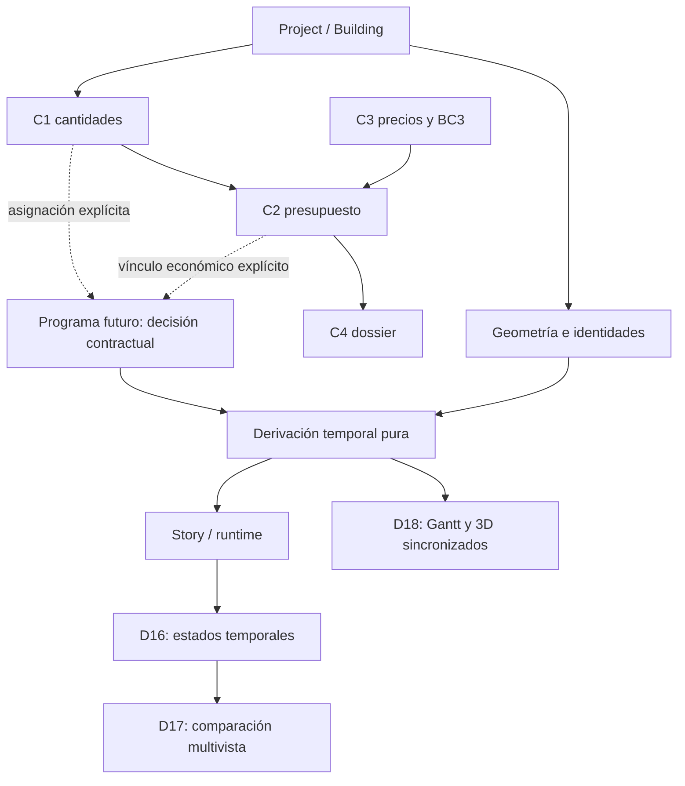

# CUT 4 — TEMPORAL / CONSTRUCTION SYSTEMS

D16 · D17 · D18

## CONTROL STATE

| Control                  | Estado verificado                                                               |
| ------------------------ | ------------------------------------------------------------------------------- |
| Reference Atlas revision | `7696fb2c6c30f158001d38ecc53feb2674acaa25`                                      |
| Donor revision           | `d7b9b69753d3af679535ee56695a05c8d955c3c6`                                      |
| Product master HEAD      | `5f4e3d20e905f5f302783f67fda0ab4a7eb21371`, confirmado mediante `git ls-remote` |
| Analysis checkout        | `C:\Users\temp123\work\floorplan-3d-donor-gap-analysis-cut2`                    |
| Analysis branch          | `docs/ft3d-donor-code-gap-analysis-cut2-2026-11-01`                             |
| Analysis HEAD            | `cc04f67fc0b46c87bc696bf566adb362f43041fd`                                      |
| Worktree cleanliness     | Checkout de análisis y donante limpios; `git diff --check` PASS en ambos        |
| Product modified         | NO                                                                              |
| Contracts modified       | NO                                                                              |
| Claude WIP touched       | NO                                                                              |
| Commit/push/PR           | NO                                                                              |

El checkout de análisis difiere del `master` verificado únicamente en el Atlas y el documento de análisis anteriores. El código de producto inspeccionado corresponde al `master` indicado.

No aparecieron ramas locales con los patrones consultados para FT3D-5/FT3D-8/construction/planning/Cut 4. Esto no acredita ausencia de WIP externo. Los demás worktrees quedaron fuera de la inspección.

## EXECUTIVE SUMMARY

El donante contiene dos demostraciones complementarias:

- **D16:** existencia temporal de geometría mediante semanas de aparición/desaparición y shaders.
- **D17:** varias representaciones del mismo modelo, evaluadas en tiempos diferentes.
- **D18:** un programa estático de fases que gobierna conjuntamente el Gantt y el estado 3D.

Rubik ya dispone de transporte temporal, escenas, seek, reproducción, restauración, cantidades y cálculo económico. La carencia principal es una autoridad explícita para **pertenencia de elementos a trabajos, fechas, dependencias y ejecución real**.

**Veredicto: MODEL D — HYBRID.** La representación temporal puede aprovechar infraestructura existente. Una planificación constructiva real requiere decisiones de producto y nuevos datos de dominio.

Auditoría basada en código y contratos. Los tests citados fueron inspeccionados; **no se ejecutaron suites ni validación visual en este Cut**.

## TARGET IDENTITY MAP

Las identidades conservan la terminología del [Atlas (line 543)]\(C:/Users/temp123/work/floorplan-3d-donor-gap-analysis-cut2/docs/product/ft3d-reference-atlas-2026-11-01.md:543).

| Target | Atlas identity                            | Donor source                                                 | Mechanism                                                        | Domain                                                                  |
| ------ | ----------------------------------------- | ------------------------------------------------------------ | ---------------------------------------------------------------- | ----------------------------------------------------------------------- |
| D16    | Tiempo autoritativo por elemento          | `04-build-time-lapse`: `world.js`, `programme.js`, `main.js` | Atributos temporales de geometría y evaluación por semana        | Representación temporal con contenido constructivo escrito para la demo |
| D17    | Varios drawings, mismos datos/tiempos     | `04-build-time-lapse/js/pipe.js`                             | Cámaras, scissor, materiales y composición de varias vistas      | Renderizado; consume el tiempo de D16                                   |
| D18    | Chart/3D, mismo estado, semana reversible | `05-schedule-build/house.js`, `view.js`                      | Tabla `PHASES`, pertenencia manual de piezas y tiempo compartido | Programa ilustrativo y presentación constructiva                        |

**D17 no introduce un modelo constructivo independiente.** Su agrupación dentro de esta familia responde a que representa los estados temporales proporcionados por D16.

## D16

### Identity

**Estado en Rubik: Partial.** Existe transporte temporal equivalente en Story; falta la representación de existencia constructiva por elemento.

### Donor evidence

En [world.js (line 454)]\(C:/Users/temp123/work/ft3d-reference-workspace/flat-to-3d/04-build-time-lapse/js/world.js:454), `stamp()` introduce `aWeek` y `aOut`. Los shaders descartan geometría antes de su aparición o después de su retirada.

`partWeeks()` asigna tiempos mediante fases y fórmulas espaciales. `bucketsOf()` agrupa geometría y codifica sustituciones de acabado. Véase [world.js (line 660)]\(C:/Users/temp123/work/ft3d-reference-workspace/flat-to-3d/04-build-time-lapse/js/world.js:660).

### Donor temporal model

- Programa de **38 semanas** definido en [programme.js (line 1)]\(C:/Users/temp123/work/ft3d-reference-workspace/flat-to-3d/04-build-time-lapse/js/programme.js:1).
- El scroll se transforma en semanas mediante keyframes y `weekAt()`.
- Las semanas pueden avanzar rápidamente para acompañar la coreografía.
- Las barras calculan tiempo transcurrido dentro de intervalos escritos para la demo.
- No hay cálculo de dependencias ni registro de ejecución real.

La autoridad temporal es el programa del ejemplo y sus reglas, no un calendario de obra importado. Evidencia: [main.js (line 193)]\(C:/Users/temp123/work/ft3d-reference-workspace/flat-to-3d/04-build-time-lapse/js/main.js:193).

### Donor data model

Piezas procedurales con geometría, material, clase y fase; posteriormente reciben tiempos por vértice. No proporcionan una identidad durable equivalente a los elementos de un proyecto Rubik.

Los acabados pueden reemplazarse visualmente mediante retirada/aparición de caras. Las instalaciones temporales también tienen intervalos de presencia.

El porcentaje del cargador representa carga de recursos, **no avance de construcción**.

### Current Rubik evidence

[Story core (line 254)]\(C:/Users/temp123/work/floorplan-3d-donor-gap-analysis-cut2/js/presentation-story-core.js:254) ya ofrece progreso absoluto, secuenciación y correspondencia entre progreso global y local.

[Presentation UI (line 613)]\(C:/Users/temp123/work/floorplan-3d-donor-gap-analysis-cut2/js/presentation-ui.js:613) implementa entrada de escena, seek, reproducción y pausa; su salida restaura el contexto.

El proyecto contiene estados de muro `existing/new/demolished`; no incluye semanas de ejecución ni estados generales instalado/completado.

### Gap

Falta un adaptador que traduzca una autoridad temporal legítima a estados visuales de los elementos reales.

Ordenar piezas por altura o coordenada puede producir una ilustración, pero no acredita secuencia constructiva.

### Persistence requirement

| Capacidad                                                            | Persistencia                                             |
| -------------------------------------------------------------------- | -------------------------------------------------------- |
| Evaluar un estado visual temporal                                    | **Derived only**                                         |
| Reproducción, scrub y resaltado                                      | **None**                                                 |
| Preferencias visuales guardables, si se desean                       | **Optional metadata**                                    |
| Fechas, pertenencia a trabajos y ejecución introducidas por usuarios | **New durable domain data — CONTRACT DECISION REQUIRED** |

No se justifica modificar `FloorPlanProjectV1` para reproducir el efecto visual.

### Classification

| Mecanismo                                             | Capa            | Clase                             |
| ----------------------------------------------------- | --------------- | --------------------------------- |
| Transporte, seek y secuenciación                      | 1: presentación | **D — Already solved**            |
| Aparición/retirada evaluada desde tiempo absoluto     | 1–2             | **B — Principle transferable**    |
| Sustitución visual de acabados y temporales           | 1–2             | **B**, con semántica explícita    |
| Semanas derivadas de coordenadas y fases de esta casa | 3               | **C — Donor-specific**            |
| Programa real, ejecución y relaciones constructivas   | 2–4             | **E — Product/contract decision** |
| Vinculación económica                                 | 5               | No implementada por D16           |

### Risks

Confundir orden visual con orden de ejecución; interpretar una barra temporal como porcentaje construido; aplicar shaders sin restaurar materiales, sombras y visibilidad; perder identidad al fusionar geometría.

### Priority

**Alta como conocimiento para FT3D-8.** Implementación condicionada a definir si la experiencia será ilustrativa o representará planificación real.

## D17

### Identity

**Estado en Rubik: Partial.** Hay fuentes y mecanismos de presentación reutilizables; no se verificó un equivalente completo de comparación simultánea del mismo modelo en distintas semanas.

### Donor evidence

[pipe.js (line 127)]\(C:/Users/temp123/work/ft3d-reference-workspace/flat-to-3d/04-build-time-lapse/js/pipe.js:127), `makePipe()`, crea los destinos de renderizado y la composición.

`P.draw()` evalúa hasta seis rectángulos con cámara, `now` y `newFrom` propios. Cambia materiales mediante `useSet()` y renderiza pases de dibujo y normales. Evidencia: [pipe.js (line 224)]\(C:/Users/temp123/work/ft3d-reference-workspace/flat-to-3d/04-build-time-lapse/js/pipe.js:224).

### Construction semantics

D17 **consume** las semanas y clases de D16. No añade:

- paquetes de trabajo;
- dependencias;
- estados de instalación;
- tareas;
- reglas de demolición;
- planificación de recursos.

La apariencia de construcción procede de los datos temporales compartidos, no del compositor multivista.

### Donor data model

Una escena compartida, descriptores de vistas, cámaras, rectángulos, tiempos y juegos de materiales.

No son seis edificios independientes ni seis versiones persistentes del proyecto.

### Current Rubik evidence

[Building UI (line 36)]\(C:/Users/temp123/work/floorplan-3d-donor-gap-analysis-cut2/js/building-ui.js:36) proporciona fuentes de presentación vinculadas a proyectos y niveles reales.

El enlace de View3D construye los niveles utilizando elevaciones y desplazamientos existentes: [index.html (line 3594)]\(C:/Users/temp123/work/floorplan-3d-donor-gap-analysis-cut2/index.html:3594).

### Existing usable data

- Identidades de proyecto, Building y niveles.
- Muros, huecos, habitaciones, objetos y escaleras.
- Geometría derivada y materiales.
- Estados de ciclo de vida de muros.
- Cantidades y procedencia de mediciones.
- Partidas económicas con identidad propia.

Estas identidades no son intercambiables: una partida agregada de pintura no identifica automáticamente todos sus elementos físicos.

### Missing domain data

No existe en los contratos inspeccionados una autoridad general para tareas, instalación, fechas, ejecución real o pertenencia elemento→paquete constructivo.

Tampoco hay una correspondencia automática entre clases visuales del donante y niveles o partidas Rubik.

### Gap

Comparación multivista que conserve identidad, aislamiento entre pases y restauración del editor. La exactitud de los estados constructivos seguiría dependiendo de una autoridad externa a D17.

### Persistence requirement

**Derived only** para representar varias vistas y estados ya disponibles.

**Optional metadata** para guardar una disposición visual, únicamente si se decide ofrecer esa función.

D17 por sí mismo no requiere nuevos datos constructivos persistentes.

### Classification

| Mecanismo                                              | Capa | Clase               |
| ------------------------------------------------------ | ---- | ------------------- |
| Mismo modelo evaluado en varios tiempos                | 1    | **B**               |
| Cámaras por rectángulo y composición                   | 1    | **B**               |
| Identidad de fuentes/niveles y restauración existentes | 1–2  | **D**               |
| Seis láminas, cámaras y pipeline concretos             | 1    | **C**               |
| Interpretar las vistas como evidencia de ejecución     | 2–4  | **E**               |
| Medición o cálculo económico                           | 5    | No pertenecen a D17 |

### Risks

Contaminación entre pases por uniforms o materiales compartidos; consumo de GPU; estados temporales sin fuente; comparación de revisiones diferentes; pérdida de contexto de nivel.

### Priority

**Media y dependiente de un caso de comparación definido.** No es requisito para establecer el dominio temporal.

## D18

### Identity

**Estado en Rubik: Partial en presentación; Missing en planificación constructiva real.**

### Donor evidence

[house.js (line 9)]\(C:/Users/temp123/work/ft3d-reference-workspace/flat-to-3d/05-schedule-build/house.js:9) contiene diez filas `PHASES`, un horizonte de 14 semanas y un inicio fijo.

`add()` asigna cada pieza a una fase e interpola su aparición dentro del intervalo: [house.js (line 618)]\(C:/Users/temp123/work/ft3d-reference-workspace/flat-to-3d/05-schedule-build/house.js:618).

`update()` aplica visibilidad, transformaciones, tintes, retirada y estados auxiliares según la semana: [house.js (line 1416)]\(C:/Users/temp123/work/ft3d-reference-workspace/flat-to-3d/05-schedule-build/house.js:1416).

### Planning semantics

**Verificado:**

- Fases estructuradas con códigos, WBS, nombres e intervalos.
- Duraciones presentadas como días laborables.
- Fechas derivadas de un inicio fijo.
- Hitos escritos para el ejemplo.
- Gantt y 3D gobernados por la misma semana.
- Reproducción, pausa y scrub.
- Estados visuales completado/actual/futuro según el tiempo.

**Límites:**

- Las fases e intervalos son estáticos.
- Las flechas enlazan filas adyacentes; no constituyen un grafo de precedencias.
- El rótulo **“CRITICAL PATH”** no está respaldado por un cálculo de camino crítico.
- El calendario simplificado omite fines de semana; no modela festivos, recursos o calendarios profesionales.
- No se verificó edición persistente del programa, planificación contra ejecución real, certificación ni coste temporal.
- El marcador “TODAY” representa la fecha del cursor temporal.

Evidencia: [programmeSVG() (line 335)]\(C:/Users/temp123/work/ft3d-reference-workspace/flat-to-3d/05-schedule-build/view\.js:335).

### Donor data model

`PHASES` aporta filas identificadas dentro del ejemplo. Las piezas reciben fase, orden y tiempos locales mediante llamadas manuales a `add()`.

`setTargetWeek()` cambia el cursor, no las fechas del programa. El Gantt funciona como navegación temporal: [view\.js (line 783)]\(C:/Users/temp123/work/ft3d-reference-workspace/flat-to-3d/05-schedule-build/view\.js:783).

Los estados lógicos se recalculan desde la semana. La cámara también usa interpolación durante la reproducción; esto no demuestra igualdad exacta de frames tras cualquier historial de navegación.

### Current Rubik evidence

Story resuelve transporte y coreografía. Building resuelve jerarquía espacial. C1–C4 ya proporcionan medición, presupuesto, referencias de precio y presentación económica.

Ninguno de estos módulos convierte por sí solo una partida o nivel en una tarea programada.

### C1–C4 overlap

| Sistema | Autoridad existente                                              | Límite temporal                                          |
| ------- | ---------------------------------------------------------------- | -------------------------------------------------------- |
| C1      | Cantidades, agrupaciones y tablas de medición                    | Sus “schedules” son tablas de cantidades, no cronogramas |
| C2      | Cantidades presupuestadas, precios, mermas, impuestos y revisión | No calcula fechas, dependencias ni avance                |
| C3      | BC3, referencias y fuentes de precios                            | Una descomposición BC3 no acredita precedencias de obra  |
| C4      | Informe y exportación económica                                  | No representa certificaciones ni flujo de caja temporal  |

Evidencias: [C1 (line 1)]\(C:/Users/temp123/work/floorplan-3d-donor-gap-analysis-cut2/js/quantity-schedule-core.js:1), [C2 (line 1)]\(C:/Users/temp123/work/floorplan-3d-donor-gap-analysis-cut2/js/budget-draft-core.js:1), [C3 (line 1)]\(C:/Users/temp123/work/floorplan-3d-donor-gap-analysis-cut2/js/bc3-budget-core.js:1), [C4 (line 1)]\(C:/Users/temp123/work/floorplan-3d-donor-gap-analysis-cut2/js/economic-dossier-core.js:1).

### Gap

Para un programa real faltan autoridad de tareas, pertenencia de elementos, calendario, dependencias y procedencia de fechas. La ejecución real necesitaría además observaciones independientes del plan.

### Persistence requirement

- Gantt de un programa ya suministrado: **Derived only**.
- Cursor y reproducción: **None**.
- Programa editable y recuperable: **New durable domain data**.
- Registro de ejecución real: **New durable domain data**.

**CONTRACT DECISION REQUIRED.** Un futuro documento de planificación separado es candidato; esta auditoría no diseña su schema.

### Classification

| Mecanismo                                         | Capa | Clase                                 |
| ------------------------------------------------- | ---- | ------------------------------------- |
| Gantt y 3D consumiendo un mismo tiempo            | 1    | **B**                                 |
| Play/pause/seek                                   | 1    | **D**                                 |
| Ghost, resaltado y aparición de piezas            | 1–2  | **B**                                 |
| Fases, duraciones, hitos y pertenencias concretas | 2–4  | **C**                                 |
| Planificación persistente y ejecución real        | 2–4  | **E**                                 |
| Cantidades, precios y cálculos Rubik              | 5    | **D**                                 |
| Costes por fase, certificaciones y caja           | 5    | **E**, si se autorizan posteriormente |

### Risks

Falsa precisión de fechas; presentar flechas decorativas como dependencias; confundir transcurso de tiempo con ejecución; inventar costes acumulados aplicando un porcentaje al presupuesto.

### Priority

**Alta para decidir el alcance de FT3D-8.** No autoriza implementar un planificador.

## STORY VS CONSTRUCTION TIMELINE

| Capacidad           | Presentation Story hoy              | Donor D16–D18                         | Necesidad futura                             |
| ------------------- | ----------------------------------- | ------------------------------------- | -------------------------------------------- |
| Normalized progress | Sí                                  | Semana y progreso derivados           | Adaptación entre cursor y dominio            |
| Discrete stages     | Escenas narrativas                  | Fases escritas                        | Etapas con autoridad explícita               |
| Dates               | No fechas de obra                   | Inicio fijo en D18                    | Calendario y fuente                          |
| Durations           | Milisegundos de presentación        | Intervalos de demo                    | Duración de trabajo separada de reproducción |
| Dependencies        | Orden narrativo                     | Sin grafo de planificación verificado | Relaciones explícitas si se prometen         |
| Element membership  | Fuentes y destinos de escena        | Asignación manual                     | Referencias a elementos reales               |
| Task IDs            | No tareas constructivas             | Códigos de fases de demo              | Identidad durable                            |
| Reverse/seek        | Sí                                  | Cursor reversible                     | Mantener evaluación absoluta                 |
| Camera choreography | Sí                                  | Cámaras y recorridos escritos         | Reutilizar Story                             |
| Material/visibility | Estados específicos de presentación | Shaders, ghost y transformaciones     | Adaptador restaurable                        |
| Quantity link       | No autoridad temporal               | Sin medición profesional enlazada     | Consumir C1                                  |
| Budget link         | No autoridad económica temporal     | Sin coste temporal verificado         | Consumir C2/C3 con asignación explícita      |
| Persistence         | No programa constructivo            | Datos del ejemplo en código           | Decisión para planificación durable          |

La evidencia respalda esta frontera:

**datos de dominio → derivación pura → descriptor de presentación → Story/runtime existente**

Story puede seguir siendo la capa de reproducción. Necesitaría un adaptador autorizado para estados constructivos; hoy sus narrativas no constituyen ese adaptador.

No deben residir en Story el calendario profesional, las precedencias, el cálculo de avance, la certificación, la selección de precios o la autoridad de pertenencia a trabajos.

## QUANTITY / COST / TIME AUTHORITY MAP

| Mecanismo       | Geometría                             | Cantidades                         | Costes                          | Tiempo                    | Persistencia                                  |
| --------------- | ------------------------------------- | ---------------------------------- | ------------------------------- | ------------------------- | --------------------------------------------- |
| D16             | Casa procedural                       | Recuentos internos auxiliares      | No verificado                   | Semanas y reglas escritas | Código de demo                                |
| D17             | Misma escena D16                      | No mide                            | No calcula                      | Consume tiempos por vista | Estado de renderizado                         |
| D18             | Piezas procedurales                   | Sin autoridad profesional enlazada | Sin cálculo temporal verificado | `PHASES` y cursor         | Código de demo                                |
| Rubik actual    | Project/Building y geometría derivada | C1                                 | C2; referencias C3; informe C4  | Story para presentación   | Contratos actuales y almacenamiento económico |
| Futuro programa | Referencias existentes                | C1                                 | C2/C3, sin duplicación          | Autoridad por decidir     | Decisión contractual                          |

[C1 (line 1)]\(C:/Users/temp123/work/floorplan-3d-donor-gap-analysis-cut2/js/quantity-core.js:1) distingue medido/estimado/no disponible y agrupa ciclo de vida. [Budget core (line 328)]\(C:/Users/temp123/work/floorplan-3d-donor-gap-analysis-cut2/js/budget-core.js:328) conserva la diferencia entre precio cero y ausente.

Las partidas pueden ser agregadas. Vincularlas a paquetes requiere una regla que evite doble cómputo. Las fechas de precio, revisión o BC3 no son fechas de obra.

### Riesgo de falsa certeza

| Afirmación                | Evidencia necesaria                              | Sin ella                           |
| ------------------------- | ------------------------------------------------ | ---------------------------------- |
| Orden constructivo real   | Secuencia validada y responsable                 | Ilustrativo                        |
| Duración y fecha fiables  | Estimación, calendario y restricciones           | Futuro dominio                     |
| Secuencia de contratistas | Paquetes y coordinación explícitos               | Unsupported                        |
| Dependencia normativa     | Regla aplicable y validación profesional         | Unsupported                        |
| Camino crítico            | Grafo y cálculo verificable                      | Unsupported                        |
| Recursos suficientes      | Asignaciones, capacidades y calendario           | Futuro dominio                     |
| Cantidades certificadas   | Medición revisada y certificación                | No afirmarlo desde C1              |
| Avance real               | Evidencia de ejecución fechada                   | El cursor no lo acredita           |
| Coste temporal/caja       | Asignación económica y criterios de devengo/pago | No derivarlo de porcentaje × total |

## MULTILEVEL / BUILDING IMPLICATIONS

[Building core (line 13)]\(C:/Users/temp123/work/floorplan-3d-donor-gap-analysis-cut2/js/building-core.js:13) limita actualmente el edificio a **dos niveles**.

La autoridad existente aporta IDs, orden, elevaciones, espesores de forjado, desplazamientos, proyectos por nivel, escaleras y sitio compartido. View3D utiliza esos datos para construir la representación conjunta.

Consecuencias:

- No importar los niveles ni cotas de la casa donante.
- Referenciar elementos dentro de su contexto Building/nivel/proyecto.
- No asumir que el orden vertical determina el orden de ejecución.
- Una escalera conecta niveles; no acredita cuándo se construye.
- Un paquete puede abarcar varios niveles: su pertenencia necesita una regla explícita.
- `Quantity.home()` acepta Building; eso no demuestra que todas las tablas y pantallas económicas operen automáticamente con el mismo alcance.

Los estados Building `clear/pending/insufficient` describen comprobaciones de distribución/conflictos, **no avance de construcción**: [buildingStatus() (line 80)]\(C:/Users/temp123/work/floorplan-3d-donor-gap-analysis-cut2/js/building-core.js:80).

El ciclo de vida `existing/new/demolished` puede contribuir a una representación de reforma, pero no debe reinterpretarse como pendiente/en ejecución/completado.

## RELATION TO CUTS 1–3

| Cut                 | Dependencia                                                                     |
| ------------------- | ------------------------------------------------------------------------------- |
| Cut 1 — D01–D08     | Transporte, cámara, composición y restauración ya auditados                     |
| Cut 2 — D09–D13     | Descomposición, representaciones y navegación si una vista temporal las consume |
| Cut 3 — D14/D15/D19 | Composición, diferenciación material y revelado espacial cuando resulten útiles |

Ninguno aporta por sí solo fechas, tareas o dependencias. No se reabre su análisis ni se incorpora su implementación a Cut 4.

## CROSS-DEPENDENCY MAP

| Dirección   | Conclusión                                                                                 |
| ----------- | ------------------------------------------------------------------------------------------ |
| D16 → D17   | D17 necesita estados temporales; puede mostrarlos como ilustración sin planificación real  |
| D17 → D16   | Los estados pueden existir sin multivista ni reproductor; D17 no es autoridad constructiva |
| D17 → D18   | Planificar exige entidades más ricas que vistas, niveles y geometría                       |
| D18 → D17   | El programa controla efectivamente la aparición 3D; no se limita a anotarla                |
| D16 → D18   | Story puede transportar el cursor sin convertirse en autoridad de planificación            |
| D18 → C1–C4 | Pueden alimentar cantidades, precios e informes mediante vínculos explícitos               |

````

````

## FT3D-8 RELEVANCE

La documentación canónica mantiene FT3D-8 como **familia futura separada** y exige un contrato explícito; prohíbe inferir planificación desde la geometría: [programa de conocimiento (line 669)]\(C:/Users/temp123/work/floorplan-3d-donor-gap-analysis-cut2/docs/product/flat-to-3d-presentation-knowledge-programme-2026-10-30.md:669).

- **D16: relevancia directa.** Evaluación temporal y existencia de elementos.
- **D17: relevancia como presentación opcional.** Comparación de tiempos.
- **D18: relevancia directa.** Un tiempo compartido gobierna cronograma y escena.

Las semanas, la fecha inicial, las cámaras, las fases y las instalaciones de estas demos siguen siendo contenido del donante.

## ARCHITECTURAL VERDICT

**MODEL D — HYBRID.**

La evidencia permite separar:

1. **Presentación derivada:** transporte Story, comparación de vistas, resaltado y estados visuales con restauración.
2. **Dominio futuro:** planificación persistente, pertenencia a trabajos, calendario, dependencias y ejecución real.

MODEL A no cubre la semántica necesaria para un programa profesional. MODEL B atribuiría a la geometría información que no contiene. MODEL C corresponde al subconjunto de planificación real, pero no a todos los mecanismos visuales.

## CONTRACT DECISIONS REQUIRED

Solo son necesarias antes de ofrecer planificación real:

1. Determinar si el producto representa una ilustración, un plan o ejecución observada.
2. Decidir la autoridad durable del programa; considerar un documento separado.
3. Definir el alcance de pertenencia a trabajos y su relación con IDs existentes.
4. Precisar calendario, procedencia de fechas y significado de dependencias.
5. Si se incluye economía temporal, decidir asignación, avance y certificación sin duplicar C1–C4.

No se justifica añadir campos a Project/Building para disponer únicamente de scrub, ghost o comparación de vistas. Tampoco usar `extensions` para introducir implícitamente un dominio sin contrato.

## LIKELY FUTURE IMPLEMENTATION OWNERSHIP

Candidatos **solo si se autoriza posteriormente**:

| Área                              | Candidato                                                 |
| --------------------------------- | --------------------------------------------------------- |
| Transporte e interacción          | Story core y Presentation UI existentes                   |
| Estados visuales y restauración   | Enlace View3D/presentación                                |
| Evaluación temporal               | Derivación pura separada de geometría y cálculo económico |
| Planificación durable             | Futuro dominio/documento sujeto a decisión                |
| Identidades y estructura espacial | Project/Building existentes                               |
| Cantidades                        | C1                                                        |
| Cálculo y fuentes económicas      | C2/C3                                                     |
| Informe económico                 | C4                                                        |

Deben preservarse las autoridades y semánticas actuales de geometría, ciclo de vida, cantidades, precios y presupuesto.

## DONOR ELEMENTS NOT TO PORT

- Programas concretos de 38 y 14 semanas.
- Fecha inicial, duraciones e hitos del ejemplo.
- Orden obtenido de coordenadas o fórmulas de esta casa.
- Fases, WBS y agrupaciones como taxonomía universal.
- Identidades procedurales como sustituto de IDs Rubik.
- Grúa, excavadora, apoyos y temporales como datos reales.
- Flechas adyacentes o rótulo “critical path” como motor de planificación.
- Tiempo transcurrido como avance ejecutado.
- Cámaras, splines, colores y constantes de reproducción.
- Cambios globales de materiales/uniforms sin aislamiento y restauración.
- Cualquier coste temporal inventado.

La clasificación **A — Directly transferable** no se asigna a los mecanismos constructivos principales: requieren adaptación a las autoridades Rubik. Las capacidades equivalentes ya existentes reciben **D**.

## AUDIT ACCEPTANCE CRITERIA

| Criterio                                                  | Resultado |
| --------------------------------------------------------- | --------- |
| Identidad D16/D17/D18 verificada en Atlas y código        | Cumplido  |
| Autoridad temporal D16 identificada                       | Cumplido  |
| D17 separado de un supuesto dominio constructivo propio   | Cumplido  |
| Programa estático D18 separado de un planificador general | Cumplido  |
| Story, View3D, Project y Building inspeccionados          | Cumplido  |
| C1–C4 y semánticas de estado contrastados                 | Cumplido  |
| Persistencia y decisiones contractuales delimitadas       | Cumplido  |
| Mecanismos clasificados por capa y transferibilidad       | Cumplido  |
| Dependencias con Cuts anteriores y FT3D-8 delimitadas     | Cumplido  |
| Veredicto arquitectónico emitido                          | Cumplido  |
| Producto, contratos y WIP intactos                        | Cumplido  |
| Análisis y donante limpios al terminar                    | Cumplido  |

Se inspeccionaron pruebas de Story, Building, cantidades, borrador económico, BC3 y dossier. **No se atribuyen resultados PASS de ejecución a esta auditoría.** El comportamiento visual efectivo y el rendimiento del donante en ejecución quedan **UNVERIFIED** en este Cut.

## CONTROL RESULT

**CUT 4 AUDIT STATUS: READY FOR HUMAN REVIEW**

- Product modified: **NO**
- Contracts modified: **NO**
- Claude branch touched: **NO**
- Implementation/Sculpture performed: **NO**
- Commit/push/merge: **NO**
- Worktrees clean: **YES**, checkout de análisis y donante verificados; otros worktrees fuera de alcance.