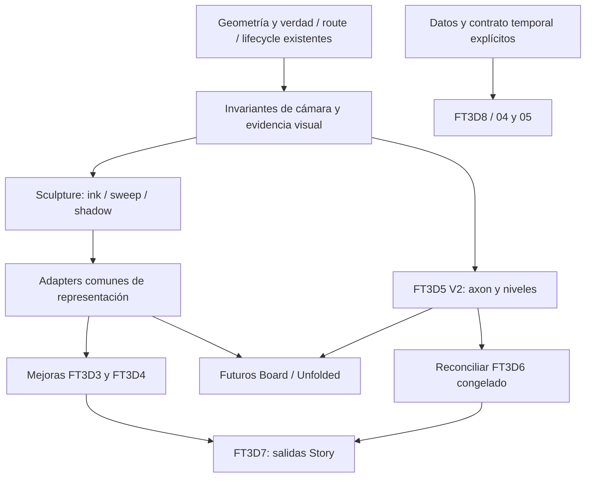

# FT3D / Rubik — Reference Atlas

**Inspección:** 01-11-2026. **Estado:** **REFERENCE ATLAS COMPLETE** para el inventario actual fijado por los SHAs de §2. Los unknowns históricos y las decisiones futuras de §20 siguen explícitos; COMPLETE no significa paridad visual aprobada ni autorización de implementación.

**Repositorio:** Juanmaes83/floorplan-3 d. **Master base:** `5f4e3d20e905f5f302783f67fda0ab4a7eb21371`.

**Rama:** `docs/ft3d-reference-atlas-2026-11-01`. Investigación y recomendaciones; no autorización de implementación. No modifica contratos ni declara aprobada una nueva experiencia visual.

## 0. EXECUTIVE TRUTH

**Qué tenemos.** Rubik ya presenta el mismo proyecto con geometría derivada, materiales autorizados, niveles reales, plano que gana volumen, descenso a estancia, player Story reversible, sección vertical y fachada narrativa. La sección deriva intersecciones y caras de corte; la fachada consume Exterior y un snapshot Solar opcional. Son capacidades integradas. FT3D-1 conserva aceptación humana final pendiente. FT3D-2 a está completo para su alcance; no requiere 2 b. Esta auditoría aporta inspección independiente de fuente, 73 tests puros y dos casos browser (§8).

**Qué falta.** Tener sección no equivale a tener Open Section. Falta un lenguaje compartido de representación: tinta jerárquica, poché/rayado, transición espacial dibujo/material y acabado de luz/material validado en movimiento. No existen en este master las narrativas axon/exploded, unfolded room, escala de Card Model ni estados temporales de construcción. Eso no significa que falten niveles, materiales, recorrido o exportaciones.

**Dónde encaja.** Conservar FT3D-1/2 y las autoridades de FT3D-3/4. Estudiar continuidad de representación común antes de cinco soluciones gráficas independientes. FT3D-5 V2 sigue siendo el corte espacial compacto/explotado por niveles. The Board por componentes y Unfolded Room requieren decisiones posteriores explícitas. FT3D-6 permanece documental y congelado. FT3D-7 conecta Story con salidas existentes. Semanas/Gantt/estados de obra pertenecen a FT3D-8, diferido.

**Prioridad.** P0: verdad de datos, route authority, lifecycle, invariantes de cámara y método de evidencia visual. P1: axon/exploded honesto, mejoras de sección/fachada apoyadas en representación común y acabado por estancia. La prioridad profesional y la secuencia de implementación son columnas distintas (§12). Son recomendaciones, no activación de desarrollo.

**Inventario:** siete familias, **14 variantes actuales**. 01/B pliega paredes y techo; 01/C apila plantas; 07/C inspecciona relieve de ladrillo. Los dos MP4 tienen timeline completo clasificado. El principal mezcla versiones anteriores, una cabecera histórica `ARCH // 12`, Lintel y promoción: no son doce familias disponibles en el checkout (§20).

**REA actualizado durante la inspección:** tras el aviso de Juanma, fork y upstream coinciden en `aa48d494e9726d469a1b9ed917f021d8a1a4c7ea`, divergencia 0/0. El anterior desfase de 17 commits ya no describe el remoto actual.

## 1. SCOPE, METHOD & DEFINITIONS

Discovery con Git, GitHub API, `rg`, rutas y símbolos; después inspección dirigida de fuente/HTML/CSS, siete README, siete PROMPT, runtime Playwright/Chrome y vídeo. Sin código donante incorporado, dependencias nuevas, cambios productivos o investigación de C4. No se usa trabajo sin commit de Claude.

El worktree original Serra tenía QA modificado/no seguido y se preservó. El checkout principal estaba limpio. Se hizo fetch antes de crear el worktree documental desde origin/master. Donantes y evidencias están fuera del producto, en `C:/Users/temp123/work/ft3d-reference-workspace/`. Sus archivos versionados permanecen intactos; se añadieron remotes upstream y actualizaron refs.

**Runtime:** Chrome 153.0.8010.53, Playwright 1.62.1 y ffmpeg/ffprobe 8.1.2, WebGL con `--enable-unsafe-swiftshader`, 1440×900. No certifica rendimiento de GPU física/teléfono. Cada una de las 14 rutas se observó en 0/.25/.5/.75/1/.75/.5/.25/0, con capturas/estado. Se usaron hooks de grabación preexistentes o scroll/input reales, sin parchear donantes. Nueve checkpoints no prueban todos los frames posibles. También se observaron root y Open Section publicados, Lintel publicado y v10 local. Los 45 archivos HTML/JS/CSS publicados de Flat-to-3 D coinciden exactamente con sus **blobs Git**, evitando falso drift por CRLF de Windows.

**Vídeo:** ffprobe, decodificación completa ffmpeg, muestras cada60 frames originales (2 s a30fps), 277+66 imágenes, 13 contact sheets inspeccionadas y ambos últimos frames. Cola principal refinada. Intervalos semiabiertos desde0 hasta duración, sin huecos; fronteras ordinarias aproximadas ±2 s, no cortes certificados al frame. Se clasifica lo visible, sin afirmar escucha de audio o visionado completo del YouTube. Cubrir todo el tiempo no significa que las 14 variantes aparezcan en vídeo.

**Taxonomía:** FAMILY=directorio actual; VARIANT=experiencia declarada por DEMOS/selector; MODE/DIRECTION=identificador técnico (`dir=b`, ruta); PHASE=dibujo/relieve/material/entrada/retorno; MECHANISM=proyección/transform/shader/clipping/luz/evaluación de estado. ISO/TOP, semana y query de grabación no son nuevas variantes.

**Evidencia:** CONFIRMED ×2+ = observación primaria contrastada entre modalidades (runtime+fuente, por ejemplo); README y PROMPT del mismo autor no bastan solos. CONFIRMED=fuente primaria directa fuerte; INFERRED=deducción explícita; UNKNOWN=no verificable. Paridad funcional y visual son juicios cualitativos separados (alta/parcial/baja/nula), no scores ni aprobación humana.

**Estados principales excluyentes:** IV=✅ INTEGRATED + VALIDATED; IH=🟡 INTEGRATED BUT EXTERNAL/HUMAN VALIDATION PENDING; PI=🟠 IMPLEMENTED / PROTECTED BUT NOT INTEGRATED; CD=🟣 CONTRACT / DESIGN ONLY; A=❌ ABSENT; D=⏸ DEFERRED. No se ha acreditado una nueva capacidad PI. FT3D-5 V2 es CD; su implementación sin handoff estable de Juanma queda **WIP / NOT CANONICAL**, fuera del baseline.

Gaps: REUSE AS-IS / EXTEND / BUILD / DEFER / DO NOT FAKE. Datos: SOURCE / DERIVED / ESTIMATED / VISUALIZATION ONLY / UNAVAILABLE. Un default visual no es una medición de obra.

**Locators:** `F:`=flat-to-3 d, `R:`=Rubik, `L:`=lintel-flat-2 d, `LL:`=lintel-live, `REA:`=REA, siempre en SHA de §2. V1/V2=vídeos de §2/apéndiceA; E-*=evidencia externa de apéndiceF. Archivo+símbolo se resuelve en ese SHA. No se inventan filenames: Open Section entra en `page.js`, no `main.js`.

## 2. EVIDENCE & VERSION MANIFEST

API GitHub confirmó fork/parent/source; Git confirmó remotes, SHAs y divergencia. Fecha de todos los registros:01-11-2026. Origin apunta al fork, upstream a la fuente indicada, URLs HTTPS con sufijo `.git`.

| Repo / owner | Branch/ref | SHA exacto | Upstream / divergencia | Licencia / reutilización |
|---|---|---|---|---|
| [Juanmaes83/floorplan-3d](https://github.com/Juanmaes83/floorplan-3d) | origin/master inicial | `5f4e3d20e905f5f302783f67fda0ab4a7eb21371` | autoridad integrada | sólo documentación propia |
| [Juanmaes83/flat-to-3d](https://github.com/Juanmaes83/flat-to-3d) | main | `d7b9b69753d3af679535ee56695a05c8d955c3c6` | Sam1983Aing/flat-to-3 d, mismo SHA, 0/0 | MIT ©2026 Samnang Aing |
| [Sam1983Aing/flat-to-3d](https://github.com/Sam1983Aing/flat-to-3d) | upstream/main | `d7b9b69753d3af679535ee56695a05c8d955c3c6` | fuente original verificada | candidato a análisis, sin extracción |
| [Juanmaes83/lintel-live](https://github.com/Juanmaes83/lintel-live) | main | `791612f6f07fdd79bafeedc74ec6c9eee0f9a86a` | Sam1983Aing/lintel-live, mismo SHA, 0/0 | sin LICENSE: REFERENCE ONLY — DO NOT COPY |
| [Juanmaes83/lintel-flat-2d](https://github.com/Juanmaes83/lintel-flat-2d) | main | `c6029d9bb0647483709a502daedc24c1dd7bc029` | Sam1983Aing/lintel-flat-2 d, mismo SHA, 0/0 | sin LICENSE: REFERENCE ONLY — DO NOT COPY |
| [Juanmaes83/rea](https://github.com/Juanmaes83/rea) | origin/main actualizado | `aa48d494e9726d469a1b9ed917f021d8a1a4c7ea` | morluto/rea, mismo SHA, 0/0 | MIT ©2026 morluto, rea-agents6.8.0 |
| [morluto/rea](https://github.com/morluto/rea) | upstream/main | `aa48d494e9726d469a1b9ed917f021d8a1a4c7ea` | autoridad upstream | herramienta de evidencia, no runtime Rubik |

REA se leyó inicialmente en checkout `d54a4661da20382ad8456564a08569fdd24131c5`. El fetch posterior comprobó su actualización remota. `git diff d54a466..aa48d49 -- LICENSE package.json src/browser/CdpBrowserProvider.ts src/browser/assets/PublishWebScripts.ts src/domain/browserScenario.ts` no mostró cambios: las conclusiones acotadas siguen vigentes sin alterar el checkout donante.

### Vídeos y deployments

| ID | Path / URL | Bytes / SHA-256 | Duración / formato / observación |
|---|---|---|---|
| V1 principal | `videos/proyecto-floor-plan-3d.mp4` | 91650280 / `924c927066b914376c4fe8eb6daac9a21c96d62e753988d980139db43aa61a46` |554.000 s, 16620frames, 30/1 fps, 1280×866, H264High/yuv420p, AACestéreo48kHz |
| V1 original | `C:/Users/temp123/Downloads/PROYECTO Y WEB REFERENCIA DE FLOOR PLAN 3D.mp4` |610693540 / `216b39776211aac0a42cbf25db3ded4ef113bdd757068f05be15601334b9a6e1` |554 s, 30 fps, 1840×1246, H264, audio sí. Frame01:44 visualmente coincide; no identidad global de frames afirmada |
| V2 complementario | `C:/Users/temp123/Downloads/PROYECTO Y WEB DONDE DEBEMOS DE RECORRER VISITAR Y AUDITAR PARA IMPLEMENTAR EN FLOOR PLAN 3D.mp4` |207350951 / `996d9cbed7cf5b635b32c3a5edbb9862363b6b1540883207739d9017c5f3fcb6` |130.400 s, 3912frames, 30 fps, 2558×1356, H264, AAC sí |
| Web obligatoria | [Open Section A](https://sam1983aing.github.io/flat-to-3d/03-open-section/index.html?dir=a) |HTTP 200, 2 canvas, observación y fuente |root +45 archivos publicados = blobs Git exactos; sin drift de contenido observado |
| Lintel publicado | [lintel-live](https://sam1983aing.github.io/lintel-live/) |HTTP 200, canvas1440×900 |avance/retroceso, comparación de comportamiento con v10 local, no identidad binaria del build |
| YouTube | [UTCPqJZFg04](https://www.youtube.com/watch?v=UTCPqJZFg04) |página 200; título «Opus 5.5 Turned 7 Flat Drawings Into Walkable 3 D Houses», Samnang Aing |player de 18:28; siguió0:00 pausado tras intentar reproducir. **No se afirma visionado**; MP4 primario es9:14 |

El lector web falló inicialmente; Chrome permitió leer YouTube. Metadata no equivale a reproducción. Cifras comerciales/copy de las referencias no se adoptan como datos Rubik.

### Autoridad documental

Todos los documentos de master se consultaron en la base fijada; sus fechas/cabeceras históricas se contrastan con código y cierres posteriores.

| Documento bajo `docs/` salvo indicación | Ref / SHA | Uso |
|---|---|---|
| `DEVELOPMENT-WORKFLOW.md`, `ROADMAP.md` |master base |disciplina y fases; misión explícita prohíbe PR/merge |
| `product/current-status-2026-10-30.md`, `roadmap-completion-matrix-2026-10-30.md` |master, contenido actualizado01-11 |1 IH, 2/3/4 IV, 5–8 no elevados |
| `product/rubik-competitive-benchmark-roadmap-2026-10-29.md` |master |estrategia única verdad espacial; no nueva auditoría competitiva actual |
| `product/point-9-ux-professional-discoverability-2026-10-28.md` |master, arquitectura/rutas/límites finales |FT3D se suma a Entregar |
| `product/building-presentation-2026-10-19.md` |master |presentación/lotev2 por niveles, 2 plantas |
| `product/flat-to-3d-presentation-knowledge-programme-2026-10-30.md` |master,§§2–9 |separación3–8, no eliminación |
| `product/ft3d-3-dynamic-section-contract-2026-10-31.md`, `ft3d-4-elevation-facade-contract-2026-10-31.md` |master+implementación |alcance cerrado; mejoras no son contrato editado |
| `product/ft3d-reference-sculpture-rea-methodology-2026-11-01.md` |origin/docs/ft3d-reference-sculpture-rea-methodology=`6e933168ff49f48c6de9d24dd7b51ff8dbec4e28` |Atlas→runtime→donor map→Sculpture→adapters→paridad→integración |
| `product/ft3d-5-axon-exploded-building-contract-2026-11-01.md` y `…-contract-audit-addendum-2026-11-01.md` |origin/docs/ft3d-5-axon-exploded-contract=`a0b6b0d6c3c8d8475e99a43a6f137afe9c355e8b` |V2 consolidado prevalece; adenda55/55, CD |
| `product/ft3d-6-profile-templates-working-contract-2026-11-01.md` |origin/docs/ft3d-6-working-contract-after-ft3d4=`5db3c1b48972128f2769598141cbe2268b792bfa` |working vigente, congelado, §50 P1–P11 |
| `product/ft3d-6-profile-templates-contract-draft-2026-10-31.md` |historia en rama FT3D-6 |draft aprobado histórico; working prevalece |

## 3. REFERENCE TAXONOMY

Autoridad: `F:index.html:DEMOS` (452+), selectores y archivos reales. **3+1+2+1+3+1+3=14** variantes. Rutas relativas a [web root](https://sam1983aing.github.io/flat-to-3d/).

| ID / internal | Family / UI code | Visible label | Mode y ruta | Source principal |
|---|---|---|---|---|
|01A /01:0|Exploded House/PURLIN AXO-01|A · The Board|`01-exploded-house/index.html?dir=a`|dir-a.js+main/core |
|01B /01:1|Exploded House|B · Unfolded Room|mismo index `?dir=b`|dir-b.js+shared |
|01C /01:2|Exploded House|C · Floor by Floor|mismo index `?dir=c`|dir-c.js+shared |
|02 /02:0|Section Sweep/COTA SWP-02|Demo|`02-section-sweep/index.html`|main/draw/house/real/look.js |
|03A /03:0|Open Section/POCHÉ SEC-03|A · Open the lens|`03-open-section/index.html?dir=a`|page.js:PLAN.a+engine/house/entourage |
|03C /03:1|Open Section|C · Down the stair|mismo index `?dir=c`|page.js:PLAN.c+shared |
|04 /04:0|Build Time-Lapse/SEQUENCE A-901|Demo|`04-build-time-lapse/index.html`|js/main/programme/world/pipe/stage |
|05A /05:0|Schedule Build/PURLIN CPM-05|A · The Programme|`05-schedule-build/index.html?dir=a`|view/house.js |
|05B /05:1|Schedule Build|B · 1:1 Site Sheet|mismo index `?dir=b`|view ramas sheet/dirb |
|05C /05:2|Schedule Build|C · Site Camera|mismo index `?dir=c`|view ramas cámara/tod |
|06 /06:0|Card Model/ATELIER1:100 MDL-06|Demo|`06-card-model/index.html`|js/page/house/desk/real/sweep |
|07A /07:0|Sunlit Elevation/ALBION ROW ELV-07|A · One Door|`07-sunlit-elevation/a-one-door/index.html`|page.js propio+engine/elevation.js |
|07B /07:1|Sunlit Elevation|B · The Row|`07-sunlit-elevation/b-the-row/index.html`|page.js propio+shared |
|07C /07:2|Sunlit Elevation|C · The Face|`07-sunlit-elevation/c-the-face/index.html`|page.js propio+shared |

`07-sunlit-elevation/index.html` es alias con meta-refresh aA, no variante15. 03 no declara B. `wk/shot/tod/ghost/room/p/t/drive/offline/rec/skip/still/nolenis/at/debug` son estado/diagnóstico/grabación, no nuevas experiencias declaradas. Root usa hash `#id:variantIndex`.

Ejemplo completo: 01→01B→dir=b→hoja desarrollada/pliegue/caja/umbral/cocina/banco→pivots de pared y techo+crecimiento local+mapeo wash+dolly/lens+sol. No es un cambio de color.

## 4. FAMILY DOSSIERS

### 4.1 Exploded House

**Propósito/observación:** composición espacial como dibujo que se ensambla y se convierte en interior; tres variantes, tres organizaciones distintas. Las tres ejecutadas avance/retroceso, nueve checkpoints, 0 errores pageerror/request failed. Geometría/dimensiones/captions/radar hardcoded por demo.

**Narrativa:** plotter líneas/fills→capas(A)/pliegue(B)/plantas(C)→lente→entrada/estancia. `main.js:intro/step` combina intro temporal y progreso; `dir-*.js:build/update(p)` transforma grupos y copy. Reset geométrico p0 observado; no transacción de restauración de editor.

**Cámara/proyección:** `core.js:camAt/applyCam` interpola target, azimut corto, frame/lens en log, distancia fullHeight/(2 tan(fov/2)), near/far y lens shift. A/C1.5°, B2.2° cenital. PerspectiveCamera, no ortográfica. A usa eyeKey/posiciones entre claves, no routing general.

**Geometría/material/luz:** `Part` agrupa por material/aristas. A seis capas con lift y pull lateral; B pivots de cuatro paredes/techo; C planta baja+cuatro plantas madera+roof y núcleo ajustable. A mantiene dibujo con fills y luz pintada, sin sombras dinámicas; B/C sí luces/materiales/sombras. `patchFill/patchLine`, tres pesos, grain/wash. No uniformar el tratamiento de toda la familia. Labels y proyecciones siguen grupos; radar tiene hotspots/botones. HTML/CSS: index/sketch; Three0.169. README/PROMPT leídos; V1 01:44–02:04 confirmaA; B/C sin ejecución identificada en vídeos. **CONFIRMED ×2+** por runtime/fuente.

### 4.2 Section Sweep

**Propósito/narrativa/runtime:** sección plana con poché/tierra/cotas/ángulos solares→lente→giro tres cuartos/scan→paseo fijo→salida/desmaterialización/hoja. Una variante, avance/retroceso observados; V1 02:16–02:42; `main.js:swingState/update`.

**Cámara:** README/poses initial~0.12° a orden12km; swing abre conservando frame antes de girar. WK+dos CatmullRomCurve3 fijan ojo/target/pausas de una casa, lens shift. No sustituye route authority.

**Geometría/corte:** `house.js:structure`, construcción de piezas desde~466: cajas divididas en CUT=0, caras poché, partes behind/front/people. Es partición del modelo fijo, no un corte móvil universal. **Dibujo:** draw.js:createDrawing/renderND/compose, normales/depth/ID, edge weighting, hatch tierra. **Material/luz:** real.js:createReal renderiza mismas piezas en otro target con materiales, sol, lamps/AO; compositor mezcla por world X y sunbeams. Hay varias escenas/passes sobre una lista autoritativa; «mismo objeto» no implica copiar número de passes.

**UI/reverse/files:** scroll, siete hotspots key-section, CTA local, HUD lens/scan/sun, mini sección; initial recuperado. REDUCED explícito en main; no prueba accesibilidad de otras familias. HTML con styles/loader; look.js procedural. README/PROMPT contrastados. **×2+.**

### 4.3 Open Section

**Propósito:** plano de corte legible mientras aparece profundidad. Dos variantes, misma casa tres niveles con itinerarios distintos. `page.js:PLAN/stateAt/colourAt`; `engine.js:createEngine/resolve/place/updateCaps/notes`. Ambas runtime; V2 00:00–00:56 y01:58–02:10; V1 02:56–03:14 con drift histórico.

**Cámara:** rect/viewport/frameH/lens; A1.6°→64°, visitas stair/kitchen/patio/living/pool. C abre12° al principio, entra antes arriba y desciende. Frontal sin órbita, mezcla tan(lens/2), keys móviles propios. **Corte/caps:** plano vertical de profundidad; shapes de sólidos extruidos producen caps; updateCaps agrupa y dispone geometría anterior. **Dibujo/material/luz:** LineMaterial, hatch tierra, notas canvas, figures/trees, scan world X que activa material procedural/sol/sombra. Mini-key3D+cinco botones.

**Reverse:** cámara/geometría vuelven a hoja; 03C dejó caption de estancia residual tras volver scrollY=0 incluso con espera adicional (E-supplement). No se declara reversibilidad DOM perfecta; causa exacta no aislada, no se corrige donante. Closing incluye secciones SVG estáticas de otros proyectos, no variantes3D. HTML/CSS inline, entourage.js; README/PROMPT. **×2+.**

### 4.4 Build Time-Lapse

**Propósito:** calendario como estado geométrico. Una variante, 38 semanas. programme.js:PROG/TILES/WEEKS; world.js:stamp/weekly/uNow codifica llegada/salida por vértice; stage.js medios auxiliares/puntales/mobiliario/plantación por semana.

**Secuencia/runtime:** seis dibujos vivos→zoom tile01→sitio aparece en orden→lente2°→50° a ojo→excavación/estructura/puntales/acabados/entrega→tile06/hoja. Forward/reverse; V1 03:14–03:50, V2 01:52–01:58. pipe.js:aim usa target+semialtura/FOV y frustum para rect papel; main WEEK_KEYS, cuatro tramos de ruta y END.total29.4 viewport heights.

**Representación/luz:** paper pass con semana en alpha, normal/depth/peso, compositor material/AO/shafts; seis scissor/viewport evalúan un modelo a semanas distintas. useSet/makePipe alternan materiales, no seis proyectos. Sol/staging ligados a tiempo. Scroll calendario/programa now/CTA; HTML mediaqueries y loader, no editor Gantt de usuario. README/PROMPT. **×2+.** FT3D-8, no5.

### 4.5 Schedule Build

**Propósito:** chart y construcción comparten PHASES. Tres direcciones de una casa. house.js:PHASES/add/update, WEEKS14, dateAt laborable desde01-03-2027 ficticio. No fechas reales de Rubik ni motor CPM acreditado por el rótulo.

**Runtime:**0/3.5/7/10.5/14 semanas y vuelta en las tres. A/C llegan al interior automático; B termina sobre hoja/sitio, INSIDE sí habilita paseo. INSIDE/ENTRY comprobados en todas (WK14, TOUR~0). AUTO/ISO/HIGH/TOP/PATH/INSIDE son modos de cámara, no variantes. TOUR_KEYS/sampleTourSpline fija cinco paradas y escalera.

**Mecanismo/material/luz/UI:** update aplica crane/drop/rise/grow/appear por fase/orden, tierra/equipo/plantas/luces/puertas. A programa; B plano/programa a1:1 en terreno, ghost; C cámara de obra/tod. Texturas métricas glulam/OSB/larch/zinc/oak, sombras/aristas, naranja fase/pieza. view.js:renderHud/bindHudEvents/setTargetWeek/syncVisuals; slider/GanttSVG click-drag/play/tabs. sketch.css+HTML; README/PROMPT. V1 03:50–04:18 A/C; B no inequívoca. **×2+.**

### 4.6 Card Model

**Propósito:** reinterpretar escala conservando piezas. house.js:houseParts métrico único; estudio/escritorio100×mayores; card/real salen de lista común en mismas coordenadas.

**Secuencia/runtime:** loader corte→heroensamble→descenso coste logarítmico→esfera bombilla/material/luz→interior con maqueta recursiva→vuelta/lámpara off. page.js:CH/update, dive40–460, turn460–880, walk880–1500, back1520–1960, end1960–2030 (unidades1vh). V1 04:18–04:52, V2 01:36–46 hero. Forward/reverse observado.

**Cámara/material/luz:** makeShot/measurePath/pathU, DOF, keys desktop/phone; sweep.js:sweepMaterial/sweepSide parchea descarte y contribución por luz, customDepth para sombras; radio mundo desde bulb, bandaámbar, compresión lejana. desk.js estudio, real.js casa. No análisis solar. HUDcm/m, captions/CTAs#; es descarte de representación, no sección03. Reverse recupera maqueta; grain/idle dependen de tiempo, no pixel-determinismo por p. HTML/page.css; README/PROMPT. **×2+.**

### 4.7 Sunlit Elevation

**Propósito:** rayado de sombra y sombra material con mismo soporte espacial→relieve→perspectiva→entrada. Tres variantes, engine común. Tres runtime avance/retroceso; V2 00:58–01:24 A; V1 04:52–05:22 A+versión histórica No.14 Calder Row.

**Cámara:** engine camAt/setCam, target/frame height/FOV log, D=(fh/2)/tan; 2°→~58°. A una puerta, B seis casas/plot04, C1:20/headers60mm antes de entrar. Dimensiones pertenecen a casa ficticia fuente.

**Dibujo/material/luz:** createStage/mat, uSweep diagonal, papel/ink/hatch/material, shadowmask para rayado. CONVENTION=(-1, 1, 1) normalizado:45°proyectado/planta, **altitud real35.26°**, no45°solar. Materialización mantiene luz, luego sol LATE/RAKE. uDepthCue, pins, niveles, radar, beats, puertas. B sólo interior plot04, Crelieve geométrico de ladrillo. Lenis/native, cinco botonesradar/variante, CTAs locales. engine/page.css+tresHTML/page; README/PROMPT. Reverse no equivale a restore de editor. **×2+.**

## 5. VARIANT DOSSIERS

Una ficha por variante; hereda sólo lo demostrado en familia. ✓local=runtime real+fuente. Vídeo ausente=no observación identificable, no inexistencia.

| ID | Estado inicial→fases→final | Source / mecanismo particular | Vídeo reconciliado | Verificación |
|---|---|---|---|---|
|01A The Board|seis capas→ensamble→porch/dining/living/loft/ridge|dir-a:update, lift acumulado, pullnormal glazing/cladding, puerta slide, seis botones+cuatro zonas|V1 00:22–28, 01:44–02:04; misma casa/capas, no adoptar copy de obra|✓local, source, README/PROMPT;×2+ |
|01B Unfolded Room|planta+cuatro elevaciones+techo→west/north/east/south/lid→caja→puerta→kitchen/window|dir-b:FOLD/GROW/update/pivots±π/2, muebles por cara, wash/sol/pendant, drawSheet|B visible selector01:44; movimiento **no observado**|✓local; source 197–260;×2+ |
|01C Floor by Floor|cinco pisos+roof→inferiores aterrizan→gapL3→L4 baja→studio|dir-c:LAND/GAP/update; Yacumulada, núcleo estira, radarstack/gap/drop/studio|selector visible; ejecución **no observada**, no confundir capasA|✓local; source 210–303;×2+ |
|02 Demo|hoja→lens/giro→scan→study/lounge/living/mezz/snug/bedroom/garden→hoja|main/draw/house/real; CUT0, GbufferID, world X, spline/keysection|V1 02:16–02:42 fuerte; root histórico nombres distintos|✓local;×2+ |
|03A Open the lens|hero→lente amplia→whole→stair/kitchen/patio/living/pool→flat material→closing|page:PLAN.a, total1600vh, colour135–355, lens1.6→64/~68, key3D|V2 00:00–56, 01:58–02:10 compatible; V1 copy diferente|✓local;×2+ |
|03C Down the stair|hero→street/kitchen→bedroom→living→pool→whole/closing|PLAN.c, total1250vh, colour60–200, initial 12°, entrada 72–74°, descenso|V1 03:08–14 sugiere bajada, letra **no inequívoca**|✓local; reversegeom sí, caption residual;×2+ |
|04 Demo|seis dibujos→tile01→obra/puntales/fitout→tile06/hoja|main/programme/world/pipe; uNow, 38 semanas, scissor|V1 03:14–50 fuerte, V2 01:52–58 hoja|✓local;×2+ |
|05A Programme|wk0→buildchart→wk14→cinco rooms|view/house:dir a, open chart-only opcional, PHASES/slider/cams|V1 03:50–04:06, V2 01:46–48 wk8|✓local+INSIDE/ENTRY;×2+ |
|05B Site Sheet|foundation plan→build sobre hoja/Gantt→top complete; INSIDE opcional|view:dirb, ghost=1, sheet texture/semana|**no match inequívoco** en MP4|✓local+INSIDE/ENTRY;×2+ |
|05C Site Camera|site/clock→build camera→interior|view:dirc, encuadre/tod/date; PHASES compartido|V1 04:06–18 compatible por UI|✓local+INSIDE/ENTRY;×2+ |
|06 Demo|maqueta en escritorio→dive→sphere→walk→desk/lámpara apagada|page/sweep/house/desk/real, escala100, por luz|V1 04:18–52 fuerte, V2 hero01:36–46|✓local;×2+ |
|07A One Door|alzado1:50→relief→sweep→late→porch/parlour/atrium/garden|a/page:KEYS/frame, setDoor/gardenDoor, length760|V2 00:58–01:24 fuerte, V1 inicial04:52–05:04|✓local;×2+ |
|07B The Row|seis casas/status→fila oblicua→scan→plot04→atrium|b/page:V/STATUS/KEYS/frame, interior plot04, length660, radar reflejado|**no observada**; vecinos de A no demuestran B|✓local;×2+ |
|07C The Face|detalle1:20→scan→rake→header closeup→hall|c/page:KEYS/frame, relief0.06, RAKE, length540|**no observada**; No.14 histórico no se reclasifica C|✓local;×2+ |

## 6. CROSS-CUTTING MECHANISMS

### Technical Drawing / Projection Continuity

Nombre de trabajo; recomendación, no contrato. Las familias comparten invariantes conceptuales, **no un engine literal único**:01 core, 02 compositor, 03 engine, 07 engine, 06 card/real.

| Mecanismo | Fuente cruzada | Rubik actual | Común / específico propuesto |
|---|---|---|---|
|technical projection|01 applyCam, 02 pose, 03 place, 07 setCam; 06 maqueta perspectiva|PerspectiveCamera, plan/section/elevation|I1 target/frame/lens/region; Card no necesita plano CAD |
|lente larga/FOV estrecho|01A/C1.5°, B2.2°, 02~.12°, 03~1.6°, 07~2°|section1.5–8°, elevation4°|reusar matemáticas, near/far/precisión |
|frame-preserving dolly|01/07 full height/(2 tan), 04 half height/tan, 03 rect|sectionOpen frame0 durante apertura|I1; no copiar factor 2 erróneo |
|target/framing invariant|keys target/frame, 03 cutrect|region libre+overview determinista|I1 landmarks screen-space |
|technical ink|01 lines, 02 normal/depth, 03 LineMaterial, 07 patches|outline/aristas selectivas, sin documento general|I2 BUILD, comparar geometría/post process |
|edge weighting|013 pesos, 02 depth/ID, 03 caps más gruesos|no jerarquía equivalente|I2 perfil representación |
|poché/caps|02 precortadoID, 03 shapes intersectados|caps muros activos+huecos|EXTEND cobertura verdadera, no caps universales fingidos |
|hatching|02/03 tierra, 07 shadow map|ausente Story|I2 filtrado píxel; 07 ademásI3identidad de sombra |
|representation/material sweep|02 world X, 03 colourX, 07 diagonal, 06 sphere|materiales puestos; sin scan general|I3 BUILD, vidrio/GLB/materiales compartidos/restore |
|lighting handoff|07 mismosol→late; 06 lamp→sun; 02 lines→shafts|neutral/Solar snapshot y restore|I3 luzvisual separada del análisis Solar |
|exploded transforms|01 Alift/pull, 01 CYacumulada|niveles reales, escena sólo CD|I4 ownership/deltas absolutos |
|unfold transforms|01 Bpivots+muebles locales|datos room/walls, narrativa A|I5 específico habitación |
|scale transition|06 desk100×, coste logarítmico, lista de piezas|sin narrativa equivalente|I6 DEFER, no mutar escala del proyecto |
|camera handoff|01 eye, 02 spline, 03 front visits, 07 threshold|room-descent→roomFrame|I1 anchors, no puertas hardcoded |
|interior-route handoff|02/05 splines fijos; 03 frontal visits|presentation-route.plan/choreography|REUSE autoridad, handoff nuevo debe demostrar seguridad |
|stateAt(p)|01 update, 03 stateAt, 07 frame, 04 week, 06(t, scroll)|corepuro+sequence|I0 conservar; donorsidle/grain no sólo p |
|reverse|14 rutas, 03C caption residual|scrub/restore testeados|I0 verificar cámara, geometría, UI, materiales |
|restore|donante es página propia|Begin/Apply/End/close/invalidate/contextLost|I0 REUSE, snapshots por efecto |
|reduced motion|02 REDUCED, no evidencia uniforme otras6|holds/saltos/teclado actuales|I0 REUSE, no scroll obligatorio |

**Infraestructura:** I0=modelo/Story/lifecycle/routing existente; I1=EXTENDinvariantes/handoff cámara; I2=BUILDrepresentación técnica; I3=BUILDtransición espacial/luz coherente; I4=FT3D-5 CDownership/transforms nivel; I5=futuro unfold; I6=posterior escala/atmósfera. Compartir evaluador no obliga a acoplar renderers. Caps, deltas, pivots, semanas siguen siendo comportamientos distintos.

## 7. LINTEL PRESENTATION & POLISH REFERENCE

### Público, privado y comportamiento

LL:README dice que sólo sirve página y que el working project es privado. L:README explica que **lintel-flat-2 d es público desde28-10**, v10final21-10, con versiones/briefs/build-live. Conflicto documental temporal: no afirmar que todo el original siga inaccesible. Lintel-live contiene31 archivos (página, scene/staging, material/luz/hero/facade, shared, 14 fotos), sin briefs/historia; lintel-flat-2 d419 archivos con documentación/tools/teach/versiones. Público no implica permiso de copia.

Chrome arrancó publicado y v10local. En publicado se observaron escritorio/plano→casa→visitas→cierre→vuelta; capturas0/.2/.5/.8/1/0. V1 05:22–09:14 muestra diferentes etapas de Lintel. Materialización por habitación, muebles/paisaje, anclas, tarjetas/dossiers, navegación/hora. Casa diseñada, no reconstrucción universal. No se enviaron formularios ni adoptaron cifras de marketing.

### Lenguaje y método de acabado

Plano/volumen/puertas/muebles conservan identidad. Still, cadencia, etiquetas, composición editorial y luz/material importan además de arquitectura software. Una cámara continua no produce por sí sola calidad de textura/mobiliario.

Autoridad: `L:001 Lintel/brief-code-house.md` y copia v10 (especialmente «The same routine for every room»), brief-living-looks, brief-phase-3, brief-iteration-9. Herramientas inspeccionadas por responsabilidad: tools/review_stills.py, living_closeups.py, flicker.mjs, look_numbers.py, walk_offline.mjs. Cifras históricas del brief son **reportadas por el autor**, no medidas por Atlas.

| Paso documentado | Evidencia | Criterio candidato FT3D |
|---|---|---|
|freeze baseline|v5bnow/code/light/codelit→v6a/v8d/v10|SHA/proyecto/cámara/viewport/DPR/opciones recuperables |
|lightfirst|brief prefiereLightingFirst; environment propio interior/rebotes|separar defecto de luz/material; no reflejar cielo exterior por defecto |
|material pass por room|procedural con detalle filtrado en derivatives|material autorizado real; no obligación de abandonar bibliotecaRubik |
|defined stills|35 review places+closeups1728×992 DPR2|before/after mismo encuadre/luz/escala/assets |
|blind side-by-side|scans/code bajo misma luz, notas externas|pares sin revelar candidato cuando proceda; no score como aprobación |
|fixlist|juntas punteadas, logs brillantes, hojas con parpadeo, bordes artificiales|defecto por distancia/ángulo/material |
|flicker check|flicker.mjs repite posiciones, diferencias vecinos/señal temporal|avance/retroceso reproducible; ratios0.35/0.6 son heurística autor, no gateRubik sin calibrar |
|coste de frame|look_numbers, versiones intercaladas por carga variable|mismo equipo, cold/warm, compilación vsrender, tails |
|shortreel|walk_offline plan/tamaño, revisión humana|transiciones/interiores difíciles/reverse |
|human approval|habitación pasa por ojo deSam, notas externas como fixes|**Juanma aprueba**, tests/score no sustituyen |
|freeze ytraza|journal/session-log/decisions, versiones firmadas/build-live|evidencia ligada al SHA final, no mezclarHEADs |

El brief reconoce que procedural pesaba menos y podía verse peor que scans, y frame bajo olivo~40%máscoste. Cifras coldload/descarga varían por pasada; no prometerlas para Rubik. Transferible: calidad y coste juntos, por estancia, aprobador identificado. No se reconstruyó/publicó Lintel.

**Licencias:** sin LICENSE verificable en inventarios Git ni metadata GitHub de ambos Lintel. **REFERENCE ONLY — DO NOT COPY**, incluidos shaders/meshes/fotos/copy/branding sustanciales. Método redactado con palabras propias.

### Papel acotado de REA

rea-agents6.8.0, upstream morluto, MIT, remotos actualizados§2. `REA:src/browser/CdpBrowserProvider.ts` observa web/CDP; domain/browserScenario.ts define escenarios; browser/assets/PublishWebScripts.ts exporta bytes retenidos con hashes/manifiesto/limitaciones. Ver un script recibido no prueba ejecución; export no reconstruye sourcemaps/imports faltantes. Límites expresos en código, no sóloREADME.

Atlas→captura/escenario/hash→análisisJS si hacefalta→donormap→Sculpture aislado→adapters→paridad→integración. Aquí fuente completa+Playwright/Git bastaron; **REA no instalado ni ejecutado**. No es renderer/geometría/routing/dependencia productiva. Motores nativos fuera de alcance; no prolongar investigación sin hueco concreto.

## 8. RUBIK CAPABILITY BASELINE

Baseline construido desde fuente de master antes del gap analysis. Tests de esta auditoría: route/story/section/elevation puros **73 PASS/0 FAIL/0 SKIP**; dos casos browser **2 PASS/0 FAIL/0 SKIP/0 cancel**. Otras suites citadas son evidencia histórica/existente, no ejecutadas ahora. Imports/dispatch verifican integración index+UI. No se hizo regresión masiva para documentación.

| ID / capacidad | Autoridad / integración real | Estado | Tests/evidencia | Límite |
|---|---|---|---|---|
|B01 geometry|js/project-core.js:geometry→index:buildArch|IV|project-core existentes, fuente|trazado/calibración no certificación; defaults supuestos |
|B02 building|building-core:LIMITS/validate; building-ui:context/presentationSources; index:buildLevels|IV|building/building-presentation históricos|máximodos niveles, offset/elevación real |
|B03 floor/ceil/slab|index:buildArch/cutLevelOpenings/levelSlab|IV|building existentes+fuente|suelo polygon, techoHdefault, slabvisual no estructura |
|B04 openings|project-core geometry+index:wallBox/doors/windows/slides|IV|opening existentes+fuente|wallId/offset/width/sill/height, no curtain wall inferido |
|B05 furniture|index:buildFurniture/syncFurniture+placement/catalog|IV|model/furniture existentes|assets autorizados, calidad variable |
|B06 materials|surface-catalog/surface-renderer.mjs:SurfaceRenderer→floorMat/wallBox|IV|surface existentes+hash/map/cache fuente|sinshader técnico/scan general |
|B07 exterior|exterior-core:derive/exterior-volumes→exteriorG|IV|exterior existentes|clasificación conservadora, no estructura multicapa |
|B08 roof|roof-core:deriveProject/deriveBuilding→roofG|IV|roof existentes|envolvente superior, no cerchas/techo inclinado inventado |
|B09 light/Solar|index:applyLight/setSolar; solar-renderer-adapter; SolarUI.result|IV|Solar históricos+elevation fuente|orientativo, no certificado ni estética equivalente |
|B10 framing|presentation-core:roomFrame; index:presentationFrame/overviewPose/StopPose|IV|framing existentes+browser actual|límites visuales históricos no reabiertos |
|B11 planreveal|story-core:planReveal; index:StoryBegin/Apply archUp/furnG|IH|Storyactual+cierreFT3D-1|aceptación humana final; sin ink/scanLintel |
|B12 room descent|story-core:roomDescent; roomFrame; UI:fullStory|IH|Storyactual+técnicoFT3D-1|primer descenso/nivel, no paseo continuo por todasrooms |
|B13 player|story-core:NARRATIVES/SCENE_MS/sequence; UI:open/enter/seek/finish|IV|Storyactual+cierre2a|kindsplan-reveal, room-descent, section-open, elevation-open |
|B14 section descriptor|presentation-section-core:derive/buildingAxis/crossings|IV|puro/browser actual|candidatos, eje envelope, no editor de sección arbitraria |
|B15 clipping/caps|index:beginSection/clipSectionMaterials/apply/end|IV|browser actual reverse/resize/cancel|edificio sin terreno/UI; caps muros activos+huecos/suelolines; otras plantas sin caps |
|B16 section narrative|story-core:sectionOpen; UI:option/holds|IV|actual+histórico7/7|lente/cut/frame reales; sinink/material scan |
|B17 facade descriptor|presentation-elevation-core:derive/outward→Exterior.derive|IV|puro/browser actual|sectores45°, largoluego huecos, no «principal»; cardinal sólo north |
|B18 facade narrative|story-core:elevationOpen; index:begin/apply/endElevation; UI:elevationView|IV|actual+histórico10/10|frontal4°, material existente, perspectiva/overview; default puede resultar ciego |
|B19 minimap/callouts|presentation-core:minimap; UI:renderMinimap/caption/ARIA|IV|browser actual+histórico|no hojaCADcotas universal, marks transitorios |
|B20 routing|presentation-route:plan/choreography; index:presentationRoute/clear|IV|route actual+fuente obstáculos/fallback|sin spline universal ni recorrido interplanta acreditado |
|B21 visibility/rebuild|index:buildLevels/sync/setLevelContext/sectionKey; BuildingUI.presentLevel|IV|browser actual+building histórico|activecota0, otras relativas, assets tardíos reenganchados, noexplosion |
|B22 lifecycle/a11y|index:StoryBegin/Apply/End/contextLost; UI:close/invalidate/popstate/holds|IV|browser actual+histórico móvil/Back|nuevo efecto debe restaurar sus estados |
|B23PNG/lote/brand|UI:captureBatch/captureBuildingBatch; core:readCaptures; delivery-image/brand|IV|capture/building históricos|staticPNG+editableZIP, no loteStory general |
|B24 vídeo|tour-video-ui+View3D hooks grabación|IV|tour-video histórico+fuente|MediaRecorder/códec navegador, no exportación de frames de toda Story |
|B25 axon/exploded|FT3D-5 V2 rama documental; sin core/kind enmaster|CD|contrato/adenda, no implementación asumida|WIP/NOTCANONICAL sin handoff |
|B26 templates|FT3D-6 working:registry/resolver|CD|contrato, no runtime|congelado, §50 P1–P11 |
|B27 construction time|FT3D-8 conceptual|D|programa|sin fases/fechas/dependencias geométricas |

**Route authority ≠ choreography.** presentation-route.plan valida entrada/altura/polígono/muros/muebles con grid orientado, clearance explícito(default220mm), segmentos/suavizado verificados y alternativas aerial/unavailable con razones. choreography consume ruta para ojo/target/ritmo y hojas visibles. Conservar ambas. Un spline donor sólo inspira ritmo/framing, no invalida camino ni inventa puerta.

room-descent converge a roomFrame, no demuestra acceso desde cualquier fachada. fullStory añade primer descenso tras overview por nivel; las demásrooms siguen como paradas. FT3D-5 V2 vuelve a overview(level). Handoff nuevo necesita anchor+entrada+ruta demostrados y fallback.

## 9. REFERENCE ↔ RUBIK GAP MATRIX

Cada fila separa **estado actual** de **trabajo propuesto**. B*=baseline§8; I*=infra§6; O*=orden§12. F/V=paridad funcional/visual. La disponibilidad no convierte una escena propuesta en integrada. «No dato» no significa que debamos crear un sustituto engañoso.

| Gap | Family | Variant | Reference capability | Rubik authority | Rubik status | Functional parity | Visual parity | Gap concreto | Classification | Required data | Data availability | Shared infra | Roadmap destination | Product priority | Implementation order | Dependencies | Evidence / confidence |
|---|---|---|---|---|---|---|---|---|---|---|---|---|---|---|---|---|---|
|G01|todas|14|mismo objeto espacial entre representaciones|B01–08|IV|alta|parcial|evitar segundo edificio/pérdida de identidad al añadir efectos|REUSE AS-IS|proyecto/niveles/geometría|SOURCE/DERIVED|I0|KEEP / EXISTING|P0|O0|ninguna nueva|R:geometry/buildArch/buildLevels; F:houseParts/Part,§4;×2+ |
|G02|01/02/03/07|01A–C, 02, 03A/C, 07A–C|lente/frame/target sin salto|B10/13/16/18|IV|alta sección, parcial transversal|parcial|formalizar invariantes screen-space/handoff común, no nueva cámara obligatoria|EXTEND|bounds/target/region/FOV|DERIVED|I1|FT3D-3 enhancement / FT3D-4 enhancement / FT3D-5|P0|O1|G01/G08|F:core.applyCam, engine.place, setCam; R:sectionOpen/elevationOpen;×2+ |
|G03|01/02/03/07|todas no temporales|tinta y pesos de línea|B06/19|A para estilo compartido|baja|baja|representación técnica general sobre mallas reales, incluyendo assets|BUILD|geometría/normales/depth/clases|DERIVED; clases por decidir|I2|FT3D-3 enhancement / FT3D-4 enhancement / FT3D-5|P1|O2→O3|G01/G02/G08/G22|F:patchLine, draw.renderND, engine.LineMaterial; R:beginSection sin ink general;×2+ |
|G04|02/03|02, 03A/C|poché/caps/hatch legibles|B14/15|IV caps activos|alta corte/parcial cobertura|parcial|caras otras plantas y tratamiento gráfico; mantener huecos|EXTEND|intersecciones/altura/thickness/huecos|DERIVED; no estructura|I2|FT3D-3 enhancement|P1|O3/O5|G03, topologías soportadas|F:house.CUT/updateCaps; R:beginSection; browser actual;×2+ |
|G05|02/03/06/07|02, 03A/C, 06, 07A–C|scan espacial dibujo→material|B06/13|A para scan|nula|nula|máscara mundo/material y reverse/restore para superficies autorizadas|BUILD|material appearance+geometría+progreso|SOURCE/DERIVED; default etiquetado|I3|FT3D-3 enhancement / FT3D-4 enhancement / FT3D-5|P1|O2→O3|G03/G08; licencia donor|F:draw.compose, colourAt, uSweep, sweepMaterial; R:StoryApply sin scan;×2+ |
|G06|02/06/07|02, 06, 07A–C|misma sombra dibujada/material y luz coherente|B09/18|A (identidad de sombra dibujada/material)|parcial|baja|hatch desde shadow y handoff visual; no cálculo Solar nuevo|BUILD|normal/geometry/luz; site si solreal|DERIVED/VISUALIZATION ONLY; SolarSOURCEopcional|I3|FT3D-4 enhancement|P1|O3/O5|G03/G05, política Solar|F:elevation.mat/CONVENTION, 06 sweep; R:applyElevation/solar adapter;×2+ |
|G07|01/02/05/07|interiores|handoff a recorrido válido|B12/20|IV (autoridad de ruta)|alta validez/parcial handoff|parcial|inspirar ritmo sin sustituir planner; no entrada arbitraria|REUSE AS-IS|puerta/obstáculos/room/clearance|SOURCE/DERIVED; unavailable fallback|I0/I1|KEEP / EXISTING|P0|O0/O1|G01, ruta demostrada|R:plan/choreography y tests actuales; F:WK/TOUR_KEYS;×2+ |
|G08|todas|14|reverse y salida sin residuo|B13/21/22|IV|alta|parcial|extender snapshot al nuevo efecto, assets tardíos, cancel/rebuild|REUSE AS-IS|prestate/runtime handles|DERIVED|I0|KEEP / EXISTING|P0|O0 ycadaO|toda mutación nueva|R:StoryBegin/End, endSection/endElevation; F:03 Cresidual;×2+ |
|G09|01|01A/C|lectura axon compacta|B02/10/25|CD narrativa|parcial vista3D/nula escena|baja|axon-open explícito, fit edificio completo dentro de dos niveles|BUILD|niveles reales/bounds|SOURCE/DERIVED|I4/I1|FT3D-5|P1|O4|contratoV2, G02/G08|F:dir-a/c keys; R:FT3D-5 V2§§4/18/19;×2+ |
|G10|01|01C|plantas se separan/recomponen|B02/21/25|CD narrativa|nula escena|nula|deltas Y visuales, ownership activo, connectors/globales|BUILD|nivel/elevación/offset/bounds|SOURCE/DERIVED+VISUALIZATION ONLYgap|I4|FT3D-5|P1|O4|G09/G08, dos niveles válidos|F:dir-c.update; R:V2§§11–20;×2+ |
|G11|01|01A|capas geométricas explicativas|B03–08|A para despiece por componente|parcial grupos|baja|Board honesto:muros/huecos/muebles/plantas/cubierta conocida|BUILD|tags/membership/owners de grupos|DERIVED; condicional|I4/I2|DEFER / FUTURE tras FT3D-5|P2|O6|G10, decisión producto,§10|F:dir-a layers; R:buildArch/levelSlab/roof;×2+ |
|G12|01/04/05|01A, 04, 05A–C|estructura/cerchas/cimentación/orden real|B01–08/27|A datos estructurales generales|nula|no aplica|no derivar sistema portante/obra de apariencia de muros|DO NOT FAKE|modelo estructural/fases autorizadas|UNAVAILABLE|I0 reglas verdad|DO NOT BUILD sin dato|P0|O0 gate|datos explícitos futuros|F:dir-a CLT/rafters, house PHASES; R:schemas/buildArch sin autoridad portante; CONFIRMED |
|G13|01|01B|hoja desarrollada→habitación|B01/03/04/06|A narrativa|parcial inputs|nula|contornos/caras/pivots/asociación huecos, concavidades|BUILD|room polygon/walls/altura/openings|SOURCE/DERIVED; fallbacks§10|I5/I1/I2|DEFER / FUTURE|P2|O6|G02/G03/G05, contrato propio|F:dir-b FOLD/GROW/drawSheet; R:geometry/buildArch;×2+ |
|G14|03|03A/C|visitas por nivel desde corte|B02/12/14/16|IV sección, IHdescent|parcial|baja|corte global legible/caps por nivel+handoff seguro, no copiar casa tres niveles|EXTEND|section/niveles/rooms/rutas|DERIVED; dos niveles máximo|I1/I2|FT3D-3 enhancement|P1|O5|G04/G07, anchors|F:PLANa/c; R:sectionTargets/fullStory;×2+ |
|G15|07|07A|relieve/material/luz→entrada|B17/18/20|IV fachada|parcial|baja|representación+continuidad de puerta sólo si entrada identificada|EXTEND|facade/openings/materials/entry/ruta|DERIVED/SOURCE; entrada condicional|I1/I3|FT3D-4 enhancement|P1|O5|G05/G06/G07|F:a/page.frame; R:elevationOpen/Exterior/route;×2+ |
|G16|07|07B|filaseis casas/status comercial|B02/17|A multiunit/status|nula|nula|dos niveles no son6viviendas; no inferir sold/reserved/available|DO NOT FAKE|unidades/inventario comercial explícito|UNAVAILABLE|I0|DO NOT BUILD sin contrato/dato|P3|fuera secuencia|producto/datofuturo|F:b/page.V/STATUS; R:BuildingLIMITS/contrato actual; CONFIRMED |
|G17|07|07C|header60mm/relieve de fabricante|B06/17|A detalle geométrico|baja apariencia|nula|material bitmap no acredita aparejo/espesor real|DEFER|detalle geométrico o preset visual rotulado|UNAVAILABLEcomohecho; VISUALIZATION ONLYposible|I2/I3|DEFER / FUTURE|P3|O9|G03/G06, dato/licencia|F:c/page.relief y engine.house; R:surface appearance; CONFIRMED |
|G18|06|06|maqueta→1:1|B01/06/13|A narrativa|nula|nula|escenografía/escala/DOF/frente esférico, no necesidad pro inmediata|DEFER|geometría+entorno de exhibición|DERIVED/VISUALIZATION ONLY|I6/I3|DEFER / FUTURE|P3|O9|G05/G06/G08, rendimiento|F:houseParts/page.measurePath/sweep; CONFIRMED×2+ |
|G19|04|04|semanas/seis dibujos/sitio|B27|D|nula|nula|modelo de fases/llegada/salida/medios auxiliares|DEFER|fases/fechas/elementIDs|UNAVAILABLE|I0; infra temporal futura|FT3D-8|DEFER|O10 tras contrato|dato autorizado/aprobación|F:programme/world.stamp/weekly; programaFT3D-8;×2+ |
|G20|05|05A–C|Gantt y piezas misma tabla|B27|D|nula|nula|timeline/tablafases real; hoja 1:1 y camera son vistas posteriores|DEFER|planning/fases/deps/días laborables|UNAVAILABLE|temporal; I1 cámara|FT3D-8|DEFER|O10 tras contrato|G19, contrato temporal|F:PHASES/update/setTargetWeek; programaFT3D-8;×2+ |
|G21|01/02/03/07|todas con key|localización/caption enlazado|B19|IV|alta|parcial|estética editorial/callouts anclados reutilizando datos reales|EXTEND|room/nivel/cámara/cut/facade|DERIVED|I1/I2|KEEP / EXISTING + enhancements3/4|P2|O5|G02, a11y|F:radar/notes/beats; R:renderMinimap;×2+ |
|G22|Lintel/transversal|por estancia|polish validado en still+movimiento|B10/22/evidencia QA|IV QA; sin paridad de acabado|parcial|baja|loop repetible, review externa, costeframe, aprobación de Juanma|EXTEND|baseline/cámara/material/luz/máquina|SOURCE/DERIVED|todas|KEEP / EXISTING; FT3D-3/4/5/7|P0|O1 ycadaO|ningún efecto sin baseline|L:brief-code-house/tools; R:QAsection/elevation;×2+ |
|G23|transversal|perfiles profesionales|componer capacidades sineditor manual|B13/26|CD|nula templates|no evaluable|resolver/capabilities/anchors, sin adapters nuevos implícitos|BUILD|availability/reasons/scope/anchors|DERIVED; FT3D-5 pendiente|I0/I1/I4|FT3D-6|P1|O7|5 integrado+P1–P11+promoción|working contract§§4/7/50; sourcefullStory; CONFIRMED |
|G24|transversal|outputs|captura/lote/vídeo Story|B23/24|IV (salidas existentes; conexión Story general ausente)|parcial|parcial|metadatos escena/estado/captura determinista, codecs reales|EXTEND|story/scene/p/SHA/proyecto|DERIVED|I0/I1|FT3D-7|P1|O8|estados estables, G08|R:captureBatch/tour-video; programaFT3D-7; CONFIRMED |
|G25|transversal|sharing|experiencia alojada interactiva|B23/24|D modalidad futura|parcial intercambio archivos|no evaluable|hosting/persistencia/privacidad no resueltos por una demo pública|DEFER|consentimiento/política host/contrato|UNAVAILABLE decisión|salidas|FT3D-7|DEFER|O8 después decisión|aprobación privacidad/hosting|programaFT3D-7; R:salidas locales; CONFIRMED |
|G26|transversal|14|control progreso sin movimiento obligatorio|B13/22|IV|alta|parcial|preservar teclas/Back/holds/fallback al extender|REUSE AS-IS|estado/targets/semántica|DERIVED|I0|KEEP / EXISTING|P0|O0 ycadaO|cada adapter|R:holdsOf/playMs/popstate; browser actual; CONFIRMED×2+ |

## 10. TRUTHFULNESS / DATA AVAILABILITY MATRIX

### 10.1 The Board: derivabilidad por capa

La demo conoce porque su autor la diseñó; Rubik sólo conoce lo declarado/trazado. Apariencia no demuestra sistema constructivo.

| Capa de referencia | Rubik source / locator | Availability | Confianza | ¿Derivar? | Sustituto visual honesto | Must not fake |
|---|---|---|---|---|---|---|
|floor/slab|room.polygon; Building.slabThicknessMm; index:levelSlab/cutLevelOpenings|SOURCEpolígono/espesor visual; DERIVEDmalla|alta|suelo y slab sólo donde existen, conservando huecos|lámina de suelo rotulada «superficie» si sin espesor|losa/cimentación resistente o solución constructiva |
|structural frame|walls.thicknessMm/heightMm no clasifican portancia; no frame authority|UNAVAILABLE|alta sobre ausencia de autoridad|no cerchas/pilares/vigas de un muro|mostrar **muros modelados**, sin llamarlos estructura|CLT/glulam/acero/armaduras, cálculo portante |
|glazing|openings:wallId/offset/width/sill/height; geometry.windows/slides|SOURCE/DERIVED|alta|huecos/modelos de ventana existentes|grupo «ventanas/huecos»; sin curtain wall ficticio|capas vidrio/carpintería certificadas o paños no declarados |
|cladding|wall.materialId/appearance; surface-renderer|SOURCEapariencia; UNAVAILABLEensamble|alta|acabado visual de superficie, no capa independiente con espesor|«acabados asignados», si se propone un overlay visual rotulado|aislamiento/revestimiento constructivo/espesores ocultos |
|roof structure|roof-core deriva envolvente, no rafters|UNAVAILABLE|alta|no|omitir con razón «estructura no modelada»|cerchas/rafters/purlins y encuentros inventados |
|roof|roof-core:deriveProject/deriveBuilding, roofG|DERIVEDcondicional|alta|sólo envolvente disponible dentro alcance actual|«cubierta visual derivada», no sustituir por pitched donor|pendiente/espesor/material/estructura desconocidos |
|walls|project.walls activas; geometry; buildArch|SOURCE/DERIVED|alta|sí con huecos/altura/defaults declarados|«muros modelados»; demolished según política existente|portancia/composición ni ejecución por capas |
|furniture|project.objects y assets autorizados; buildFurniture|SOURCE/DERIVED|alta|sí, con owner de nivel; OFF sigueOFF|mantener geometría/genéricos existentes|muebles donor o dimensiones reales no verificadas |
|site/context|contexto existente y datum/norte configurado; group terrain|SOURCE/DERIVEDsegúnfuente|media-alta|sólo datos disponibles, respetando atribución|contexto opcional, oculto si induce una lectura falsa|terreno/ubicación/norte exactos inventados |

**Board honesto:** ensamblaje explicativo de grupos de visualización reales (niveles/suelos/muros/huecos/mobiliario y cubierta derivable) con huecos/offsets/base intactos. Separación es **VISUALIZATION ONLY**, no secuencia de obra. La versión mínima mejor preparada es FT3D-5 por niveles; el despiece por componentes queda propuesta posterior G11, con matriz de ownership real y sin estructura. No todos los grupos tienen que existir en todos los proyectos.

### 10.2 Unfolded Room: inputs y fallbacks

| Input | Rubik source | Tipo de dato / disponibilidad | Required / optional / fallback | Regla honesta / límite |
|---|---|---|---|---|
|room contour|rooms.polygon→geometry.rooms.poly|SOURCE/DERIVED|required|polígono válido; no suponer rectángulo por nombre |
|wall geometry|walls+openings+geometry.wall segments|SOURCE/DERIVED|required para paredes reales|asociar por geometría/tolerancias; si sólo room polygon, hoja plana sin paredes explícita o unavailable |
|wall orientation|segment direction/outward relative room|DERIVED|required|resolver normals/pivots por cara; concavidad/caras compartidas requieren contrato |
|wallheight|wall.heightMm o project.defaults.wallHeightMm|SOURCE si declarada; defaultVISUALIZATION ONLY, no medición|required con fallback visible|no afirmar altura medida si se usó default; heterogeneidad conservada |
|floor|room polygon/floorMaterialId|SOURCE/DERIVED|required|mismo contorno; sin capas constructivas |
|ceiling|buildArch:polygon aH salvo terrace/balcony|DERIVED/VISUALIZATION ONLY|optional|sin techo conocido, omitir techo o rotular plano de cierre visual; no faldón real fingido |
|doors|openings kind door, wallId/offset/width/height/hinge|SOURCE/DERIVED|optional|falta puerta=no hueco inventado; entrada a recorrido sólo autoridad válida |
|windows|openings kind window, sill/height|SOURCE/DERIVED|optional|conservar posición/altura; si incompleto, warning/omitir detalle |
|materials|materialIDs/appearance/presets|SOURCEapariencia|optional; fallback neutral|neutral explícito; material visual no producto constructivo |
|furniture|objects position/rotation/size/level|SOURCE/DERIVED|optional|no reflejar muebles compartidos enparedes sin ownership; furniture OFF respetado |
|dimensions|coordenadas calibradas/unidadesmm|DERIVED deSOURCE, calidad medición externa|optional|cotas delmodelo, no certificación; no redondear para que encaje una demo |
|orientation/north|site.northOffsetDeg|SOURCE sólo si existe|optional; fallback ejes locales|sin norte usarparedA/B/local, no N/E falsos |

**Conclusión derivada:** una versión útil de habitación desarrollada es viable para un subconjunto con room polygon, paredes asociables y alturas conocidas o defaults visibles. No está implementada. Debe gatear topologías/ambigüedad, resolver materiales/puertas por cara y caer a una vista de habitación/plano existente con razón. Cuatro paredes rectangulares de dir-b no son algoritmo universal. No exigir norte, muebles, acabados o techo como condición absoluta; nunca completar información arquitectónica por estética.

## 11. ROADMAP MAPPING

| Destino | Qué conservar/incorporar tras aprobación | Gaps |
|---|---|---|
|KEEP / EXISTING|geometría, planner/choreography, Story, lifecycle/a11y, PNG/ZIP/vídeo existentes; reglas polish|G01/07/08/22/26, baseG21 |
|FT3D-3 enhancement|representación sección/caps/ink/scan y visitas derivadas, sin reabrir cierre|G02/03/04/05/14/21 |
|FT3D-4 enhancement|representación fachada/sombra/material/cámara/entrada válida|G02/03/05/06/15/21 |
|FT3D-5|axon/explodedV2 espacial por niveles; invariantes comunes, terminología honesta|G09/10; G02/03/05 sólo mejora posterior aprobada |
|FT3D-6|consumir capabilities comprobadas; reconciliar§50 tras5; no inventar capítulos|G23 |
|FT3D-7|conectar outputs actuales a estadosStory, evidencia/metadatos, reels; hosting aparte|G24/25 |
|FT3D-8|familia temporal, contrato independiente, datos por fase/semana|G19/20 |
|DEFER / FUTURE|Board por componentes, Unfolded, detalle fabricante, Card Model|G11/13/17/18 |
|DO NOT BUILD sin dato|estructura/fases reales inferidas; fila comercial con statuses ficticios|G12/16 |

No se crea una nueva casa de navegación: representación profesional sigue en Entregar/Presentación; inspección puede reutilizarse en Analizar sólo con decisión de producto. No eliminar rutas, vistas, modos, exportaciones, accesibilidad o fallback existentes.

## 12. PRIORITY & DEPENDENCY MATRIX

Valores H/M/L son evaluación de producto/ingeniería, **INFERRED**, no medición empírica. «Donor leverage» significa mecanismo MIT candidato, no compatibilidad plug-and-play. Una dependencia de fuente/licencia/dato puede impedir un P0 visual inmediato.

| Gaps | Valor profesional | Delta visual | Reuso transversal | Data readiness | Donor leverage | Complejidad | Riesgo principal | Desbloquea / justificación prioridad |
|---|---|---|---|---|---|---|---|---|
|G01|H|M|H|H|L, autoridadRubik|L preservar|segunda verdad|todo; P0: invariante |
|G02|H|H|H|H|H, 01/03/07|M|precisión/lente/frame/region|handoffs/axon/section/facade; P0 sin salto |
|G03|H|H|H|Hgeom, Mclases|H, 01/02/03/07|H|GLB/transparencia/performance|lectura técnica común; P1: después del prototipo |
|G04|H|H|M|M-Htopología|M, 03|H|capsfalsos/aberturas|sección multi nivel legible; P1 |
|G05|H|H|H|Happearance|H, 02/03/07|H|shaders/restore/material shared|identidad dibujo-material; P1 |
|G06|M-H|H|M|M, Solaropcional|H, 07|H|coste shadow/datoSolar|fachada comprensible; P1 |
|G07|H|H|H|condicional|M, ritmo no ruta|Hhandoff, Lpreservar|atravesar muros|visitas válidas; P0 |
|G08|H|M|H|H|L, editor propio|M|residuo/rebuild/context lost|seguridad de toda extensión; P0 |
|G09/10|H|H|M-H|Hpara dos niveles|Hconcepto01C|M-H|ownership activo/slab/connector|lectura edificio; P1, contrato yaacotado |
|G11|M|H|M|M, por grupo|M, 01A|H|falsas capas|explicación componentes; P2 trasverdad/ownership |
|G12|H|no efecto exigible|H|L/UNAVAILABLE|Lpara datos|no implementar|falsa certeza|confianza producto; P0: gate |
|G13|Hinteriorismo|H|M|Mpor proyecto|H, 01B|H|topologías/pared compartida|desarrollados útiles; P2 trasinfra |
|G14|H|H|M|M-H|M, 03|H|recorrido entre plantas falso|lectura multi nivel; P1 dentrodos niveles |
|G15|H|H|M|Mentry|H, 07A|H|principal/entry inferida|fachada→interior coherente; P1 |
|G16|Mpromotora|H|L|L|L, multi unit nuevo|H|status comercial inventado|no habilita hoy; P3/DO NOTFAKE |
|G17|Lgeneral|Hcloseup|L-M|Lcomohecho|M, 07C|H|detalle falso/coste|marketing de materiales; P3 |
|G18|Lgeneral|H|M|M-Hgeom|H, 06|H|coste/escenografía/claridad|marketing; P3 |
|G19/20|Hfuturo|H|Htemporal|L|Halgoritmo, Ldato|muyH|calendario/obraficción|planning visual; DEFERcontrato |
|G21|M-H|M|H|H|Hconcepto|M|densidad/a11y|orientación/callouts; P2 |
|G22|H|H|H|Hcapturas|LcodeLintel prohibido, Hmétodo|Mcontinuada|score automático como aprobación|cierre visual humano; P0 |
|G23|H|M|H|M5pendiente|L, reusarRubik|M-H|capabilities inventadas|experiencias porperfil; P1 tras5 |
|G24|H|Hentrega|H|Hestados actuales|Mhooks existentes, no exportador listo|H|codecs/estado/privacidad|salidasStory; P1 tras estabilidad |
|G25|Hcliente|M|M|Ldecisión|L|H|privacidad/hosting|share alojado; DEFER |
|G26|H|M|H|H|L, baseRubikmejor|Mporadapter|movimiento forzado|acceso a todas experiencias; P0 |

**Orden propuesto independiente de prioridad:**

| Orden | Trabajo | Depende de | Desbloquea |
|---|---|---|---|
|O0|congelar verdad/routing/lifecycle/a11y y baseline|master auditado|cualquier corte |
|O1|landmarks/framing/anchors + manifiesto de calidad|O0|prototipo y comparación fiable |
|O2|SculptureLab aislado para evaluar ink/scan/shadow, con proyectoRubik real|O1+licenciaMIT|elecciónI2/I3 con coste conocido |
|O3|adapter de representación común acotado, si aprobado|O2+restore/GLBtest|enhancements3/4/5 |
|O4|cerrar FT3D-5 V2 existente sobre master conocido|O0/O1, contrato vigente|capabilities axon/exploded para6 |
|O5|mejorar sección/fachada/callouts según delta demostrado|O3+rutas/inputs|mayor paridad visual |
|O6|contratosBoard por componentes/Unfolded para subconjuntos honestos|O3/O4+datos/decisión|nuevas lecturas espaciales |
|O7|reconciliar5con6§50 y promover6tras aprobación|O4 integrado; capabilities reales|templates |
|O8|salidasStory, metadatos evidencia; share tras decisión separada|estados estables; O7 no obligatorio si se aprueba otro orden|entrega profesional |
|O9|detalle/maqueta/atmósfera optativos|infra/rendimiento/valor probado|marketing opcional |
|O10|contrato temporal→FT3D-8|datosfases+aprobación producto|04/05 sobre proyectos reales |

O4 puede continuar con el contrato ya aprobado **sin esperar** a O2/O3: el Atlas no interfiere con Claude ni redefine su WIP. La representación premium es una mejora posterior; no se cuela como gate retroactivo de FT3D-5 V2. O5/O6 tampoco bloquean automáticamente O7.



Las flechas representan dependencias técnicas o de composición; no una obligación de abrir todos los frentes. Todo nodo nuevo exige aprobación de alcance propia.

## 13. FT3D-3 RECONCILIATION

**KEEP:** derive/buildingAxis, geometría de entrada, reasons, sameScene, clipping sólo edificio, caps activos con huecos, stateAt, region libre, minimapa, holds, rebuild y restore. Está integrado/validado; no reabrir por no parecerse al donante.

**EXTEND posterior:** ink/pesos/hatch y material scan; caps de niveles adicionales sólo si se derivan correctamente; framing con landmarks y lectura de profundidad. Section Sweep muestra giro/sweep/paseo; Open Section sostiene frontal y visita pisos: no fundirlos en un único comportamiento sin decisión. Donor02 precorta piezas; Rubik conserva descriptor derivado. Donor03 requiere tres niveles; Rubik sigue dos. Visitas adicionales deben pasar authority de ruta o usar vista seccional explícita, no paseo transitable afirmado.

Aceptación futura propuesta: mismo corte/aberturas a checkpoints, frontal legible, frame estable, scan sin doble geometría autoritativa, reverse/cancel/assetlate/reduced/captura. Comparar source de sectionOpen y E-rubik con F02/03. Contrato actual no editado.

## 14. FT3D-4 RECONCILIATION

**KEEP:** Exterior.derive como única clasificación, outward/normals/candidatos45°, selección neutral, norte condicional, Solar snapshot opcional, contexto enhancement, dos niveles, cámara4°, retorno overview y restore.

**EXTEND posterior:** I2/I3 para alzado/tinta/sombra/material; continuidad visual de entrada sólo si se identifica puerta y ruta; separación luz de presentación/sol geográfico. La demo conserva la máscara de sombra en el scan y después mueve sol; Rubik hoy aplica un snapshot, no idéntico mecanismo. No convertir el vector de dibujo(-1, 1, 1) en fecha/hora real.

La fachada automática casi ciega en captura no es regresión: sigue largo→huecos→orden. Si se desea otra política, requerirá decisión explícita; no sustituirla silenciosamente por «principal». El selector existente permite alternativa. No crear detalles07C por leer una textura ni una urbanización07B desde Building. Contrato no editado.

## 15. FT3D-5 RECONCILIATION

Autoridad revisada:V2 consolidado `a0b6b0d…`, adenda de auditoría55/55. Implementación WIP/NOTCANONICAL sin handoff. El Atlas no exige cambiar el trabajo en curso ni presenta requisitos posteriores como V2 incumplido.

| Acción recomendada para futura reconciliación/V3 | Qué y por qué | Evidencia/dependencia |
|---|---|---|
|KEEP|dos capabilities axon compacto/levels verticales, scope building, maxOccurrences=1, dos niveles; exploded requiere2|V2§4; 01C, BuildingLIMITS |
|KEEP|todos niveles estructurales de presentationSources; rooms no deciden existencia|V2§5, BuildingUI.presentationSources |
|KEEP|baseTransform+delta absoluta mm→worldm; gapvisual overlap-safe, no cota; sin reparenting activo|V2§§7/11–16, 01C.update no licencia para estructura |
|KEEP|ownership activo/slab/furn/lamps, connectors/globales ocultos durante separación, p0/p1 antesEnd|V2§§13/15/28, renderer buildLevels |
|KEEP|Begin transaccional, rollback, restore, lifecycle síncrono, resize sólo narrativa|V2§§16/18/27–30; B22 |
|KEEP|axon7s, exploded10s, holds, recomposición/retorno overview, unplayer|V2§§19–23; StoryNARRATIVES |
|CHANGE|precisar en comparativas futuras que«nivel separado»no significa FloorbyFloorcompleto ni Boardmaterial|G09/10/11, 01C entraL3yL4desciende, 01 Acomponentes |
|CHANGE|objetivo de paridad debe medir proyección/encuadre/ink/material además de deltaY; como evolución, no gate V2|§6/§12, G02/03/05 |
|ADD|en futuro addendum, contrato común de landmarks/representación compartida y evidencia ligada alSHA|I1/I2/I3, G22; no5sistemas |
|ADD|estudio de nivel elegido→overview nivel→room descent/route válido; handoff directo sólo con anchor/ruta demostrado|B12/B20; V2 vuelve overview, 01 Cno generalizable |
|ADD|capabilities/reasons para grupos reales de Board y subsetUnfolded como futuros cortes independientes|§10, G11/13; aprobación nueva |
|MOVE OUT|construcción, fechas, crane, Gantt, semanas|FT3D-8; 04/05 |
|MOVE OUT|plantillas, resolver y política profesional|FT3D-6 congelado |
|MOVE OUT|packaging/hosting/exportStory yCard Modelescenográfico|FT3D-7 yfuture, respectivamente |
|DO NOT ADD|estructura CLT/rafters o spans portantes inferidos; seis casas/status; Nniveles por demo|§10, G12/16; sin datos |

V2 ya dice expresamente que **no crea overview(building) ni anchor sin PresentationPlan** (§4.3/P11). No proponer lo contrario por llamar building a la escena. Es posible usar todos los niveles estructurales para el descriptor y seguir necesitando overview(level) como anchor del player. MinimapV2 sigue geometría real, singaps/flechas nuevos. Las recomendaciones sobre call outs no lo modifican.

Resultado accionable para siguiente corte: donor-map de cámara/representación; después decidir si V3 añade sólo infraestructura gráfica, unhandoff o un nuevo subset. Separar cambios con riesgo y deps, evitar reabrir55puntos resueltos y no introducir obligación de red/schema.

## 16. FT3D-6 IMPACT — FROZEN

No se edita ni implementa. Workingcontract `5db3c1b…` prevalece sobre draft histórico. Cinco perfiles:real-estate/developer/architecture/renovation/interior-design; default neutral «Sin plantilla». No inferir profesión/roomfamily por palabras delname. Registry/resolver fuera de renderer/UI; resources sin adapter no se convierten en escenas.

Después de FT3D-5 integrado, reconciliar exactamente sus P1–P11 de§50:availability/reason, adapterID, scope/coverage, variants, anchors, repetibilidad/ocurrencias, holds, levelView/site-context, partial/unsupported, timing y overview building/ejecución sin rooms. El Atlas **no los resuelve por promesa contractual**. V2 ya ofrece una respuesta documental para algunos(p.ej.P11=no), pero implementación y QA deben confirmar la antes de promover6.

Impactos concretos: axon/exploded no equivalen a Board/unfold; representación técnica es un estado visual de capability, no nueva profesión; Solar como enhancement ysite-data como resource siguen distintos; room-tour sigue primer descent por nivel+paradas, no spline general. Aparición de una representación no puede elevar resource a adapter ni minimumStory semántico a ejecutabilidad. Conservar reason `presentation-plan-unavailable` cuando mínimo espacial existe pero no hay plan ejecutable. Capturas/paridad no autorizan templates todavía.

## 17. FT3D-7 / OUTPUT IMPACT

Conservar PNG, captura configurable, lote project/building, editableZIP, branding, observaciones y vídeo actual. Su existencia está integrada; **exportar Story completa como secuencia determinista no lo está**. `presentation-ui` mantiene estados mientras Story corre y no equivale al exporter de todas las escenas. `tour-video-ui` conserva codecMP4/WebM según navegador, no promesaMP4universal.

Siguiente salida candidata:captura reproducible de scene/progress/representation con metadatos proyecto/building revision, sceneID, target/region, viewport/DPR, material quality, luz/Solar, fuentes/atribuciones ySHA. Después loteStory/reel con mismo evaluador, no grabación no determinista presentada como golden master. Playbacklocal→stills→lote→vídeo según pipeline verificado. Hosting/share interactivo requiere política/privacidad/consentimiento y no se obtiene copiandoGitHubPagesdonor. FT3D-7 no cancela ninguna salida existente.

## 18. FT3D-8 TEMPORAL FAMILY

04 y05 comparten **tiempo→existencia/estado del elemento→vista y chart**, pero difieren:04 seis drawings+38 semanas+recorrido de obra; 05 PHASES14 semanas+scrub/play+site/camera/sheet. Distintos presupuestos temporales ficticios, no benchmark de duración de construcción.

Prerequisitos de un futuro contrato:identidad persistente de elementos/fases, fecha/unidad tiempo, intervalos llegada/salida, fuente/certeza, dependencias si seprometen, calendario laboral y medios auxiliares autorizados, estadoas-planned/as-built explícito si existe, cambio/revisión. Geometrywalls no da esas fechas ni una critical path real.

Se puede estudiar el evaluador puro update(week) o shaderweekly como patrón. No importar PHASES de una casa ni timestamps por orden de dibujo. Sin datos:disabled/demo conceptual sintética identificada fuera del producto, no falsa timeline profesional. **DEFER, FT3D-8 separado**, no contaminar5ni6conGantt. Su prioridad futura profesional puede ser alta, pero data readiness actual es baja.

## 19. DONOR-CODE ANALYSIS QUEUE

Cola para el siguiente corte, **sin extracción realizada**. En esta cola, 01/ equivale a 01-exploded-house/, 02/ a 02-section-sweep/, 03/ a 03-open-section/, 04/ a 04-build-time-lapse/, 05/ a 05-schedule-build/, 06/ a 06-card-model/ y 07/ a 07-sunlit-elevation/. Todos los F:* están en d7b9b69… y son candidatos bajo MIT, conservando aviso íntegro y revisando terceros; eso no certifica adaptación a Rubik. No copiar casa/dimensiones/captions/rutas fijas como arquitectura de producto. Lintel queda sólo referencia metodológica.

| Candidato / repo | File / symbol | Mecanismo y utilidad | Rubik target | Licencia | Adaptación esperada | Riesgo | Prioridad |
|---|---|---|---|---|---|---|---|
|D01 flat-to-3 d|01/core.js:camAt/applyCam|target/frame/lens y lens shift, continuidad|story-core/roomFrame|MIT verificada|unidades, region, near/far, precisión, landmarks; reusar core actual|factor 2, worldrange|P0 análisis/G02 |
|D02 flat-to-3 d|03/engine.js:resolve/place; page.js:mix/stateAt|encuadre de corte sin órbita, tan-lens|sectionOpen|MIT|descriptor derivado en lugar de rect fijo, portrait/landscape|clipping/precision|P0 análisis/G02 |
|D03 flat-to-3 d|07/engine/elevation.js:camAt/setCam|frame/fov log y transición de escala|elevationOpen/axon futuro|MIT|samePerspective, anchors/endpose|deriva visual|P1 |
|D04 flat-to-3 d|01/core.js:patchLine/patchFill/Part|tinta/pesos/grain/wash por superficie|SurfaceRenderer/representación|MIT|aislar estado, GLB/material compartido, no nuevo authority|versionThree/shader patch|P1 |
|D05 flat-to-3 d|02/draw.js:createDrawing/renderND/compose|normal/depth/ID→edge weighting/poché|prototipoI2|MIT|comparar coste con geometry edges, clasificar mallasRubik|passes/VRAM/transparencia|P1 |
|D06 flat-to-3 d|03/engine.js:updateCaps/withColour/notes|caps por sólidos/scan/overlay técnico|section core/rendererI2–3|MIT|caps desde descriptorRubik, no shapes donor como dato|topología/coste rebuild|P1 |
|D07 flat-to-3 d|07/engine/elevation.js:mat/GLSL_COMMON|shadow map hatch y sweep diagonal|I2/I3 facade|MIT|estado visual independiente del snapshotSolar, filtrado, restore|sombras/aliasing/GLB|P1 |
|D08 flat-to-3 d|02/draw.js:compose + main:update/scanX|materialización world X|I3 section/facade|MIT|eje/frente derivados, misma geom autorizada|materiales transparentes/targets|P1 |
|D09 flat-to-3 d|01/dir-c.js:update/LAND/GAP|Y absoluta acumulada, entrada a gap|FT3D-5 axon/layers|MIT|sólodos niveles, base+delta, owners; no núcleo estirable como hecho|active/slab/connectors|P1 |
|D10 flat-to-3 d|01/dir-a.js:update/layer|pull por normal/lift/callouts|Board futuro|MIT|mapear sólo grupos demostrables§10; sin rafters falsos|estructura falsa|P2 |
|D11 flat-to-3 d|01/dir-b.js:wall/FOLD/GROW/update/drawSheet|pivots, desarrollado y anotación por cara|Unfolded futuro|MIT|paredes no rectangulares/asociación huecos/altura/defaults|topología shared walls|P2 |
|D12 flat-to-3 d|01/main.js:radar/jumpToP; 03 page:keybuttons; 07 engine:radar|orientación y paradas vinculadas|minimap/callouts|MIT|mantenerCore.minimap/ARIA/teclado, no coordenadas fijas|densidad/solapamiento|P2 |
|D13 flat-to-3 d|02/main.js:WK/curves; 05 view.js:TOUR_KEYS/sampleTourSpline|ritmo/target/pausas, inspiración|presentation-route.choreography|MIT|**no** sustituir plan(), seguirruta validada|camino atraviesa sólidos|P1 estudio acotado |
|D14 flat-to-3 d|06/js/page.js:makeShot/measurePath/pathU|coste de descenso log, escala|Card futuro/I6|MIT|escenografía optativa, escala de mundo Rubik intacta|DOF/mobilecost|P3 |
|D15 flat-to-3 d|06/js/sweep.js:sweepMaterial/sweepSide/DEPTH|frente esférico/por luz separation|I3 prototipo, Cardposterior|MIT|orden luces/versionThree, caches, customDepth, dispose|shaderchunk frágil|P2 estudio/P3 producto |
|D16 flat-to-3 d|04/js/world.js:stamp/weekly; programme.js:PROG/TILES|tiempo autoritativo por elemento|FT3D-8 futuro|MIT|contrato element/fase/fecha, no importar38weeks|datos inexistentes|DEFER |
|D17 flat-to-3 d|04/js/pipe.js:aim/useSet/makePipe|varios drawings mismos datos/tiempos|FT3D-8 view/output future|MIT|colección real, passbudget, 6 tiles no hard code|VRAM/rendercost|DEFER |
|D18 flat-to-3 d|05/house.js:PHASES/add/update; view:setTargetWeek|chart/3 D mismo estado, semana reversible|FT3D-8 futuro|MIT|planning real/campos/días laborables explícitos|parecerCPM sinserlo|DEFER |
|D19 flat-to-3 d|07/c/page.js:relief/RAKE; engine.house|detalle geométrico y sombra|material detail future|MIT|sin branding/datos fabricante falsos, licencia de nuevos assets|precisión ficticia|P3 |
|D20 lintel-flat-2 d|001 Lintel/brief-code-house.md; tools/flicker.mjs/look_numbers.py/review_stills.py|polishloop, método y comparación|QA/Sculpture acceptance|**REFERENCE ONLY — DO NOT COPY**|diseñar protocolo/herramienta propios, no extracción|licencia/score mal interpretado|P0 método |
|D21 REA|src/browser/CdpBrowserProvider.ts; assets/PublishWebScripts.ts|captura/provenance de scripts|workspace investigación externo|MIT morluto|usar herramienta sólo si falta evidencia, no dependenciaRubik|confundir respuesta con ejecución|bajo demanda |

Antes de cada extracción futura: fijar SHA/licencia/terceros, símbolo, responsabilidad mínima y autoridad destino; probar proyecto real, reverse/restore/reduced y rendimiento; mantener aviso MIT donde corresponda. No importar módulos enteros por conveniencia si mezclan datos de una casa con mecanismo.

## 20. UNKNOWNS / CONFLICTS / VERSION DRIFT

| ID | Observación / conflicto | Qué sabemos / qué no | Resolución o trabajo futuro concreto |
|---|---|---|---|
|U01|web publicada vs checkoutWindows parecían45 archivos distintos|era CRLF; los 45blobsGit coinciden byte exacto con responses|resuelto; comparar blob, no autocrlf |
|U02|V1 muestra `ARCH // 12` mientras root actual dice7|vídeo usa un shell histórico; frame01:44 muestra TheSection, TheElevation, TheStudyModel, TheExplodedAxo, TheSunStudy, SiteToRoom, TheNapkinSketch, TheBuild y un «TheMaterial…» truncado|registrar contexto histórico, no sumar títulos truncados como variantes ejecutables del repo actual; resto de 12 UNKNOWN |
|U03|V1«Spare»,«Studio Note»,«Hall Line»,«No.14 Calder Row» vs fuentes actuales|son escenas históricas análogas, versión/SHA no demostrados; timeline las distingue|no afirmar identidad ni mecanismos exclusivos históricos; para reproducir esas versiones exactas haría falta archivo/SHA del autor, fuera de las 14 rutas actuales |
|U04|03C caption residual al volver a p=0|captura y scrollY=0/HUD inicial confirman; geometría vuelve|limitación donante, causa exacta UNKNOWN, no corrección productiva ni afirmación de DOM perfecto |
|U05|No vídeo inequívoco de01B/01C/05B/07B/07C|selectores no prueban ejecución; runtime/fuente sí auditados|ausencia audio visual explícita, denominador 14 no reducido |
|U06|YouTube página accesible, playback detenido|title/context18:28 disponibles; tiempo0pausado tras intento|no afirmar visionado; MP4 local sigue primario |
|U07|lintel-liveREADME dice working private|lintel-flat-2 dREADME fecha apertura28-10, v10 incluido|conflicto documental temporal reconciliado, original historia completa no garantizada |
|U08|Lintel sin licencia|ningún LICENSE seguido, metadata null|REFERENCE ONLY; obtener permiso explícito si futuro desea copiar, no deducir de público |
|U09|REA desfase17commits inicial|aviso humano+fetch origin/upstream=aa48d49, 0/0|resuelto; checkout inicial d54 documentado, símbolos relevantes sin cambios |
|U10|FT3D-5 puede estar cambiando en otro worktree|sólo contratoV2 estable entregado; no handoff de implementación|WIP/NOTCANONICAL; reconciliar tras handoff sin tocar el worktree de Claude |
|U11|impacto performance deI2/I3|demos corren con SwiftShader; no comparativa Rubik con GPU/móvil|Sculpture acotado con metadatos/framelatency y proyecto real; no prometer presupuesto aún |
|U12|varios claims del README son simplificaciones|07«45°sun»no altitud45°, 06 no pixel puro de p, 02 varios scenes passes|fuente/matemáticas corrigen, sin rechazar finalidad visual |
|U13|documentos antiguos deRoadmap/contratos marcan pendiente|master y current-status actualizado confirman1–4 integrados|usar estado actual y fuente; no elevar 5/6 |
|U14|naturaleza de medidas/capas|slab es visual, altura por defecto no medición, material no estructura|matrices§10 y policy DO NOT FAKE, leer scale.confidence para cualquier cifra |
|U15|paridad visual final|Atlas inspecciona y recomienda, no aprobación Juanma de nuevas escenas|futura comparación still/reel humana por SHA; no declarar equivalente de referencia |

Los unknowns históricos no se rellenan con versiones actuales. El inventario canónico de rutas actuales queda cerrado en su SHA; el vídeo histórico queda clasificado incluso donde su fuente exacta no está disponible. Los trabajos futuros enumerados son decisiones/validaciones de producto o recreaciones históricas, no capacidades ya acreditadas.

## 21. COVERAGE LEDGER

Los contadores tienen unidad explícita. No confundir ocurrencias DOM con acciones únicas ni controles escondidos/opacity0 con controles simultáneamente visibles.

| Unidad / denominador descubierto | Cobertura | Evidencia / precisión |
|---|---|---|
|familias actuales inventariadas|7/7|directorios/DEMOS/dossiers4.1–4.7 |
|familias runtime disponibles observadas|7/7|Chrome/WebGL real, avance/retroceso |
|variantes declaradas|14/14|§3/§5, 3+1+2+1+3+1+3 |
|rutas de variante runtime|14/14|126 observaciones(9×14), 84 capturas(6×14); no 126tests independientes |
|choices de variante por selector lógico|36/36 clasificadas|rootbar14+rootmatrix14+01 dirs3+03 dirs2+05 dirs3; repeticiones entre rutas no se vuelven a contar como acciones nuevas |
|clases de interacción actual|18/18 clasificadas|apéndiceC; incluyeGantt/hotspots/scroll, además de buttons/a |
|ocurrencias DOM recolectadas por ruta|148/148 clasificadas|138 enbarrido+10 tabsroomde05B/C; incluye anclas/dormantes, excluye acciones continuas de canvas, contadas por clase |
|placements root previstos/contrastados|49/49 clasificados|siete botones familia+siete títulos matrix click+14 pillmatrix+14 pillbar+7 utilities, fuente yUI; no49visibles a la vez |
|directorios fuente por familia|7/7|58 archivos seguidos bajo familias, todos inventariados en apéndiceD |
|archivos runtime JS/HTML/CSS|45/45 inventariados y comparados con publicados|44 enfamilias+rootindex; inspección profunda por responsabilidad, no auditoría línea por línea de todo el código de texturas |
|entradas/direcciones de variantes distintas|11/11 inspeccionadas|3 dir01+main02+page03+main04+view05+page06+3 page07 |
|README/PROMPT de familia|14/14 leídos|7 README+7 PROMPT; fuente confirma/limita afirmaciones |
|V1 timeline clasificado|554.000/554.000 s, 100%|277 muestras+último frame+cola; categorías de apéndiceA, sin afirmar fronteras exactas por frame |
|V2 timeline clasificado|130.400/130.400 s, 100%|66 muestras+último frame; sin huecos |
|familias/variantes reconciliadas entre fuentes disponibles|7/7 y14/14|vídeo ausente/drift histórico explícitos§5/20; no inventar observación |
|repos obligatorios provenance/licencia|4/4|fork/upstreamGitHub+Git; ausenciaLintel explícita; REAactualizado |
|baseline de capacidades Rubik|27/27 filas|§8; 21 unidades de autoridad dirigidas del apéndiceE |
|gaps materiales clasificados/mapeados|26/26|G01–G26,§9 |
|gapsP0/P1 con evidencia|17/17|P0=01/02/07/08/12/22/26; P1=03/04/05/06/09/10/14/15/23/24 |
|matrices de verdad|9/9 capasBoard; 12/12 inputsUnfolded|§10 |
|mecanismos transversales obligatorios|21/21|§6; technical projection, lente larga, dolly, target, ink, weights, poché, hatch, caps, blend, sweep, light, exploded, unfold, scale, camera handoff, route handoff, stateAt, reverse, restore/reduced agrupados en filas |
|segunda auditoría crítica|PASS|apéndice H; fuentes originales, contadores y locators contrastados |

### Gates obligatorios

**Gates obligatorios: 27/27 PASS en el alcance de las referencias actuales.** Ausencias de vídeo por variante, versiones históricas sin SHA y falta de licencia Lintel se registran como tales, sin convertirlas en evidencia positiva. No hay un gate obligatorio actual técnicamente bloqueado. La aprobación de nuevas capacidades y su paridad visual pertenece a cortes posteriores.

| Gate | Resultado / locator |
|---|---|
|1. Siete familias inventariadas|PASS, §3/4 y apéndice D |
|2. Runtime disponible de siete familias|PASS, E-runtime, §4 |
|3. Todas las variantes descubiertas|PASS, 14/14, §5 |
|4. Controles de variante clasificados|PASS, 36/36 placements y 18 clases, apéndice C |
|5. Timeline MP4 completo|PASS, V1 37 intervalos / V2 9, continuidad comprobada hasta último frame |
|6. Todos los directorios de familia inventariados|PASS, 58 archivos bajo siete familias |
|7. Fuentes de variantes inspeccionadas|PASS, 11 entradas distintas cubren las14 variantes |
|8. Vídeo/runtime/fuente reconciliados|PASS, §5/20; ausencia audiovisual y drift explícitos, sin atribución inventada |
|9. Fork/upstream verificados|PASS, §2; REA actualizado tras aviso humano |
|10. Licencias verificadas o ausencia explícita|PASS, apéndice G; Lintel REFERENCE ONLY |
|11. Master SHA registrado|PASS, §2 |
|12. Baseline integrado desde fuente|PASS, 27 capacidades y 21 unidades de autoridad |
|13. Contrato separado de implementación|PASS, B25/26 y §15/16 |
|14. FT3D-5 WIP no elevado a integrado|PASS, sin handoff de implementación |
|15. Paridad funcional/visual separadas|PASS, columnas distintas de §9 |
|16. Gaps materiales clasificados|PASS, G01–G26 |
|17. Gaps mapeados a roadmap|PASS, §9/11 |
|18. P0/P1 con evidencia|PASS, 17/17, fuente y confianza por fila |
|19. Derivabilidad The Board|PASS, nueve capas, §10.1 |
|20. Derivabilidad Unfolded Room|PASS, doce inputs, §10.2 |
|21. Continuidad técnica transversal|PASS, 21 conceptos, §6 |
|22. Route authority frente a choreography|PASS, §8, G07 |
|23. Lintel polish loop|PASS, §7 y fuente releída en segunda pasada |
|24. Donor queue|PASS, 21 candidatos, sin extracción |
|25. Unknowns/conflictos explícitos|PASS, U01–U15 |
|26. Denominadores reales|PASS, esta sección y validación externa |
|27. Segunda auditoría de evidencia|PASS, apéndice H |

## 22. APPENDICES

### A. Video timestamp map

Intervalos `[inicio,fin)`, continuos hasta duración; temporalidad aproximada±2 s excepto límites delarchivo. «Histórico»no afirmaSHA/correspondencia exacta;«contexto»clasifica tiempo que no demuestra una capacidadFT3D. Las muestras sistemáticas y tailframes se conservan fuera de Git.

#### V1 — 00:00 a 09:14.000

| Inicio–fin | Categoría / family / variant | Observación visible |
|---|---|---|
|00:00–00:16|contexto/YouTube+Lintelmontage|plan→volumen/entrada; no runtime actual del repo |
|00:16–00:22|repetición/Lintel|plano/labels/spatial preview |
|00:22–00:28|01/01A|axo/capas→preview de ensamblaje |
|00:28–00:30|transición/02 o03 no inequívoco|sección plana brevemontage, no identidad de variante |
|00:30–00:32|04|hojaseis dibujos en preview |
|00:32–00:34|07/Acompatible|alzado front preview |
|00:34–00:38|contexto/GitHub|README/repositorio |
|00:38–00:42|05/Acompatible|programa/obrawk01–07 |
|00:42–00:50|01/01A|ensamble→interior loft |
|00:50–00:56|06|deskmodel→casa |
|00:56–01:02|07/Acompatible|fachada→interior/escalera |
|01:02–01:44|contexto/promoción/UI|sitio externo, cursos/redsocial/suscripción/eventos; ningúnmecanismoFT3Dnuevo |
|01:44–02:04|01/01A|Board se ensambla, porch/dining/loft/longroom; selectorB/Cvisible, no ejecutado |
|02:04–02:16|histórico/Spare|axo/ensamble/interior, análogoA; fuente exacta desconocida |
|02:16–02:42|02|cut→lens/giro→material→interiores→retirada |
|02:42–02:46|repetición/transición/Spare|interior yhojavacía |
|02:46–02:56|histórico/StudioNote|cut, luzdibujada→depth→living/bedroom→hoja; no reetiquetado actual sin prueba |
|02:56–03:08|03 histórico/AoC|sección escalonada→stair/kitchen/living→flat |
|03:08–03:14|03 histórico/Ccompatible|bajada de nivel, captions diferentes; letra no inequívoca |
|03:14–03:40|04|hoja38 semanas→excavación→site walk→props→fitout→view |
|03:40–03:50|histórico/HallLine|hojadibujos→site/props/vista de cimentación; overlayPhotoen03:44 contexto |
|03:50–04:06|05/05A|wk01→frame→roof→cladding→wk14kitchen/loft |
|04:06–04:18|05/05 Ccompatible|site camera time/date→interior; Bno identificada |
|04:18–04:52|06|maqueta en escritorio→dive→sphere/material→interior/escritorio recursivo→desk/lamp/closing |
|04:52–05:04|07/07 Acompatible|alzadobase→sweep→sombras tardías |
|05:04–05:22|histórico/No.14 Calder Row|alzado→material→puerta→hall/courtyard→overview; noTheFaceasumido |
|05:22–05:56|Lintel|plan→entry→living, capas de dibujo/material yrepetición |
|05:56–06:40|Lintel|plan→puerta→entrada/cocina/patio/gallery/master/bath/garden |
|06:40–07:06|Lintel/repetición|overview desk/plan→puerta→entrance |
|07:06–07:48|contexto/overlay ranking|panel comparación modelos sobre interior; no adoptar afirmaciones deIA |
|07:48–08:06|Lintel/repetición|entrada/living material |
|08:06–08:24|Lintel|kitchen/dining/wine; stills/pausas |
|08:24–08:42|Lintel|patio/olivo/exterior lateral; tarjeta práctica |
|08:42–08:54|Lintel|gallery/master/bath/garden; tarjeta team |
|08:54–09:00|Lintel/lighting|piscina noche→puerta |
|09:00–09:12|Lintel/repetición|puerta/luz material estado horario |
|09:12–09:14.000|contexto/outro/transición|presentador/endcards; último frame09:13.9667recomendacionesYouTube, noescenaFT3D |

#### V2 — 00:00 a 02:10.400

| Inicio–fin | Categoría / family / variant | Observación |
|---|---|---|
|00:00–00:56|03/03 Acompatible|sección frontal→lens→scan→stair/kitchen/patio/bedroom/living/pool |
|00:56–00:58|transición/UI|papelvacío/cambiodemo |
|00:58–01:24|07/07A|alzado→depth→sweep→door→entry/kitchen |
|01:24–01:36|UI/loading|papel con loader/pen; no nueva variante |
|01:36–01:46|06|desk/cardhero→inicio descenso, no walk completo |
|01:46–01:48|05/05 Acompatible|buildwk8breve |
|01:48–01:54|UI/loading|hoja en progreso |
|01:54–02:00|04|seis drawings38 semanas |
|02:00–02:10.400|03/03 Acompatible|plot→material→stair, último frame02:10.3667 |

Reproducción de muestreo: `ffprobe -show_format -show_streams -of json <file>`; ffmpeg filtro `select=not(mod(n\,60)),scale=400:-2`, fps_modevfr. Frames nominalesV1=0, 60,…16560; V2=0, 60,…3900. Últimosframes16619/3911extraídos aparte. No necesidad de subir cientos de imágenes.

### B. Web route inventory

Las14 rutas exactas están en§3. Local: `http://127.0.0.1:8847/flat-to-3d/<ruta>`; publicado: `https://sam1983aing.github.io/flat-to-3d/<ruta>`. Servidor sólo lectura Python sobre workspace externo. Root publicado/03 AHTTP 200, fuente publicada45/45 blobs idénticos. Todas las 14 locales, nueve checkpoints; no afirmar14publicadas recorridas por browser, porque la comparación publicada fue archivos+root/03A.

| Family | Query de control realmente usada para evidencia | Evaluación avance/retroceso |
|---|---|---|
|01A/B/C|`drive`, dir correspondiente|`__ready`,`__frame(99,p)` |
|02|`offline`|`__frame(99,p)` y2RAF,`__st` |
|03A/C|dir correspondiente, scroll nativo|scroll0..max; espera; 03 Ccheckextra retorno0 |
|04|`still&offline`|scroll p×29.4×innerHeight,`__frame(20000)` |
|05A/B/C|dir, sliderreal|inputrange0..14/dispatchinput; INSIDE/ENTRYsuplementario |
|06|`rec`|`__rig.frame(30,p×2030,{snap:true})` |
|07A/B/C|`skip&nolenis`|scroll native0..max; suplemento`__jumpToP`para controles tardíos |

Son hooks del fuente fijado, no API de Rubik. Intro plotter se explica por source/vídeo; modo drive/offline acelera/reproduce estados, no certifica tiempo de carga. Se observó root→next/prev conhash, open/close matrix, hide/showbar; alias07A confirmado por HTML.

### C. UI / control inventory

**18 clases funcionales** cubren los controles descubiertos. Una clase puede tener muchas ocurrencias; loslabels de todas las variantes están en§3/5 y abajo. Clasificar no equivale a probar cada botón en todos los estados; navegación principal, scrub/scroll, INSIDE/ENTRYyavance/retroceso sí ejecutados.

| # | Superficie / locator | Labels/instancias y clasificación |
|---|---|---|
|C01|root.num-strip/.demo-btn|siete familias, selectDemo(idx, 0), navegación |
|C02|root.sheet-card h3click|siete títulos familia, abre primera variante, cierra matrix |
|C03|root.cur-variants/.var-pill|14 choices posibles entre estados, 3 iniciales; variant selector |
|C04|root.sheet-vars/.var-pill|14 choices matrix, dataidx/vidx; variant selector |
|C05|root utilities|toggle-matrix/close-matrix; prev/next; open-new; hide-bar/show-bar=siete placements; navigation/chrome, ninguna feature arquitectónica |
|C06|01#dirSwitch, 03.dirs, 05 data-dir|3+2+3 choices, selectores de variante; A/B/Ctalcomo§3 |
|C07|01 radarbuttons|A:AXO/PORCH/DINING/LIVING/LOFT/RIDGE; B:SHEET/FOLD/DOOR/KITCHEN/WINDOW; C:STACK/L3GAP/L4DROP/STUDIO; progress navigation |
|C08|01/02 radarSVGhotspots|01 Acuatro zonas, B3, C2; 02 study/upper lounge/living/mezz/snug/bedroom/lower garden7; progress navigation, nométricas |
|C09|03 key3Dbuttons|STAIR/KITCHEN/PATIO/LIVING/POOL5porruta; PLAN.stops dirige progreso |
|C10|05 camera buttons|AUTO/ISO/HIGH/TOP/PATH/INSIDE6porruta; mode, no variante |
|C11|05 playbutton|BUILD/play/pause, mismaPHASES; controlador temporal |
|C12|05 range+GanttSVG|Scrub build week; drag/clickchart yfilafase; tiempo0..14, diez fases00..09, estado enlazado |
|C13|05 roomtabs|ENTRY/LIVING/KITCHEN/LOFT/OVERLOOK5porruta alactivarINSIDE; handoff/tour positions |
|C14|07 radarbuttons/hitareas|A:STREET/PORCH/PARLOUR/ATRIUM/GARDEN; B:ROW/PLOT04/PARLOUR/ATRIUM/GARDEN; C:1:20 WALL/RAKESUN/HEADER/PORCH/INTERIOR; progress navigation |
|C15|scroll/wheel/touch control|narrative progress01/02/03/04/06/07, week05; no datos nuevos |
|C16|CTA real con hash local|01#scroll, 02#start, 04#visit; page anchors, nocita/servicio alojado acreditado |
|C17|placeholder/header/closing links|03 Work/Studio/Journal/Start/Menuhref#; 06 Start/See/Writehref#; 07 brand/Book/Reserve/Orderhref#; placeholder, no export/comercio funcional |
|C18|labels/readouts/no-controls|caps/cotas/scale/frame/lens/sun/week/phase/status/pins/dotted lines/closingSVG; información/ornamento, no selectores de variante. Plot status de07Bsin interacción comercial |

Conteo de ocurrencias recolectadas por ruta(uniendo05tabs):01 A14, 01 B12, 01 C10, 029, 03 A13, 03 C13, 042, 05 A16, 05 B16, 05 C16, 063, 07 A8, 07 B8, 07 C8=148. Incluyeenlacesnooperativos/dormantes(p.ej.Menu03móvil), no trata opacidad/bounding box como prueba accesibilidad. Gantt/zonas continuas se clasifican aparte por binding source C08/C12/C14, no por infinitos puntos seleccionables. Root49 placements se deduce decontrols/config ysiete h3bindings, con14 pills bar contadas entre estados. Placements de elección de variante=36; no sumar36como36variantes.

Lintel es referencia complementaria:Services/Craft/Practice/Team/Process, navegación stop prev/next, room/dossier hide, horariosMorning/Noon/Golden/Night, selector de alcance y formulario local; clasificados como presentación/marketing, ninguno elevado a capacidad Rubik ni transacción enviada.

### D. Reference source-file inventory

Inventario completo de los 58 archivos bajo familias y cuatro root en el SHA de§2. Responsabilidades en§4/19; inspección profunda dirigida a mecanismos, no afirmación de auditoría línea por línea de cada objeto.

| Directorio | Archivos seguidos / responsabilidad |
|---|---|
|ROOT (4)|[.gitignore](https://github.com/Juanmaes83/flat-to-3d/blob/d7b9b69753d3af679535ee56695a05c8d955c3c6/.gitignore); [LICENSE](https://github.com/Juanmaes83/flat-to-3d/blob/d7b9b69753d3af679535ee56695a05c8d955c3c6/LICENSE); [README.md](https://github.com/Juanmaes83/flat-to-3d/blob/d7b9b69753d3af679535ee56695a05c8d955c3c6/README.md); [index.html](https://github.com/Juanmaes83/flat-to-3d/blob/d7b9b69753d3af679535ee56695a05c8d955c3c6/index.html)|
|`01-exploded-house` (9)|[PROMPT.md](https://github.com/Juanmaes83/flat-to-3d/blob/d7b9b69753d3af679535ee56695a05c8d955c3c6/01-exploded-house/PROMPT.md); [README.md](https://github.com/Juanmaes83/flat-to-3d/blob/d7b9b69753d3af679535ee56695a05c8d955c3c6/01-exploded-house/README.md); [core.js](https://github.com/Juanmaes83/flat-to-3d/blob/d7b9b69753d3af679535ee56695a05c8d955c3c6/01-exploded-house/core.js); [dir-a.js](https://github.com/Juanmaes83/flat-to-3d/blob/d7b9b69753d3af679535ee56695a05c8d955c3c6/01-exploded-house/dir-a.js); [dir-b.js](https://github.com/Juanmaes83/flat-to-3d/blob/d7b9b69753d3af679535ee56695a05c8d955c3c6/01-exploded-house/dir-b.js); [dir-c.js](https://github.com/Juanmaes83/flat-to-3d/blob/d7b9b69753d3af679535ee56695a05c8d955c3c6/01-exploded-house/dir-c.js); [index.html](https://github.com/Juanmaes83/flat-to-3d/blob/d7b9b69753d3af679535ee56695a05c8d955c3c6/01-exploded-house/index.html); [main.js](https://github.com/Juanmaes83/flat-to-3d/blob/d7b9b69753d3af679535ee56695a05c8d955c3c6/01-exploded-house/main.js); [sketch.css](https://github.com/Juanmaes83/flat-to-3d/blob/d7b9b69753d3af679535ee56695a05c8d955c3c6/01-exploded-house/sketch.css)|
|`02-section-sweep` (8)|[PROMPT.md](https://github.com/Juanmaes83/flat-to-3d/blob/d7b9b69753d3af679535ee56695a05c8d955c3c6/02-section-sweep/PROMPT.md); [README.md](https://github.com/Juanmaes83/flat-to-3d/blob/d7b9b69753d3af679535ee56695a05c8d955c3c6/02-section-sweep/README.md); [draw.js](https://github.com/Juanmaes83/flat-to-3d/blob/d7b9b69753d3af679535ee56695a05c8d955c3c6/02-section-sweep/draw.js); [house.js](https://github.com/Juanmaes83/flat-to-3d/blob/d7b9b69753d3af679535ee56695a05c8d955c3c6/02-section-sweep/house.js); [index.html](https://github.com/Juanmaes83/flat-to-3d/blob/d7b9b69753d3af679535ee56695a05c8d955c3c6/02-section-sweep/index.html); [look.js](https://github.com/Juanmaes83/flat-to-3d/blob/d7b9b69753d3af679535ee56695a05c8d955c3c6/02-section-sweep/look.js); [main.js](https://github.com/Juanmaes83/flat-to-3d/blob/d7b9b69753d3af679535ee56695a05c8d955c3c6/02-section-sweep/main.js); [real.js](https://github.com/Juanmaes83/flat-to-3d/blob/d7b9b69753d3af679535ee56695a05c8d955c3c6/02-section-sweep/real.js)|
|`03-open-section` (7)|[PROMPT.md](https://github.com/Juanmaes83/flat-to-3d/blob/d7b9b69753d3af679535ee56695a05c8d955c3c6/03-open-section/PROMPT.md); [README.md](https://github.com/Juanmaes83/flat-to-3d/blob/d7b9b69753d3af679535ee56695a05c8d955c3c6/03-open-section/README.md); [engine.js](https://github.com/Juanmaes83/flat-to-3d/blob/d7b9b69753d3af679535ee56695a05c8d955c3c6/03-open-section/engine.js); [entourage.js](https://github.com/Juanmaes83/flat-to-3d/blob/d7b9b69753d3af679535ee56695a05c8d955c3c6/03-open-section/entourage.js); [house.js](https://github.com/Juanmaes83/flat-to-3d/blob/d7b9b69753d3af679535ee56695a05c8d955c3c6/03-open-section/house.js); [index.html](https://github.com/Juanmaes83/flat-to-3d/blob/d7b9b69753d3af679535ee56695a05c8d955c3c6/03-open-section/index.html); [page.js](https://github.com/Juanmaes83/flat-to-3d/blob/d7b9b69753d3af679535ee56695a05c8d955c3c6/03-open-section/page.js)|
|`04-build-time-lapse` (8)|[PROMPT.md](https://github.com/Juanmaes83/flat-to-3d/blob/d7b9b69753d3af679535ee56695a05c8d955c3c6/04-build-time-lapse/PROMPT.md); [README.md](https://github.com/Juanmaes83/flat-to-3d/blob/d7b9b69753d3af679535ee56695a05c8d955c3c6/04-build-time-lapse/README.md); [index.html](https://github.com/Juanmaes83/flat-to-3d/blob/d7b9b69753d3af679535ee56695a05c8d955c3c6/04-build-time-lapse/index.html); [js/main.js](https://github.com/Juanmaes83/flat-to-3d/blob/d7b9b69753d3af679535ee56695a05c8d955c3c6/04-build-time-lapse/js/main.js); [js/pipe.js](https://github.com/Juanmaes83/flat-to-3d/blob/d7b9b69753d3af679535ee56695a05c8d955c3c6/04-build-time-lapse/js/pipe.js); [js/programme.js](https://github.com/Juanmaes83/flat-to-3d/blob/d7b9b69753d3af679535ee56695a05c8d955c3c6/04-build-time-lapse/js/programme.js); [js/stage.js](https://github.com/Juanmaes83/flat-to-3d/blob/d7b9b69753d3af679535ee56695a05c8d955c3c6/04-build-time-lapse/js/stage.js); [js/world.js](https://github.com/Juanmaes83/flat-to-3d/blob/d7b9b69753d3af679535ee56695a05c8d955c3c6/04-build-time-lapse/js/world.js)|
|`05-schedule-build` (6)|[PROMPT.md](https://github.com/Juanmaes83/flat-to-3d/blob/d7b9b69753d3af679535ee56695a05c8d955c3c6/05-schedule-build/PROMPT.md); [README.md](https://github.com/Juanmaes83/flat-to-3d/blob/d7b9b69753d3af679535ee56695a05c8d955c3c6/05-schedule-build/README.md); [house.js](https://github.com/Juanmaes83/flat-to-3d/blob/d7b9b69753d3af679535ee56695a05c8d955c3c6/05-schedule-build/house.js); [index.html](https://github.com/Juanmaes83/flat-to-3d/blob/d7b9b69753d3af679535ee56695a05c8d955c3c6/05-schedule-build/index.html); [sketch.css](https://github.com/Juanmaes83/flat-to-3d/blob/d7b9b69753d3af679535ee56695a05c8d955c3c6/05-schedule-build/sketch.css); [view.js](https://github.com/Juanmaes83/flat-to-3d/blob/d7b9b69753d3af679535ee56695a05c8d955c3c6/05-schedule-build/view.js)|
|`06-card-model` (9)|[PROMPT.md](https://github.com/Juanmaes83/flat-to-3d/blob/d7b9b69753d3af679535ee56695a05c8d955c3c6/06-card-model/PROMPT.md); [README.md](https://github.com/Juanmaes83/flat-to-3d/blob/d7b9b69753d3af679535ee56695a05c8d955c3c6/06-card-model/README.md); [css/page.css](https://github.com/Juanmaes83/flat-to-3d/blob/d7b9b69753d3af679535ee56695a05c8d955c3c6/06-card-model/css/page.css); [index.html](https://github.com/Juanmaes83/flat-to-3d/blob/d7b9b69753d3af679535ee56695a05c8d955c3c6/06-card-model/index.html); [js/desk.js](https://github.com/Juanmaes83/flat-to-3d/blob/d7b9b69753d3af679535ee56695a05c8d955c3c6/06-card-model/js/desk.js); [js/house.js](https://github.com/Juanmaes83/flat-to-3d/blob/d7b9b69753d3af679535ee56695a05c8d955c3c6/06-card-model/js/house.js); [js/page.js](https://github.com/Juanmaes83/flat-to-3d/blob/d7b9b69753d3af679535ee56695a05c8d955c3c6/06-card-model/js/page.js); [js/real.js](https://github.com/Juanmaes83/flat-to-3d/blob/d7b9b69753d3af679535ee56695a05c8d955c3c6/06-card-model/js/real.js); [js/sweep.js](https://github.com/Juanmaes83/flat-to-3d/blob/d7b9b69753d3af679535ee56695a05c8d955c3c6/06-card-model/js/sweep.js)|
|`07-sunlit-elevation` (11)|[PROMPT.md](https://github.com/Juanmaes83/flat-to-3d/blob/d7b9b69753d3af679535ee56695a05c8d955c3c6/07-sunlit-elevation/PROMPT.md); [README.md](https://github.com/Juanmaes83/flat-to-3d/blob/d7b9b69753d3af679535ee56695a05c8d955c3c6/07-sunlit-elevation/README.md); [a-one-door/index.html](https://github.com/Juanmaes83/flat-to-3d/blob/d7b9b69753d3af679535ee56695a05c8d955c3c6/07-sunlit-elevation/a-one-door/index.html); [a-one-door/page.js](https://github.com/Juanmaes83/flat-to-3d/blob/d7b9b69753d3af679535ee56695a05c8d955c3c6/07-sunlit-elevation/a-one-door/page.js); [b-the-row/index.html](https://github.com/Juanmaes83/flat-to-3d/blob/d7b9b69753d3af679535ee56695a05c8d955c3c6/07-sunlit-elevation/b-the-row/index.html); [b-the-row/page.js](https://github.com/Juanmaes83/flat-to-3d/blob/d7b9b69753d3af679535ee56695a05c8d955c3c6/07-sunlit-elevation/b-the-row/page.js); [c-the-face/index.html](https://github.com/Juanmaes83/flat-to-3d/blob/d7b9b69753d3af679535ee56695a05c8d955c3c6/07-sunlit-elevation/c-the-face/index.html); [c-the-face/page.js](https://github.com/Juanmaes83/flat-to-3d/blob/d7b9b69753d3af679535ee56695a05c8d955c3c6/07-sunlit-elevation/c-the-face/page.js); [engine/elevation.js](https://github.com/Juanmaes83/flat-to-3d/blob/d7b9b69753d3af679535ee56695a05c8d955c3c6/07-sunlit-elevation/engine/elevation.js); [engine/page.css](https://github.com/Juanmaes83/flat-to-3d/blob/d7b9b69753d3af679535ee56695a05c8d955c3c6/07-sunlit-elevation/engine/page.css); [index.html](https://github.com/Juanmaes83/flat-to-3d/blob/d7b9b69753d3af679535ee56695a05c8d955c3c6/07-sunlit-elevation/index.html)|

### E. Rubik source authority inventory

**21 unidades de auditoría**:las unidades de index agrupan funciones del mismo fichero; no se afirma21 archivos distintos.

| Unidad | Source / símbolos auditados | Responsabilidad / filas baseline |
|---|---|---|
|R01|js/project-core.js:geometry/roomFamily|walls/openings/room/objects; B01/04 |
|R02|js/building-core.js:LIMITS/validate/slabVoids/toBuilding|niveles/offsets/alturas/visualslab; B02/03 |
|R03|js/building-ui.js:presentationSources/context/presentLevel|fuentes actuales y contexto; B02/21 |
|R04|js/presentation-core.js:create/createBuilding/roomFrame/minimap/readCaptures|plan, fit, metadata; B10/19/23 |
|R05|js/presentation-story-core.js:NARRATIVES/SCENE_MS/sequence/planReveal/roomDescent/sectionOpen/elevationOpen|estado puro; B11–18 |
|R06|js/presentation-section-core.js:derive/buildingAxis/crossings|corte/razones/intersecciones; B14 |
|R07|js/presentation-elevation-core.js:derive/outward|fachadas/cardinalidad/parcial; B17 |
|R08|js/presentation-route.js:plan/choreography|routing/seguridad/ritmo; B20 |
|R09|js/presentation-ui.js:fullStory/enterScene/openStory/holdsOf/closeStory/renderMinimap/captureBatch/captureBuildingBatch|dispatch/UI/controls/captura/lifecycle; B13/19/22/23 |
|R10|index.html:buildArch/buildFurniture/wallBox/buildLevels/cutLevelOpenings/levelSlab|geometría renderizada yownership; B01–05/21 |
|R11|index.html:presentationFrame/overviewPose/presentationStopPose/presentationRoute|framing/cámara y route; B10/20 |
|R12|index.html:StoryBegin/Apply/End/beginSection/endSection/beginElevation/endElevation|integration/restore; B11–18/22 |
|R13|index.html:sync/sectionKey/setLevelContext/contextLost/ClipInfo/Residue|rebuild/residuo/invalidación; B21/22 |
|R14|js/surface-catalog.js:validate/library|presets/procedencia/mapas; B06 |
|R15|js/surface-renderer.mjs:SurfaceRenderer.get/load/cache/dispose|hash/maps/appearance; B06 |
|R16|index.html:floorMat/mat/applyLight + project.materials|materiales fallback/procedural/luz; B06/09 |
|R17|js/exterior-core.js:derive|fachada conservadora; B07/17 |
|R18|js/exterior-volumes.js:read + roofconfigs|volúmenes/parapets; B07/08 |
|R19|js/roof-core.js:deriveProject/deriveBuilding|envolventes superiores; B08 |
|R20|js/solar-renderer-adapter.js:apply yindexsetSolar/applyElevation|snapshot orientativo, luz/restauración; B09/18 |
|R21|js/tour-video-ui.js:dialog/codec/record yView3D recording hooks|vídeo existente; B24 |

`js/surface-core.js` es **SurfaceMetrics**, no catálogo de materiales:áreas/status measured/estimated/unavailable, source.scale.confidence. Sirve para dimensiones con procedencia explícita/context, pero no debe citarse como autor de MeshStandardMaterial. Esta distinción se corrigió al volver a la fuente durante la auditoría.

### F. Evidence ledger y reproducción

Root externo:`C:/Users/temp123/work/ft3d-reference-workspace/evidence/`. Archivos pesados/capturas no se copian al producto. Las tablas del Atlas conservan resultados y locators suficientes aunque se pierda ese scratch; para reproducir runtime hacen falta Internet para CDNs de donantes yChrome/WebGL.

| ID | Artefactos externos | Qué respalda |
|---|---|---|
|E-provenance|*-github.json;*-files.json; fetch/logsGit|fork/parent/source/licencias/inventarios; REAupdateGittras el aviso |
|E-video|primary-video-manifests.json, video-manifests.json, prepare-video.py, V1-master/V2-audit frames/sheets, tail-video.py/refine-video.py|hashes/formato/muestreo y clasificación completa |
|E-runtime|runtime-audit.cjs/json; 01-1-0.jpg…07-3-8.jpg; runtime-sheet-*.jpg|14 variantes, 126 checkpoints, 84 capturas, errores/controls/estado |
|E-published|published-audit.cjs/json, drift.cjs, published-root/03.jpg|webHTTP 200 y45hashesGit/publicados idénticos |
|E-supplement|supplement.cjs/json, 03-c-reverse-settled.jpg, root-matrix.jpg, youtube-playback.jpg|root navigation, caption residual, límite de reproducción YouTube |
|E-controls|controls.cjs, control-supplement.json, 05-a/b/c-entry.jpg|tabs/INSIDE/ENTRYtres direcciones, CTAporbeats07 |
|E-lintel|lintel-live-*.jpg, published-audit.json, lintel-local.cjs/json, capturas locales|publicado avance/retroceso/v10local, fuente y documentos de calidad |
|E-rubik-pure|rubik-pure-tests.log|73 PASS/0 FAIL/0 SKIP sobrebase |
|E-rubik-browser|rubik-browser-tests.log, rubik-section/*, rubik-elevation/*|2 PASS/0 FAIL/0 SKIP; capturas inspeccionadas: sección p.5/facadep.35 |
|E-contracts|ft3d5-contract.md, ft3d5-addendum.md, ft3d6-working.md, methodology.md|lectura git show heads documentales exactos, contratos no editados |

Comandos de validación actuales:

```powershell
node --test tests/presentation-route.test.cjs tests/presentation-story.test.cjs tests/presentation-section.test.cjs tests/presentation-elevation.test.cjs
$env:NODE_PATH='C:\Users\temp123\work\floorplan-solar-ci-tools\node_modules'
$env:CHROME='C:\Program Files\Google\Chrome\Application\chrome.exe'
$env:SECTION_ARTIFACTS='C:\Users\temp123\work\ft3d-reference-workspace\evidence\rubik-section'
$env:ELEVATION_ARTIFACTS='C:\Users\temp123\work\ft3d-reference-workspace\evidence\rubik-elevation'
node --test --test-name-pattern='OFF unchanged|OFF parity' tests/presentation-section.browser.test.cjs tests/presentation-elevation.browser.test.cjs
git diff --check
```

Filtrado deliberado:se ejecutaron2casos dirigidos, no se presenta toda la suite browser como nueva green. No se modificaron tests. Los casos ejecutados verifican OFF/ON, selector/default, plane/building only, frontal/oblique, reverse, scrub, resize/cancel/continue/restauración. Históricos7/7 section, 10/10 elevation y690unitariasdeFT3D-4 proceden delcurrent-status, no son recuentos de esta ejecución.

Reproducción del audit externo:servidor `python -m http.server 8847 --bind 127.0.0.1 --directory C:/Users/temp123/work/ft3d-reference-workspace`; Playwright existente de `floorplan-solar-ci-tools/node_modules/playwright`, sin instalación; Chrome del equipo. Hooks/recorrido reproducibles enB. La comparación de hashes publicados debe comparar `git show HEAD:path` con response body, no bytecheckoutCRLF.

### G. License / provenance ledger

- **Flat-to-3 D:** LICENSE real MIT,©2026SamnangAing. Permiteuso/copia/modificación/merge/publicación/distribución/sublicencia/venta; condición:incluir aviso de copyright y de permiso en todas lascopias/porciones sustanciales. ASIS, sin garantías y limitación de responsabilidad. Terceros no se relicencian por este aviso. Three/Lenis/fontsyassets requieren sus propias condiciones; READMEdeclara fontsSIL, Atlas no extiende la verificación a todos los recursosCDN.
- **REA:** LICENSE real MIT,©2026morluto, mismas obligaciones deavisos/ASIS. Package6.8.0 yautoridad upstream verificados; no dependenciaRubik añadida.
- **Lintel-live / lintel-flat-2 d:** no LICENSE explícito encontrado en archivos seguidos; GitHub license=null. SOURCEPÚBLICO ≠ PERMISO DE REUTILIZACIÓN. REFERENCE ONLY — DO NOT COPY. Fotografías también quedan excluidas de copia. No deducir permiso de README«private»o de apertura pública posterior.
- **MP4 aportado:**evidencia primaria autorizada para esta investigación; Atlasno afirma licencia para redistribuir escenas/música como assets de producto. No nuevo vídeo incorporado aGit.
- **Rubik:**materiales/GLBsiguen sus catálogos/licencias existentes. No convertir el diseño donor en autorización para sustituirlos.

### H. Final evidence self-audit

**Resultado: PASS.** Segunda pasada realizada antes del commit, volviendo a los archivos originales de los SHAs fijados, a las capturas y a los manifiestos. No se dedujo aprobación de diseño a partir de tests.

| Clase crítica revisada | Contraste realizado | Resultado / ajuste |
|---|---|---|
|Siete familias / catorce variantes|11 entradas de comportamiento, hooks, rutas y capturas; source rechecks de cada dirección|PASS; se corrigió length de07A a760vh al consultar su page.js |
|Todos los P0: G01/02/07/08/12/22/26|geometry/buildLevels, camAt/sectionOpen, route.plan/choreography, End/clip restore, ausencia de autoridad estructural, brief/tools de calidad, holds/Back|PASS; se mantiene incertidumbre de datos y validación humana |
|Todos los BUILD: G03/05/06/09/10/11/13/23|donantes ink/scan/shadow, dir-a/b/c y autoridades Rubik; contrato5 V2 y working6|PASS; BUILD no presentado como integrado; G06 usa A para identidad de sombra, aunque Solar existente sea IV |
|Todos los DO NOT FAKE: G12/16|modelo/project geometry, Building LIMITS y ausencia de autoridad de estructura/inventario comercial; PHASES/STATUS hardcoded donantes|PASS; apariencia no se eleva a sistema portante ni venta real |
|Todos los cambios propuestos FT3D-5|V2 §§4/5/7/11–23/27–30, adenda55/55 y dir-a/b/c; §15 distingue evolución de obligaciones V2|PASS; se conserva P11=no overview(building), anchors y ejecución dependientes del PresentationPlan |
|Conclusiones de continuidad|applyCam/place/setCam, caps/scan/shadow y stateAt/End actuales, nueve checkpoints por ruta|PASS; se preservan diferencias de engine/passes, semialtura/altura completa y dependencia temporal del grain |
|Rubik authority mapping|fuentes R01–R21 y dispatchs reales|PASS; se corrigió atribución de surface-core (métricas), separada de catálogo/renderer de materiales |
|Provenance/drift|45 responses frente a blobs Git; GitHub parent/source; fetch REA posterior|PASS; 0 drift de contenido actual, REA fork/upstream0/0 |
|Vídeo y web|343 muestras sistemáticas, tails, capturas runtime; página YouTube sin progreso|PASS clasificación; no se afirma visionado YouTube ni SHA de escenas históricas |
|Validación documental|23 grupos de locators/símbolos reconsultados, 62 enlaces GitHub contrastados contra objetos Git, 23 secciones0–22 y tablas con columnas consistentes|PASS; 26 gaps,17 P0/P1; timelines sin huecos:554.0s y130.4s |

Evidencia de esta segunda pasada: `self-audit.json`, `final-doc-validation.json` y scripts de validación en el workspace externo. La comprobación de presencia de símbolos complementa la revisión de su responsabilidad; no se presenta como test de producto. No se encontró un checker Markdown/enlaces ya configurado apropiado para este documento; se verificaron estructura, tablas y targets Git sin instalar dependencias.

**Validación técnica del baseline:**73 tests puros y2 casos browser PASS,0FAIL,0SKIP,0cancel. Sin CI/Preview nuevos: este corte entrega documentación y no modifica runtime. El cierre Git exige diff sólo documental y `git diff --check`; el SHA publicado de la rama documental se entrega en el handoff.
