# RUBIK F03 — Índice visual verificable
**Repositorio:** `Juanmaes83/floorplan-3d` · **Rama aislada:** `docs/f03-facade-visual-references-v1`  
**Base congelada de ventanas F02:** PR [#167](https://github.com/Juanmaes83/floorplan-3d/pull/167) @ `fe876c1c2016beafba48f1993b5c23ecb82f6814`.  
**Corte auditado:** `2623d12ebbb97c167cc8bdda6dc8a1b8ecd92a42` · 04/11/2026.

> **Estado:** biblioteca documental, no catálogo de producción. Los PNG bajo `00-originales-por-clasificar` no han sido inspeccionados visualmente uno por uno desde el conector; sus títulos son identificadores, **no** afirmaciones de estilo, composición ni calidad. No se presenta una textura albedo como fotografía de fachada.

## Inventario real en GitHub
| Clase | Elementos | Uso permitido ahora | Limitación |
|---|---:|---|---|
| Imágenes candidatas de referencia (PNG) | **12** | Dirección visual / inspección | No clasificadas visualmente; una se titula «Catálogo…» y podría ser lámina, no escena independiente |
| Albedo plano `*_diff_4k.jpg` | **13** | Previsualización de color/material | No son fotografías arquitectónicas ni texturas listas para el runtime |
| Mapas PBR complementarios | **9** | Fuente para procesamiento: 3 normales, 3 rugosidades, 3 desplazamientos | EXR/PNG/JPG fuente, sin optimización web |
| Materiales con cuatro canales disponibles | **3** | Candidatos de estuco/revoco | Sin calibración de UV, escala ni evaluación visual F03 |
| CSV de procedencia | **2** | Trazabilidad | Licencia CC0 confirmada por el usuario para archivos Poly Haven, no para PNG conceptuales |

El archivo [`reference-manifest.json`](reference-manifest.json) es la fuente legible por máquina; [`pbr-audit-and-conversion.md`](pbr-audit-and-conversion.md) es el control técnico de canales; [`material-token-map.md`](material-token-map.md) define vocabulario propuesto y compatibilidad con el catálogo existente.

## 1. Galería de imágenes candidatas (12 PNG)
Cada ruta es **relativa y existente en esta rama**. Abre la imagen para validar composición, escala, fachadas completas y semántica; después asigna etiqueta en el manifiesto, sin renombrar el archivo original.

| Referencia | Referencia | Referencia |
|---|---|---|
| **V-01** 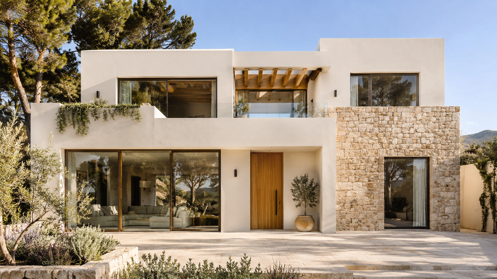 <small>14236036-ea00-48f6-89e7-9f75dcc2051e.png</small> | **V-02** 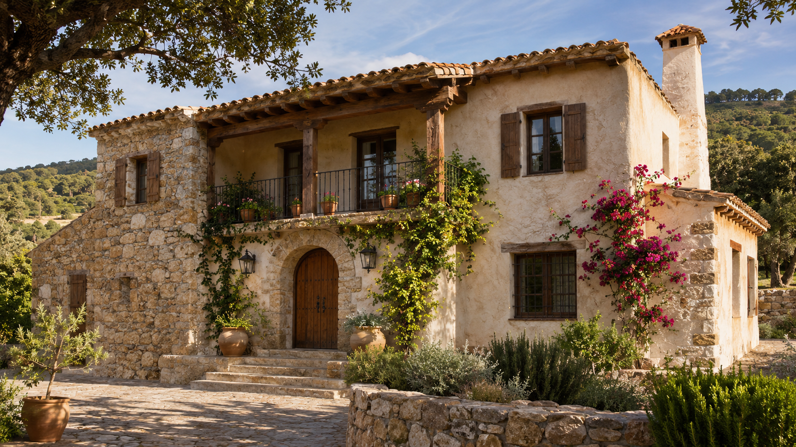 <small>2ce99dbf-6fd5-41be-b102-8cf184bd90db.png</small> | **V-03** 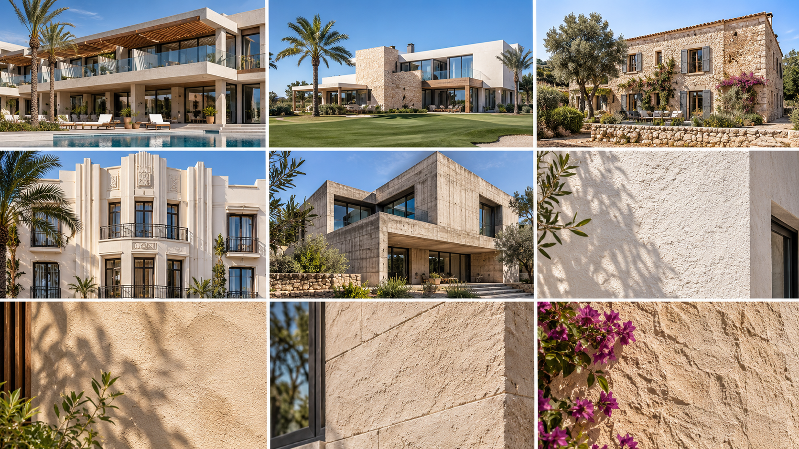 <small>3725ba05-4a35-433a-bb3d-983804406b06.png</small> |
| **V-04** 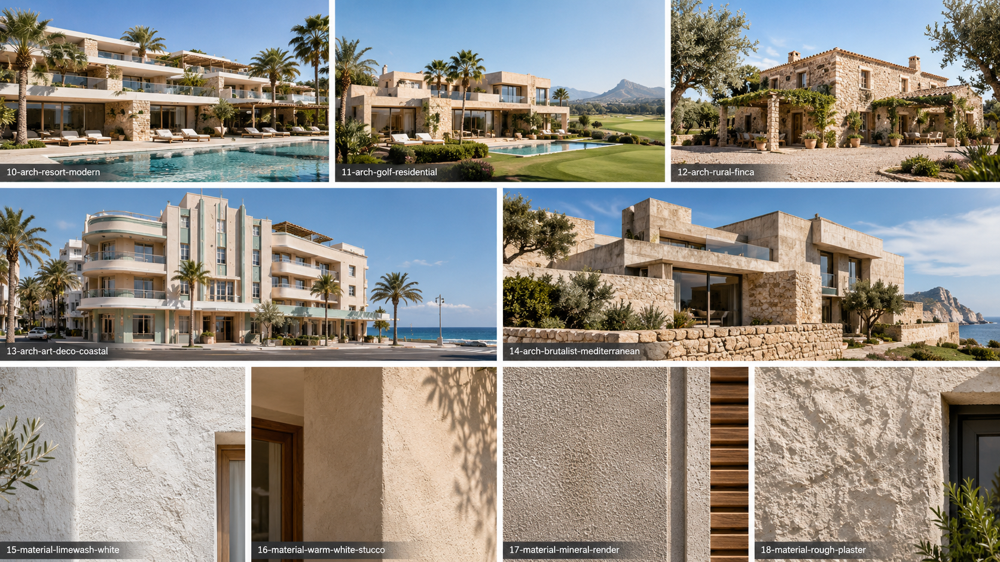 <small>52467fe7-2618-4034-a1b3-550f81036ed7.png</small> | **V-05** 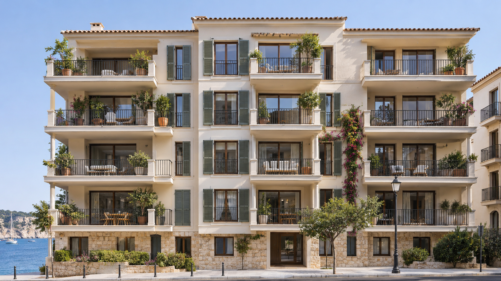 <small>88a2a672-6030-4e2d-9ddf-ffab022abae5.png</small> | **V-06**  <small>Catálogo Mediterráneo de Fachadas y Texturas.png</small> |
| **V-07** 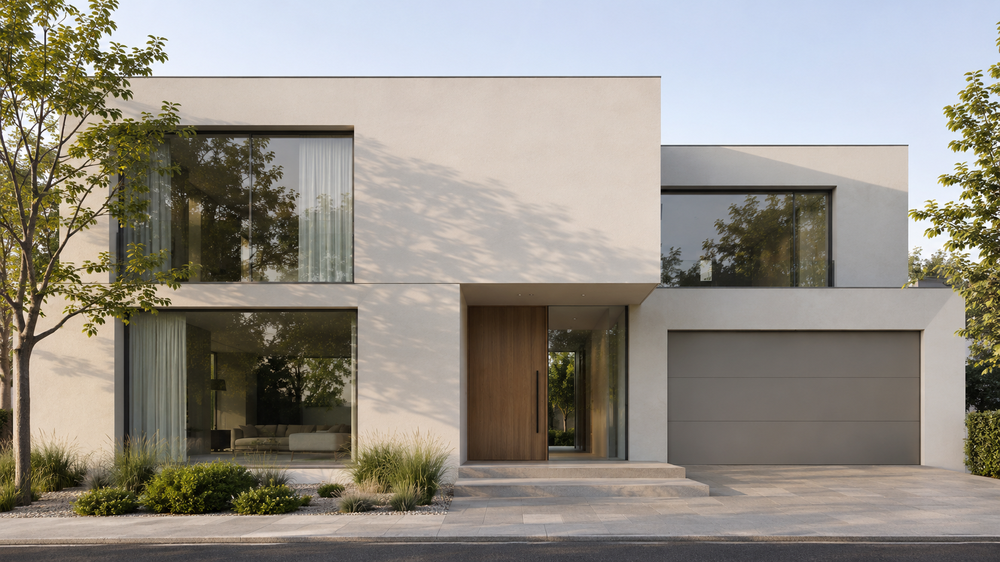 <small>a9ed6dc5-5200-46f2-88a7-e4af8b2927e2.png</small> | **V-08** 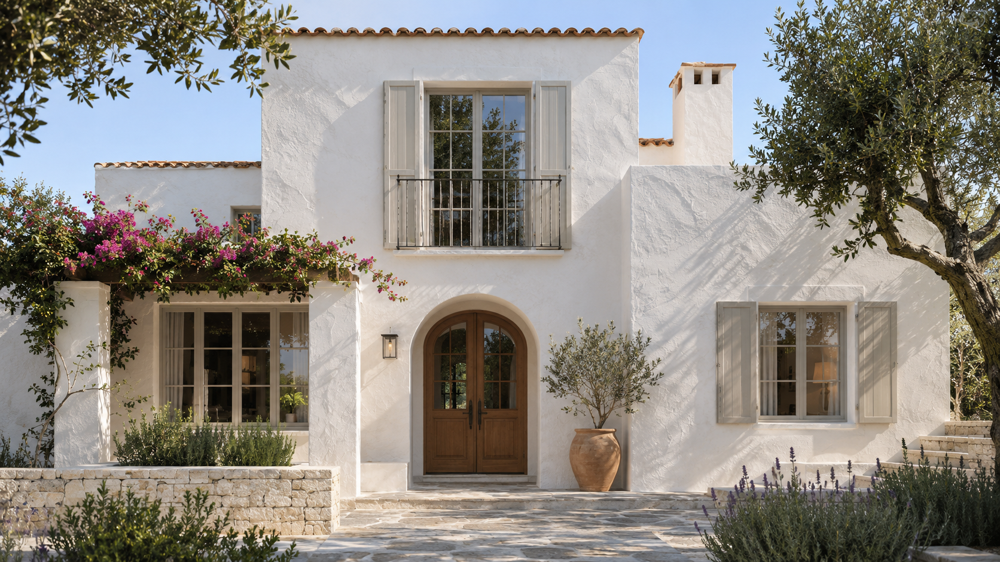 <small>c112f716-7a3f-44da-814b-f1bebc73bd79.png</small> | **V-09** 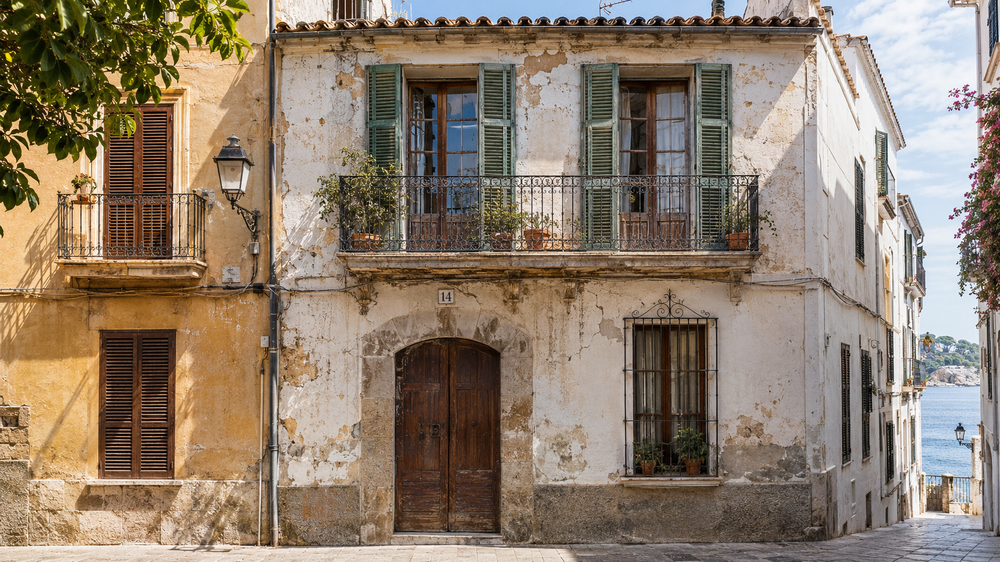 <small>cf411fa9-18fe-461f-a98f-16673356e2cb.png</small> |
| **V-10** 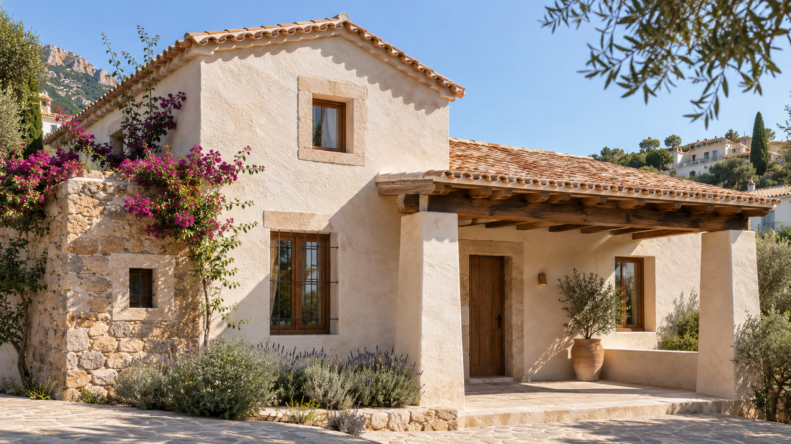 <small>d8ec669c-8b2d-4d60-89f6-60dfa71a56c1.png</small> | **V-11** 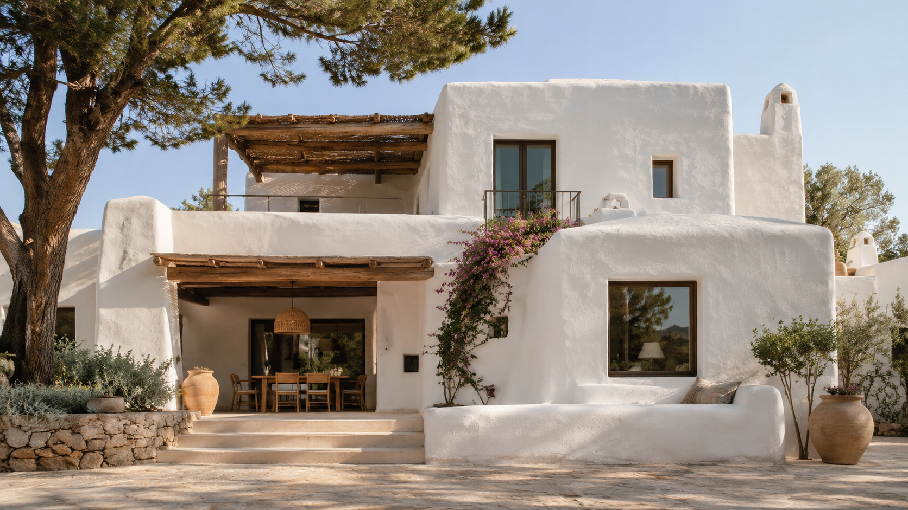 <small>dfb59322-707c-4dcb-84cd-5bed2d243b87.png</small> | **V-12** 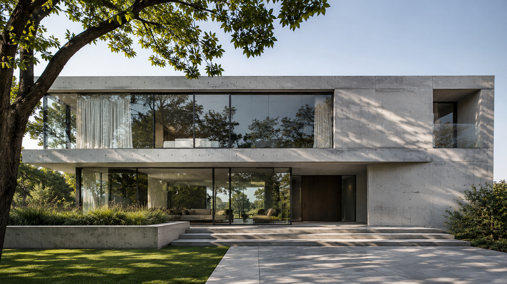 <small>fd9cfd61-fb5b-4c54-b406-64b2d02bbb27.png</small> |

**Advertencia de procedencia:** estos 12 PNG proceden de la carpeta de referencias aportadas por el usuario. No adjudicarles automáticamente licencia CC0 ni autoría arquitectónica; documentar el origen individual antes de cualquier distribución externa.

## 2. Materiales: 13 mapas de color, NO escenas arquitectónicas
| Familia candidata | Albedo real en GitHub | Estado PBR en esta rama | Uso orientativo |
|---|---|---|---|
| white_stucco | [`references/02-facade-materials/albedo-previews/white_stucco_diff_4k.jpg`](references/02-facade-materials/albedo-previews/white_stucco_diff_4k.jpg) | 4/4 canales fuente | Estuco mineral blanco exterior |
| white_rough_plaster | [`references/02-facade-materials/albedo-previews/white_rough_plaster_diff_4k.jpg`](references/02-facade-materials/albedo-previews/white_rough_plaster_diff_4k.jpg) | 4/4 canales fuente | Revoco blanco de grano visible |
| rough_plaster_03 | [`references/02-facade-materials/albedo-previews/rough_plaster_03_diff_4k.jpg`](references/02-facade-materials/albedo-previews/rough_plaster_03_diff_4k.jpg) | 4/4 canales fuente | Revoco artesanal rugoso |
| rough_plasterbrick_05 | [`references/02-facade-materials/albedo-previews/rough_plasterbrick_05_diff_4k.jpg`](references/02-facade-materials/albedo-previews/rough_plasterbrick_05_diff_4k.jpg) | 1/4 canales fuente | Revestimiento mineral con lectura de ladrillo |
| stacked_brick_wall | [`references/02-facade-materials/albedo-previews/stacked_brick_wall_diff_4k.jpg`](references/02-facade-materials/albedo-previews/stacked_brick_wall_diff_4k.jpg) | 1/4 canales fuente | Ladrillo apilado / aparejo |
| patterned_terracotta_tiling | [`references/02-facade-materials/albedo-previews/patterned_terracotta_tiling_diff_4k.jpg`](references/02-facade-materials/albedo-previews/patterned_terracotta_tiling_diff_4k.jpg) | 1/4 canales fuente | Aplacado cerámico terracota |
| coated_pine | [`references/02-facade-materials/albedo-previews/coated_pine_diff_4k.jpg`](references/02-facade-materials/albedo-previews/coated_pine_diff_4k.jpg) | 1/4 canales fuente | Revestimiento de pino tratado |
| dark_paneled_wood | [`references/02-facade-materials/albedo-previews/dark_paneled_wood_diff_4k.jpg`](references/02-facade-materials/albedo-previews/dark_paneled_wood_diff_4k.jpg) | 1/4 canales fuente | Panelado de madera oscura |
| white_oak_veneer | [`references/02-facade-materials/albedo-previews/white_oak_veneer_diff_4k.jpg`](references/02-facade-materials/albedo-previews/white_oak_veneer_diff_4k.jpg) | 1/4 canales fuente | Chapa de roble claro, no tablón |
| rounded_square_tiled_wall | [`references/02-facade-materials/albedo-previews/rounded_square_tiled_wall_diff_4k.jpg`](references/02-facade-materials/albedo-previews/rounded_square_tiled_wall_diff_4k.jpg) | 1/4 canales fuente | Revestimiento cerámico de módulos cuadrados redondeados |
| brown_floor_tiles | [`references/02-facade-materials/albedo-previews/brown_floor_tiles_diff_4k.jpg`](references/02-facade-materials/albedo-previews/brown_floor_tiles_diff_4k.jpg) | 1/4 canales fuente | Baldosa de suelo; contexto horizontal |
| cobblestone_floor_08 | [`references/02-facade-materials/albedo-previews/cobblestone_floor_08_diff_4k.jpg`](references/02-facade-materials/albedo-previews/cobblestone_floor_08_diff_4k.jpg) | 1/4 canales fuente | Adoquín de pavimento; contexto urbano |
| ganges_river_pebbles | [`references/02-facade-materials/albedo-previews/ganges_river_pebbles_diff_4k.jpg`](references/02-facade-materials/albedo-previews/ganges_river_pebbles_diff_4k.jpg) | 1/4 canales fuente | Grava / guijarros; terreno |

No se insertan los 13 albedos como imágenes gigantes en esta página (los JPG 4K suman 130.51 MiB). Los enlaces permiten consultar cada mapa sin descargar la colección completa.

## 3. Referencias de regresión F02 — baseline, NO nuevas referencias F03
- [F02: cobertura 12 ventanas, contacto OFF/V2](https://github.com/Juanmaes83/floorplan-3d/tree/docs/f03-facade-visual-references-v1/docs/qa/hero-fidelity-v2/evidence/coverage-12/off-v2-contact.jpg).
- [F02: fachada general](https://github.com/Juanmaes83/floorplan-3d/tree/docs/f03-facade-visual-references-v1/docs/qa/hero-fidelity-v2/evidence/coverage-12/v2-general.jpg).
- [F02: plano medio](https://github.com/Juanmaes83/floorplan-3d/tree/docs/f03-facade-visual-references-v1/docs/qa/hero-fidelity-v2/evidence/iteration-2/v2-medium.jpg).
- [F02: sistemas de carpintería](https://github.com/Juanmaes83/floorplan-3d/tree/docs/f03-facade-visual-references-v1/docs/qa/hero-fidelity-v2/evidence/systems/systems-contact.jpg).
- [F02: móvil](https://github.com/Juanmaes83/floorplan-3d/tree/docs/f03-facade-visual-references-v1/docs/qa/hero-fidelity-v2/evidence/lifecycle/mobile-contact.jpg).

Las anteriores son **evidencias técnicas**, no sustituyen las 36 escenas conceptuales del objetivo visual original.

## 4. Uso correcto por Kimi
1. Consumir el JSON y comprobar las rutas con `git ls-files`, sin descargar los ZIP locales ni modificar F02.
2. Etiquetar primero los doce PNG como escena completa / detalle / mosaico / dudoso / fuera de alcance; una imagen no etiquetada no se asigna a una familia visual.
3. Usar albedos únicamente como fuentes de materiales, enlazadas por un token semántico **propuesto**; ningún `MATERIAL.WALL.*` aparece aprobado como API de runtime.
4. Comparar renders F03 con F02 en D1, M1, M2, M3, G1 y fachada completa; preservar cámara, geometría, huecos y materiales realmente asignados.
5. Mantener intactos `js/visual-families-core.mjs`, `js/visual-families-adapter.mjs` y el contrato `F02/window-assembly@2` en la fase documental. F03 no ha ejecutado todavía pruebas de render ni aprobado dirección visual.

**Siguientes documentos:** [mapeo semántico](material-token-map.md) · [auditoría y pipeline PBR](pbr-audit-and-conversion.md) · [cobertura y pendientes](visual-coverage-and-gaps.md) · [handoff Kimi](KIMI-F03-HANDOFF.md).
