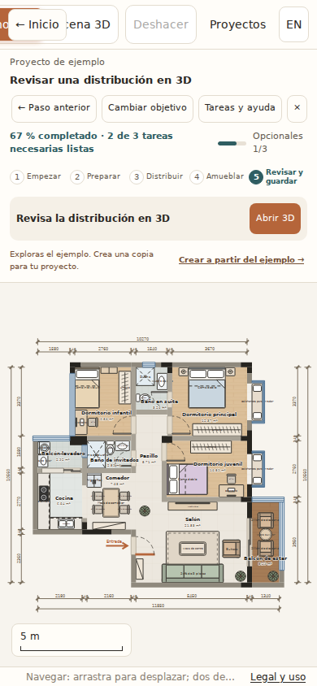
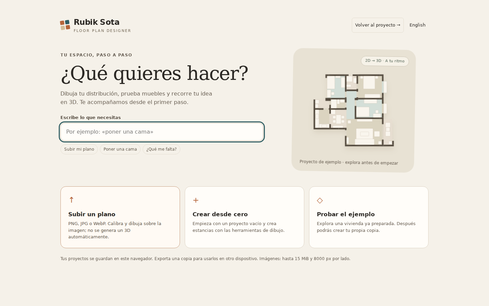

# Corrección de navegación — 13 de octubre de 2026

La entrada al editor no creaba historial de pantalla y la reapertura de la URL restauraba el editor automáticamente. «Inicio» quedaba al final de la barra móvil. Además, una tarea completada seleccionada para revisar podía avanzar automáticamente.

## Cambio

- Pantallas `#inicio` / `#editor` con Atrás y Adelante del navegador. URL base → bienvenida; recarga del editor → editor.
- «← Inicio» visible incluso con desplazamiento horizontal, y retorno explícito al proyecto desde la bienvenida.
- «← Paso anterior» y revisión manual persistente de tareas completadas.
- Cancelar/Escape desde primera estancia devuelve al inicio; Atrás cierra el diálogo sin aplicar una estancia.
- Pantalla, guía y documento son independientes. Los tests comparan el documento completo antes y después y verifican el progreso recuperado.

## Validación

- Reproducción inicial: fallo por ausencia de `#editor` al elegir el ejemplo.
- Navegación: 4/4 pruebas, en 1440×900, 390×844 y 844×390; sin errores JavaScript ni desbordamiento horizontal.
- Regresión de los cinco recorridos guiados: 5/5, incluyendo 3D, guardar/recargar, importación/calibración, búsquedas y cambio de objetivo.
- Node: 162 aprobadas, 0 fallos, 1 omitida (Blender externo).
- Las capturas muestran la barra móvil desplazada para comprobar que Inicio sigue accesible.

[Log de navegación](artifacts/guide-navigation/navigation-results.txt) · [Log de lógica/editor](artifacts/guide-navigation/core-results.txt) · [Regresión de recorridos](artifacts/guide-navigation/regression-results.txt).




## Reproducción

```bash
CHROME=/ruta/a/chromium node --test tests/guide-navigation.browser.test.cjs
```

QA con Playwright 1.62.1 y Chrome Headless Shell 151.0.7922.34. Móvil emulado; no representa rendimiento en dispositivos físicos. Esta corrección no modifica el schema del proyecto. Los proyectos siguen siendo locales al origen del navegador; una preview distinta tiene almacenamiento separado.
