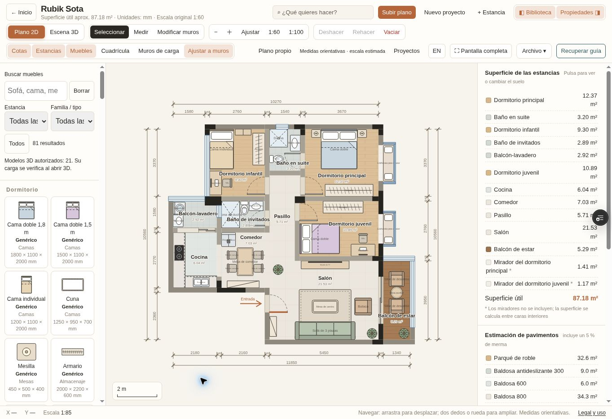
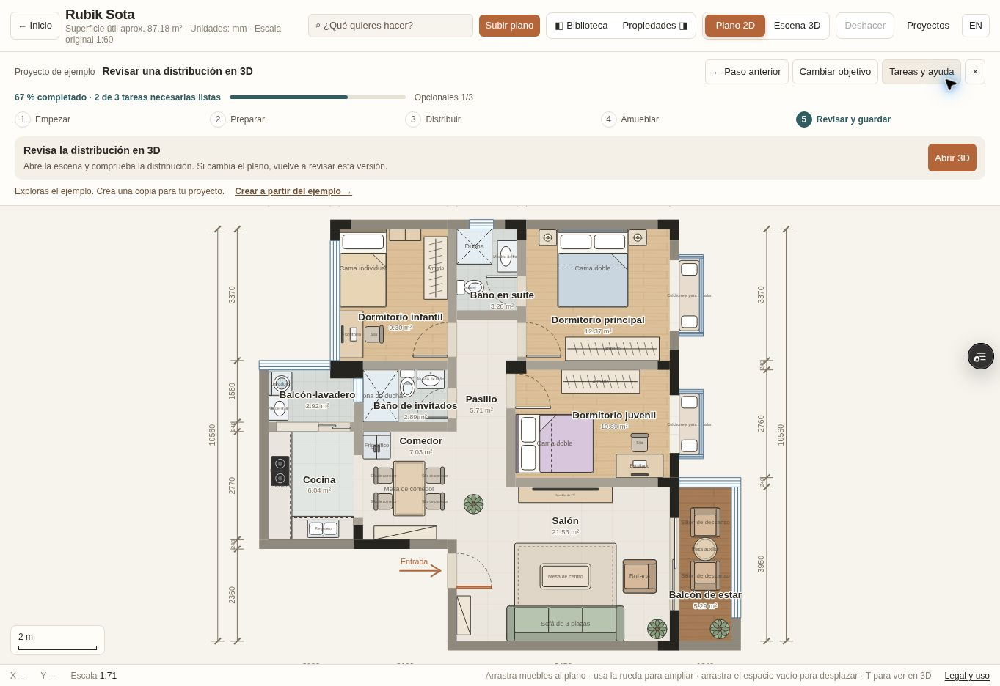

# PR #38 — revisión de correcciones, 13-10-2026

## Estado de cierre

**Correcciones publicadas; verificación integral pendiente.** Rama `feat/multiformat-guided-import`, código revisado `bff676abda6594be7a13d848f816ac5dae1aef8a`. La PR sigue en borrador, sin merge. Este informe y sus capturas no cambian el código de producto probado.

Las causas y correcciones de las nueve regresiones se detallan en [el registro de integración](multiformat-integration-2026-10-13.md#revisión-de-las-nueve-regresiones-de-pr-38). No se declara que las nueve pruebas hayan pasado: su suite completa todavía necesita una ejecución final.

## Evidencia disponible

| Comprobación | Resultado y límite |
| --- | --- |
| Unitarias sobre el checkout exacto `bff676a` | 176 aprobadas, 0 fallos, 1 omitida por Blender externo. Node 24.19.0, TMPDIR dentro del workspace. [Log completo](artifacts/pr38-review/unit-bff676a.log). |
| Sintaxis y documentación | guide-ui.js, editor/layout-fixture y guide.browser correctos; enlaces/anclas/tablas y diff correctos. |
| CI anterior `62ef50a` | Pasaron los tres recorridos ampliados de editor completo, recarga y recuperación. Una prueba de calibración quedó inestable; 25/26 recorridos y regresiones posteriores sin ejecutar. Se corrigieron las coordenadas tras estabilizar el layout. |
| CI final `bff676a` | [Importación/regresiones](https://github.com/Juanmaes83/floorplan-3d/actions/runs/38449725542) y [guía](https://github.com/Juanmaes83/floorplan-3d/actions/runs/38449725526) no llegaron a iniciar pasos. GitHub informa: “The job was not started because your account is locked due to a billing issue.” El relanzamiento de importación volvió a quedar bloqueado. |
| Chromium local | El Chromium 153 del paquete @sparticuz también termina antes de abrir una página, incluso con no-zygote/single-process. No constituye una ejecución de las suites de navegador. |
| Preview exacta `bff676a` | [Vercel](https://floorplan-3d-advd22ww1-juanma-espinosas-projects.vercel.app/) READY, deployment `dpl_3Ri9nAsTAa8AKwSk6aLXg5VYkKXL`. Acceso protegido verificado mediante enlace temporal; no se publica el token en el repositorio. |

## Revisión visible de la preview

Navegador remoto, viewport de escritorio 1363×936. No es emulación móvil ni medición de rendimiento físico.

- Bienvenida → ejemplo → Tareas y ayuda → Todas las herramientas: la guía se oculta y aparece Recuperar guía. El stage ocupa 765,25 px (81,76 % del alto); no hay desbordamiento horizontal.
- Recargar conserva el editor completo y las 13 estancias/46 muebles del ejemplo.
- Recuperar guía vuelve a mostrarla con progreso 67 %, sin alterar esos elementos. La captura se tomó después de observar el layout final, con barra de 210 px y el botón Recuperar guía oculto.
- Importación real del fixture `vivienda-dos-estancias.dxf`: mensaje de cinco muros con grosor medido, dos puertas, una ventana y dos estancias; plano con dos estancias y cero muebles. La guía muestra 75 %, mantiene la revisión 3D pendiente y no hereda su evidencia.
- Proyectos permite reabrir el ejemplo con 13 estancias y 46 muebles, y regresar al DXF con sus dos estancias. Inicio y Volver al proyecto mantienen el DXF abierto.
- Exportar copia JSON/ZIP produjo un evento de descarga para el DXF. No se acredita aquí comparación de bytes de esa descarga.

## Pendiente para declarar lista la PR

1. Restaurar la disponibilidad de GitHub Actions en la cuenta, o ejecutar la suite completa en otro entorno Chromium compatible.
2. Ejecutar los workflows contra el HEAD vigente y confirmar las nueve regresiones, la calibración guiada y los artefactos finales.
3. Revisar móvil vertical/horizontal y 3D del mismo código; no sustituir esa evidencia por READY ni por las capturas de escritorio.
4. Registrar resultados y completar la aprobación humana antes del merge.

F2 sigue experimental; no cambia FloorPlanProjectV1, sus unidades, los proyectos existentes ni el alcance de #21/#36. No se modificó facturación, protección de Vercel ni producción.
