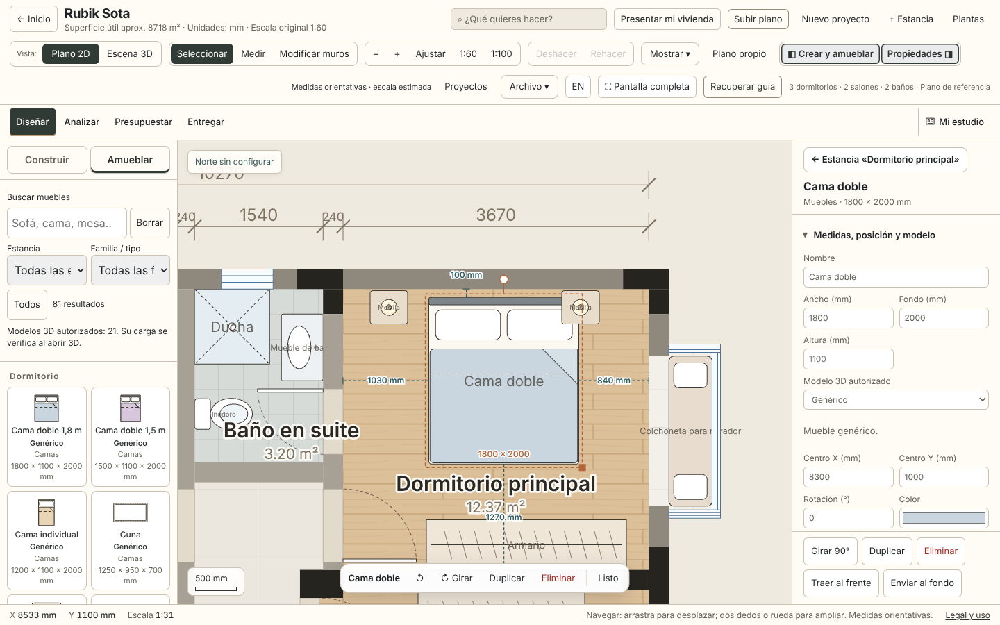
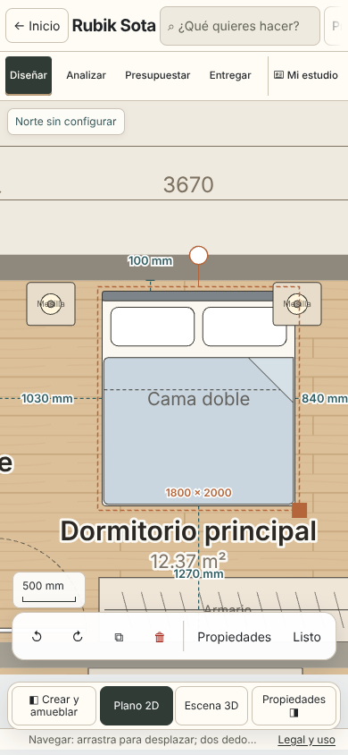

# UX-08 · Cotas en vivo al mover muebles (ola 2, corte 2c)

**Base:** `master@f119f1bbec4e3b3ee66a64c5e3aa2c7a6e4d72af`, con R03 ya integrado (#222). El enfoque es el de la auditoría M10 (`docs/product/auditoria-4-pdf-referencias-ui-ux-2026-11-09.md`): rayos ortogonales desde la huella orientada del mueble, con la misma geometría que `layout-review`.

## Qué ve la persona

Al **arrastrar** un mueble en el plano 2D, con ratón o con el dedo, aparecen a cada lado una línea discontinua y una cifra en milímetros con el espacio libre hasta el límite de la estancia. Las cifras cambian mientras se arrastra y desaparecen al soltar.

**Con las flechas del teclado** se ven durante 1,4 s después de cada paso y se ocultan solas.

No hay botones ni paneles nuevos.

| Escritorio, 1440×900 | Móvil, 390×844 (táctil) |
|---|---|
|  |  |

## Qué mide cada cota

**Para cada lado de la huella orientada**, el rectángulo girado (la misma que `FloorPlanTracing.footprint`, `layout-review` y R03), la cifra es **cuánto podría avanzar ese lado, en su perpendicular, antes de tocar el primer límite**.

- Los **límites** son el contorno de la estancia que contiene el mueble y las caras de los muros no demolidos, así que un tabique interior también cuenta.
- Se toma el **mínimo a lo largo de todo el lado**, no solo desde su centro. En una estancia en L la cifra es el hueco real más estrecho, no el de la caja de la estancia.
- La línea se dibuja donde está ese mínimo. Si el hueco es igual en todo el lado, se dibuja en su centro; en el lado del asa de giro, a un cuarto, para no taparla.
- Las cifras son **milímetros enteros del proyecto**; el zoom solo cambia el tamaño del dibujo.
- Junto a un muro se ve **«0 mm»**.

**Cuándo no hay cifra.** No se inventa ninguna. En vez de cotas se muestra una línea «Sin cotas: …» cuando el mueble:
- no está dentro de una estancia;
- está en dos estancias que se solapan;
- sale de su estancia;
- invade un muro;
- tiene medidas no válidas.

Un lado sin ningún límite delante tampoco tiene cota.

**Qué no es:**
- **No mide hasta otros muebles.** Lo hace `layout-review` con su holgura.
- **No es una anchura de paso certificada** ni una comprobación de accesibilidad o normativa.

## Cómo está construido

| Archivo | Papel |
|---|---|
| `js/live-dimensions-core.js` | Núcleo puro: `measure(geometry, piece)`. Sin DOM, red ni almacenamiento; no muta nada |
| `js/live-dimensions-ui.js` | Marcado SVG. Las cifras no tapan las asas de giro y tamaño, y si se saldrían de la pantalla se deslizan por su línea. Además, gestiona la aparición tras las flechas |
| `index.html` (+5 líneas) | Carga de los dos scripts **antes** del bloque R03 (su orden autorizado no cambia), una línea en `renderSel` y una llamada en el manejador de las flechas |

**Se reutiliza, sin cambios:**
- la geometría del proyecto (`FloorPlanCore.geometry`: estancias y muros);
- la convención de huella de `tracing-core`;
- el arrastre, `snapMove` y la rejilla;
- `renderSel` y la capa `#gSel`.

**Por qué en `#gSel`:** las dos exportaciones del plano (lámina, `sheet-ui.js`, y PNG, `index.html`) ya vacían esa capa. Las guías nunca llegan a una captura ni a un entregable, sin tocar ninguna exportación.

**Nada se guarda:**
- el esquema `FloorPlanProjectV1` no cambia;
- no hay propiedades ni extensiones nuevas;
- el movimiento se guarda igual que antes, con un paso de deshacer por arrastre o por flecha;
- la herramienta de medir y las reglas de colocación no cambian;
- no hay red ni IA.

## Pruebas

| Suite | Qué acredita |
|---|---|
| `tests/ux08-live-dimensions.test.cjs` (7) | Estancia rectangular con el mueble alineado, girado (contraste por fuerza bruta con rayos, también en L), estancia en L y tabique, junto a un muro, los casos sin cota, independencia del zoom y solo lectura con el proyecto de ejemplo |
| `tests/ux08-live-dimensions.browser.test.cjs` (3) | Editor real a 1440×900 con ratón, 390×844 y 820×1180 con **táctil real**. Comprueba que las cifras cambian al arrastrar y coinciden con el núcleo, que no capturan el puntero, que la posición sigue siendo la de `snapMove` y que al soltar no queda nada y hay un paso de deshacer. También deshacer y rehacer, que el proyecto y el almacén guardados no llevan nada visual, otro zoom, un armario R03 con interior (cotas, interior intacto), las flechas (aparecen y se ocultan) y que no hay errores ni desplazamiento horizontal |

## Límites

- Pruebas con Chromium de Playwright, sin dispositivos físicos. La legibilidad en un teléfono real necesita el visto bueno del propietario.
- Si se aleja mucho el zoom, una cifra que taparía un asa se omite: antes sin cifra que encima de un control.
- Las cotas se calculan contra la planta activa. En edificios de varias plantas no se miran otras plantas.
