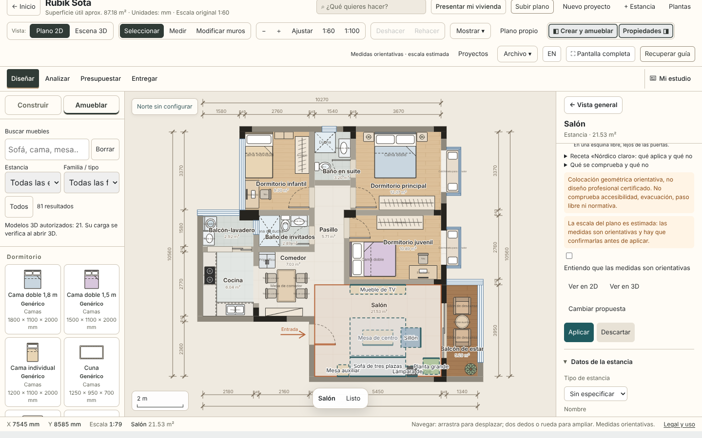
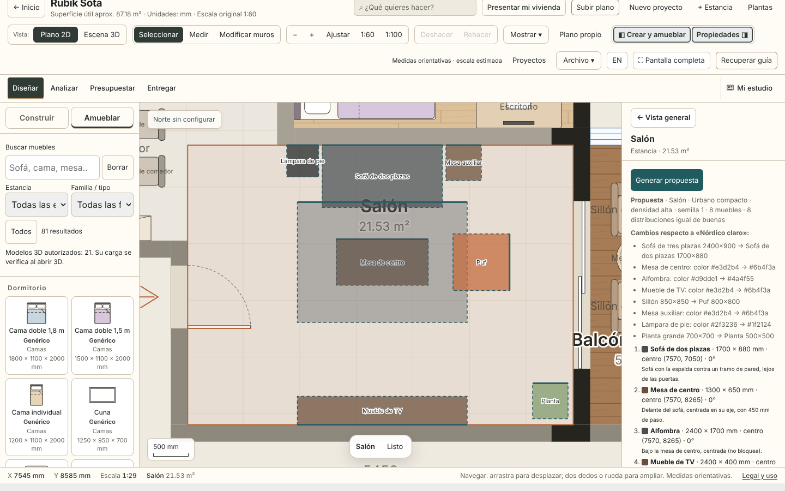
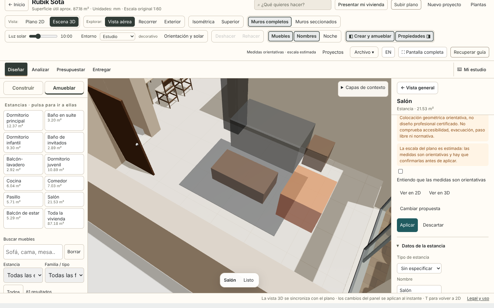
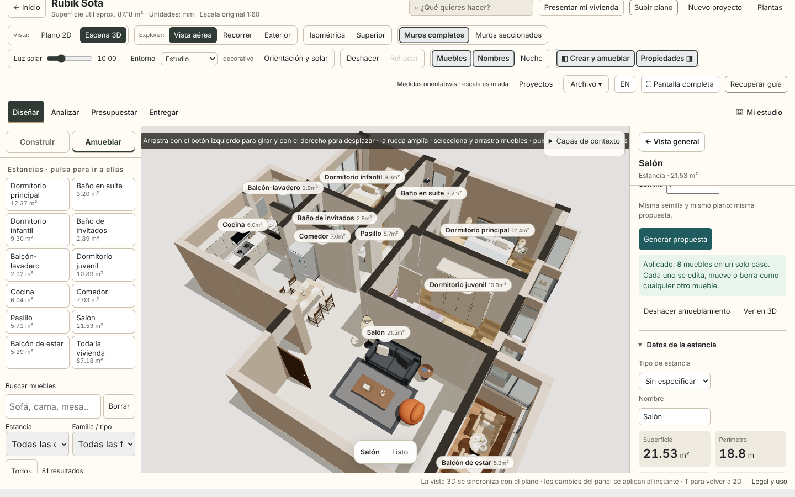
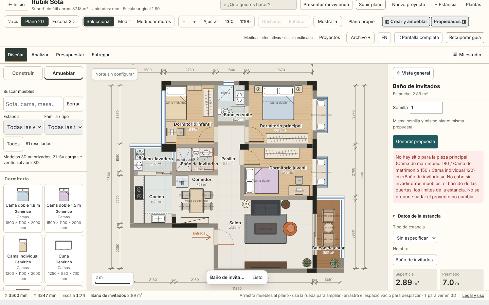
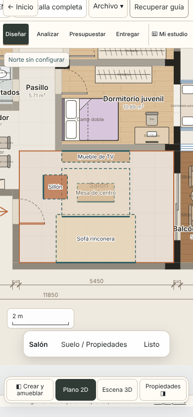
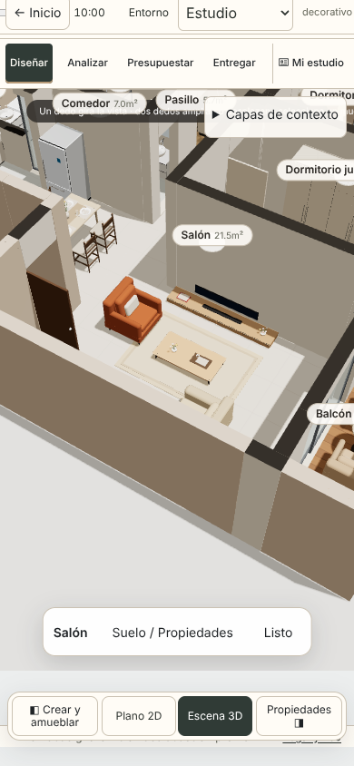

# UX-12 + UX-13 · Amueblamiento inteligente V1 (ola 3)

**Base:** `master@c8021fcfb27d02d8577e9520c47950a97c7b434c`, que ya incluye R03 (#222), R02-A (#223) y UX-08 (#224).

**Qué es:** una propuesta de amueblamiento **por estancia**, geométricamente válida y reproducible, que se revisa en 2D y en 3D antes de guardarse. Se aplica en un solo paso que se puede deshacer, y después cada mueble se edita como cualquier otro.

## Recorrido

| Paso | Dónde |
|---|---|
| Seleccionar una estancia en el plano 2D | Panel de la estancia → **«Amueblar esta estancia»** (primer grupo del panel) |
| Configurar | **Uso real declarado** (salón, dormitorio, comedor, despacho), **densidad** (baja, media, alta), **receta de estilo**, **semilla** |
| **Generar propuesta** | Lista de piezas con medidas, centro y giro en mm, la regla que la coloca, piezas descartadas y por qué, muebles existentes respetados |
| **Ver en 2D / Ver en 3D** | 2D: vista previa en `#gSel`, que la lámina y el PNG ya vacían. 3D: cajas translúcidas en una capa propia. En el móvil, «Ver en 2D» retira el panel para dejar el plano a la vista |
| **Cambiar propuesta** / cambiar receta | La semilla siguiente da otra distribución igual de buena. Al cambiar de receta, el panel enumera las diferencias |
| **Aplicar** | Con escala estimada, primero hay que confirmar que las medidas son orientativas. Todo se valida otra vez y se guarda en un paso del commit de RUBIK |
| **Descartar** | El proyecto queda idéntico |
| **Deshacer** | Un paso revierte el conjunto entero; rehacer lo devuelve |

Generar, cambiar de receta, ver en 2D/3D y descartar **no modifican el proyecto**: ni los datos, ni lo guardado, ni el historial.

## UX-12 · Motor de amueblamiento (`js/smart-furnishing-core.js`, puro)

- **Geometría:** mm del proyecto y polígonos reales de la estancia (también en L). Usa la huella orientada de `FloorPlanTracing`.
- **Validación de cada pose:** `FloorPlanPlacement.problemsIn`. Comprueba la estancia completa, la escalera y su hueco, los muros, el barrido de las puertas, y los muebles existentes y los ya propuestos. Además, el centro de la pieza debe caer solo en esa estancia.
- **Al aplicar:**
  - se comprueba que el proyecto no ha cambiado desde la propuesta;
  - se valida otra vez cada objeto (enteros, medidas positivas, giro 0–359, color hexadecimal, id nuevo);
  - el conjunto pasa por `FloorPlanLayoutReview`: sin solapes ni contacto con la hoja de una puerta para ningún mueble nuevo;
  - el resultado debe cumplir el contrato completo.

  Todo o nada.
- **Reglas de composición:**
  - sofá contra la pared, con mesa de centro delante a 450 mm, alfombra debajo, mueble de TV en la pared de enfrente, en su eje, y butaca o puf a un lado;
  - cama con el cabecero contra la pared y mesillas a los lados;
  - mesa con sillas alrededor (2, 4 o 6 según la densidad; la mesa redonda admite cuatro);
  - escritorio con su silla delante.

  Para el ancla se evalúan varias poses: tramos largos, centradas y lejos de las puertas. Se elige la composición más completa. **La semilla solo decide entre composiciones igual de buenas.**
- **Muebles existentes:** nunca se mueven ni se sustituyen. Si ya hay un sofá, ese sofá es el ancla, y un tipo que ya existe no se repite.
- **Sin propuesta, con motivo:**
  - estancia inexistente, ambigua (solapa otra estancia) o sin sitio para la pieza principal;
  - escala sin calibrar;
  - uso sin declarar o sin programa en V1;
  - receta no válida o piezas que no existen en el catálogo;
  - nada que añadir.
- **Qué no es:** es colocación geométrica, no diseño profesional certificado. **No comprueba accesibilidad, evacuación, paso libre, altura ni normativa**, y el panel lo dice.

## UX-13 · Recetas de estilo

| Receta | Piezas (con alternativa si no cabe) | Paleta |
|---|---|---|
| **Nórdico claro** | Sofá de 3 plazas, sillón, planta grande, cama de 180, armario de 200, mesa de 180 | Maderas claras, textiles gris y blanco, acento azul niebla |
| **Urbano compacto** | Sofá de 2 plazas, puf, mesa redonda, cama de 150, armario de 120 | Nogal, grafito y acento cobre |
| **Mediterráneo cálido** | Rinconera (si no cabe, sofá de 3 plazas, y lo dice), butacas, mesa de 180 | Miel, arena y terracota |

- **Qué cambia:** las piezas, sus medidas y el color de cada mueble, en el campo canónico `color`. Se ve en el 2D y en el 3D.
- **Qué declara que no aplica:**
  - el suelo, que en V1 no se cambia;
  - los modelos 3D comerciales, porque BIB-01 está pendiente;
  - textiles y decoración, porque no hay recursos.
- **Comparación automatizada:** entre cualquier par de recetas en el salón y el dormitorio hay diferencias en datos y en el dibujo. Una receta que solo cambia el nombre no produce ninguna diferencia, y la prueba lo detecta.

## Datos y catálogo

- **Solo piezas del catálogo genérico de RUBIK** (`js/generic-catalog.js`, medidas de diseño, no productos medidos). Ningún `assetRef` ni modelo comercial.
- **BIB-01 sigue abierta:** este corte no la cierra.
- **Datos de prueba sintéticos:** el piso de ejemplo de RUBIK. La grabación abre `tests/fixtures/smart-furnishing-demo.json`, que es el mismo piso con el salón vacío.
- **Sin servicios externos, sin IA y sin coste.**

## Pruebas

| Suite | Qué acredita |
|---|---|
| `tests/smart-furnishing.test.cjs` (17) | Reproducibilidad y ausencia de cambios al generar. Semillas distintas dan distribuciones distintas. Estancia en L. Estancia pequeña. Barrido de puerta. Estancia ambigua. Escala estimada y sin calibrar. Uso. Muebles existentes. Armario R03 (`x-r03-cabinet` intacto). Techo R02-A (`x-r02a-ceiling` intacto). Cotas UX-08. Aplicar atómico y sin duplicados. Proyecto cambiado. Negativos: dimensiones, muro, id. Recetas en datos y dibujo, y la receta que solo cambia el nombre. Recursos no disponibles. Densidad. **Las posiciones finales las comprueba `tests/smart-furnishing/verify.cjs`, independiente del motor.** |
| `tests/smart-furnishing.browser.test.cjs` (4) | Editor real: flujo completo en escritorio (generar, receta, 3D, exportaciones, descartar, aplicar, editar una pieza, cotas al arrastrar, deshacer, rehacer, reabrir). Rechazo legítimo. Convivencia R03 + R02-A. Móvil 390×844 con toques reales. |
| `scripts/qa/record-smart-furnishing.cjs` | Dos vídeos del flujo real, capturas y `manifest.json`, con comprobaciones en cada paso. |

## Límites conocidos

- Usos con programa en V1: salón, dormitorio, comedor y despacho. Cocina y baño se rechazan con un mensaje.
- El historial de deshacer de RUBIK es de la sesión: tras recargar no se puede deshacer lo aplicado antes, pero los muebles siguen y se borran uno a uno.
- Pruebas con Chromium de Playwright, sin dispositivos físicos.

## Evidencias

**Capturas** del flujo real (generadas por `scripts/qa/record-smart-furnishing.cjs`):

| | |
|---|---|
|  Propuesta «Nórdico claro» en 2D, con cifras y reglas |  Cambio a «Urbano compacto»: diferencias enumeradas |
|  La propuesta en 3D antes de aplicar (cajas translúcidas) |  Aplicada: muebles reales del editor en 3D |
|  Rechazo legítimo: no cabe, nada cambia |   Móvil 390×844 táctil |

**Vídeos** (escritorio 1440×900 y móvil 390×844), **todas las capturas** y **`manifest.json`**:
- se suben como artefacto `smart-furnishing-<SHA>` del workflow *UX-12 + UX-13 smart furnishing*;
- no se guardan en el repositorio.

**Qué registra el manifiesto:**
- HEAD y versión de Chromium;
- resolución de cada vídeo;
- cada paso con su resultado;
- duración y tamaño medidos con `ffprobe`;
- errores de consola y fallos de red;
- los eventos del propio panel, que prueban que la propuesta y la aplicación salieron de los clics.
