# F03 V2 - Evidencias para revision visual humana

Estado: TECHNICALLY_TESTED_PARTIAL_VISUAL_ACCEPTANCE (aprobacion de muestra, NO de sistema completo)

Codigo probado: dd9c26ff47da38a2e1672121d55cf8c4ccd07f98

Pruebas comunicadas:
- Unitarias F02/F03 V1/F03 V2: 10/10 PASS
- Chromium F03 V2 A/B/C: 1/1 PASS
- 42 capturas WebP y 3 manifiestos

A = F02 OFF / F03 OFF
B = F02 ON / F03 OFF
C = F02 ON / F03 V2 ON

## Estuco aprobado V1, ampliado en V2

| A | B | C |
|---|---|---|
|  | 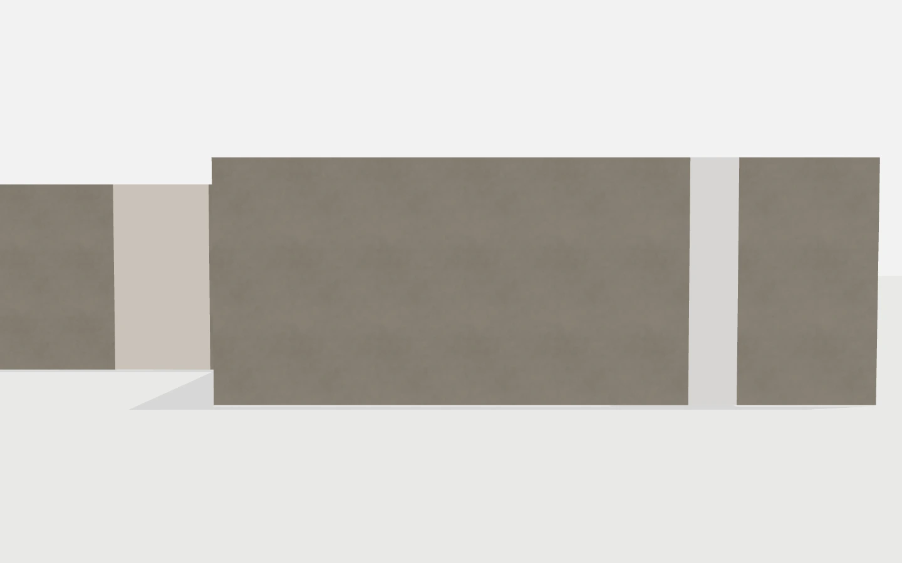 | 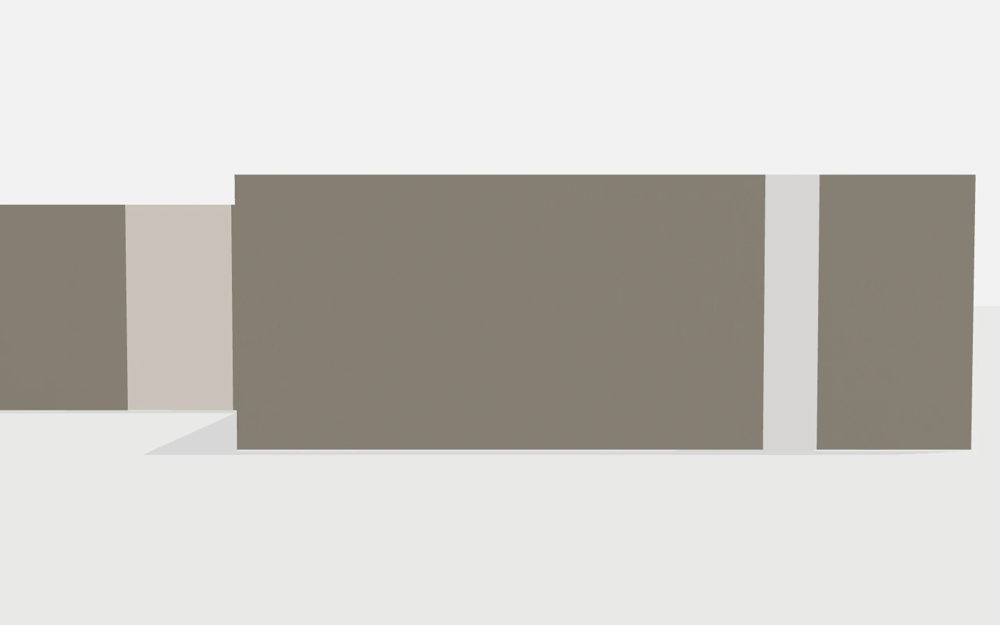 |
| 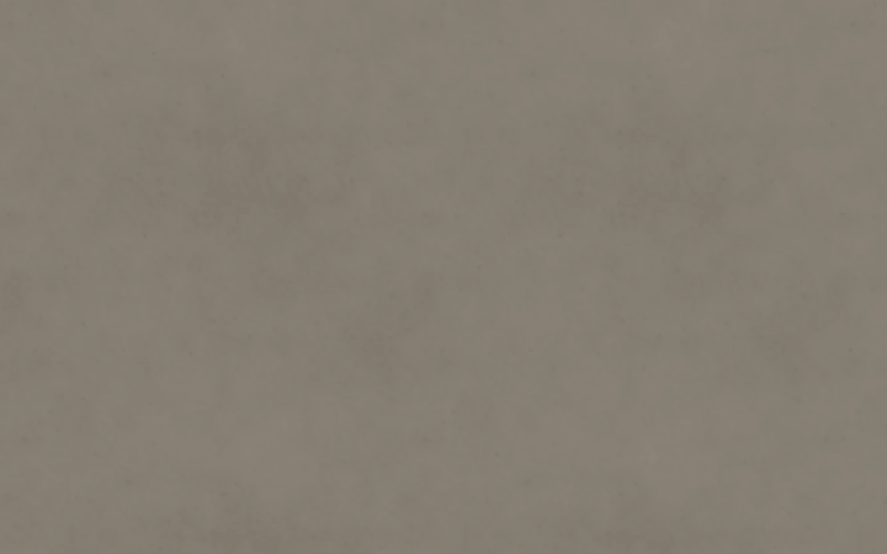 |  | 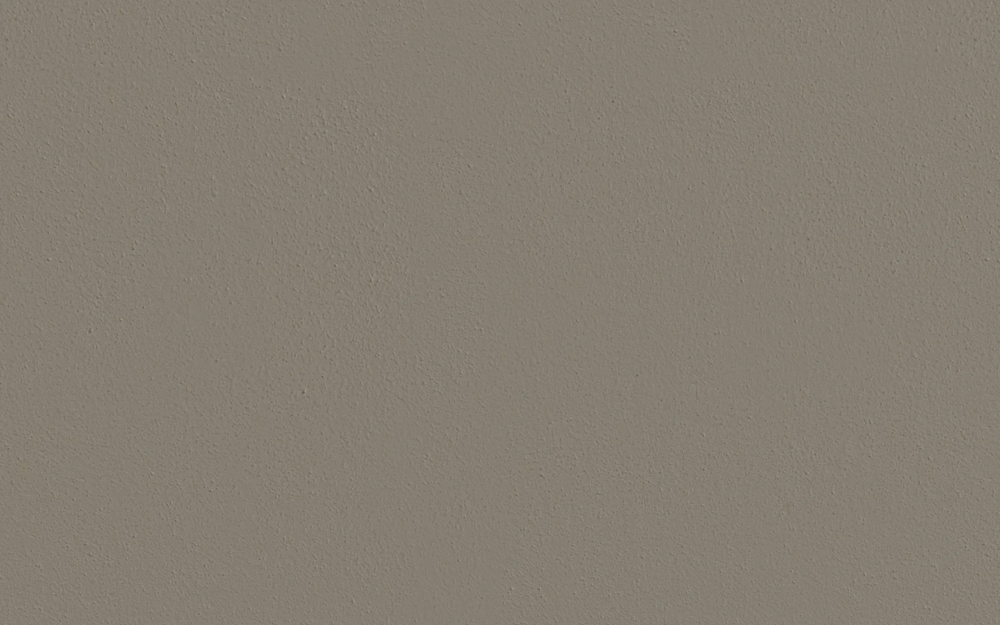 |
| 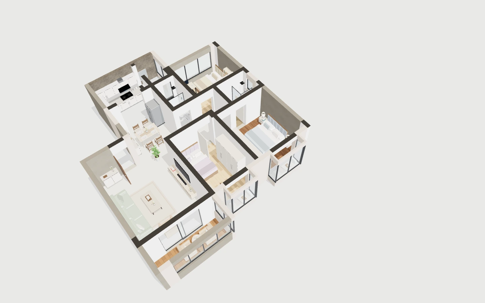 |  | 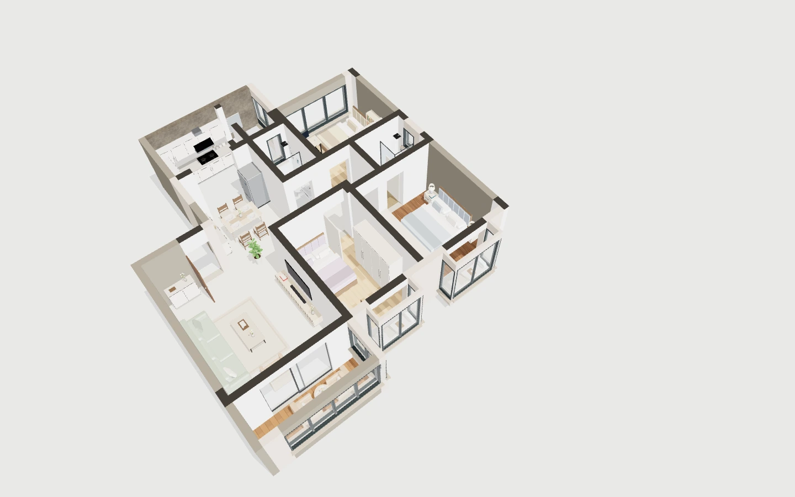 |

[Manifest estuco](stucco/manifest.json)

## Revoco rough_plaster_03 - ejemplo aprobado visualmente

| A | B | C |
|---|---|---|
|  | 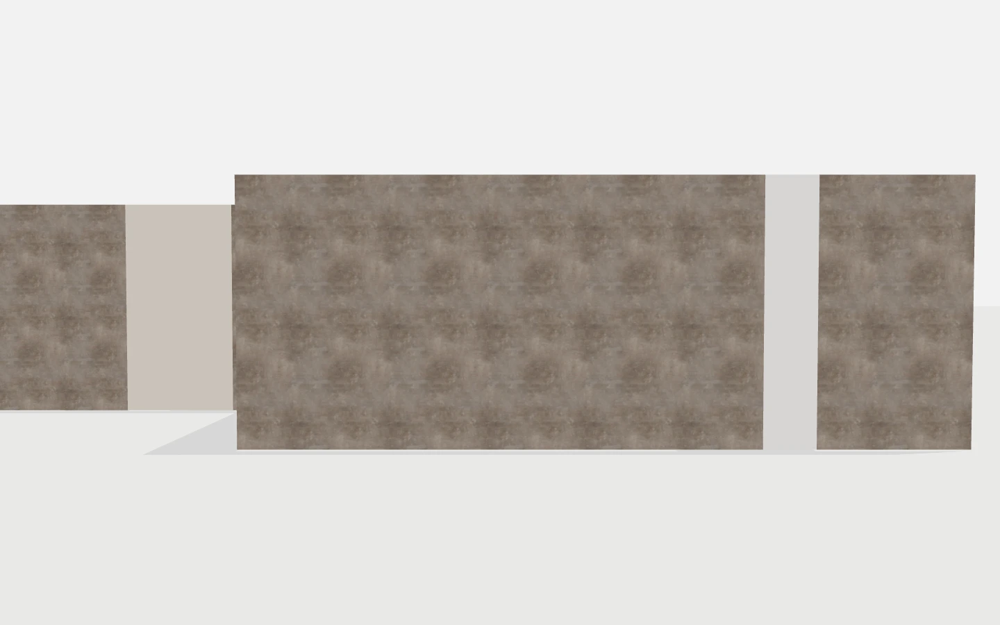 | 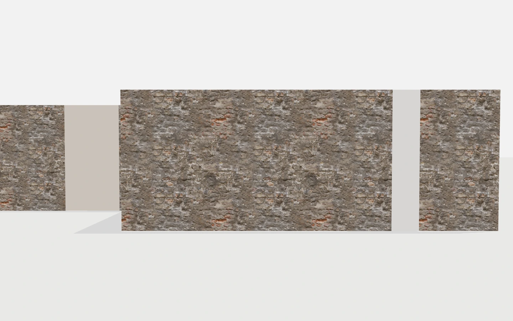 |
| 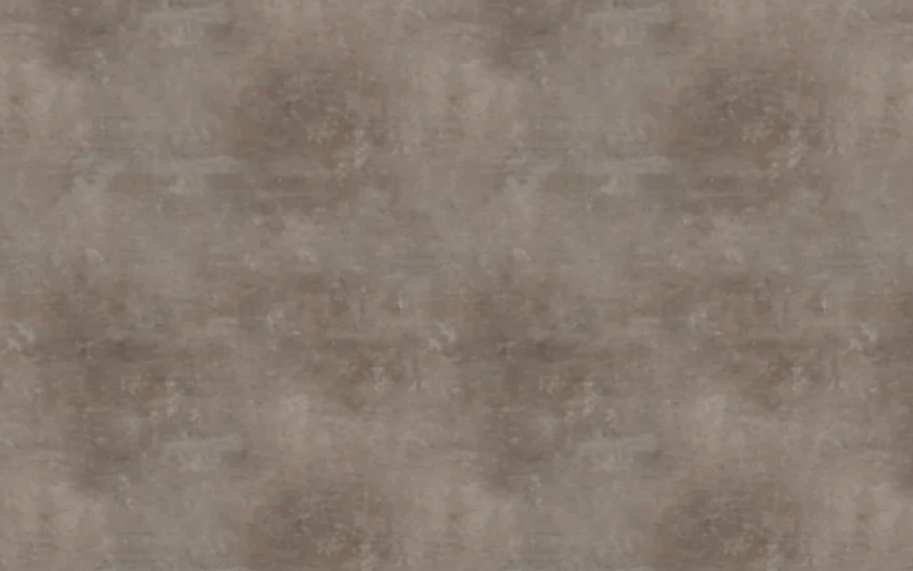 |  | 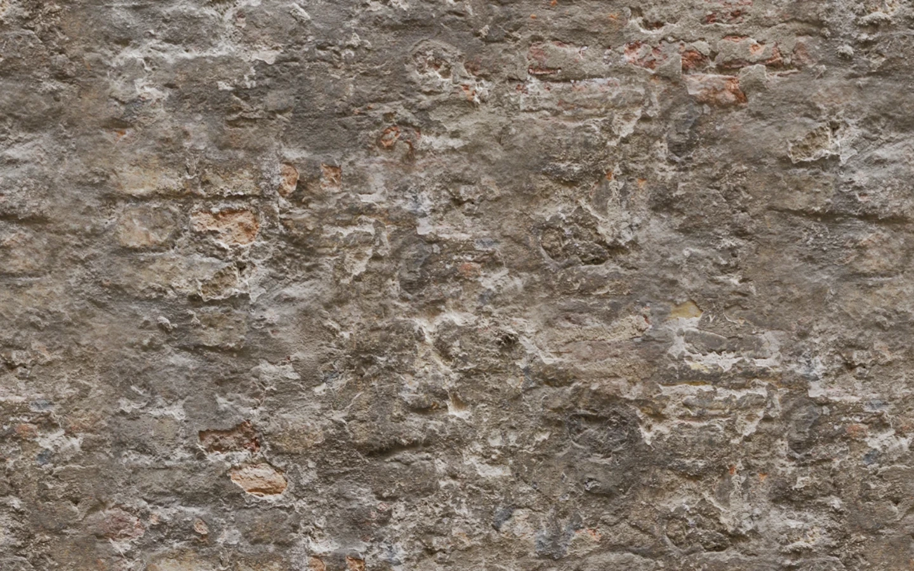 |
|  |  | 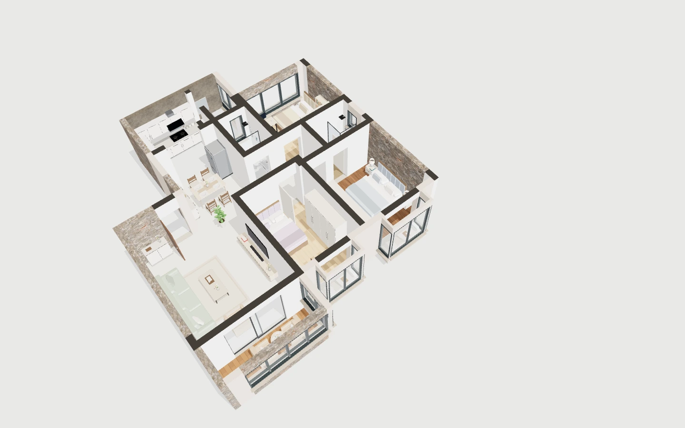 |

[Manifest revoco](rough/manifest.json)

**Decision humana:** El tratamiento visual `rough_plaster_03` de estas capturas ha sido aprobado como el ejemplo mas conseguido, y es el **referente preferido** para elevar el realismo de otros acabados. La prioridad es **transferir la METODOLOGIA EXPERIMENTAL** a otros materiales/referencias conservando su identidad, NO aplicar este mismo revoco a todas las superficies ni habilitarlo por defecto. La variante conserva opt-in y compatibilidad semantica.

[Decision y siguiente mision](../../../F03-V2-DECISION-METODOLOGIA-Y-SIGUIENTE-MISION-2026-11-05.md)

## Movil emulado - estuco

| A | B | C |
|---|---|---|
| 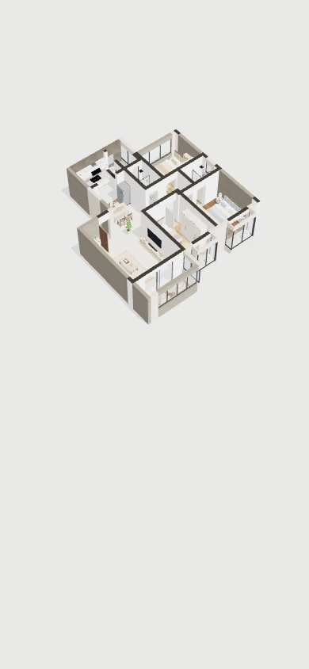 | 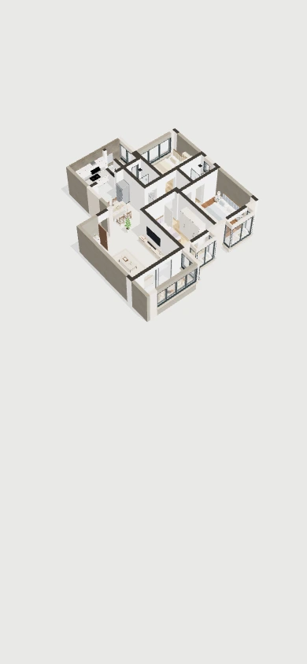 | 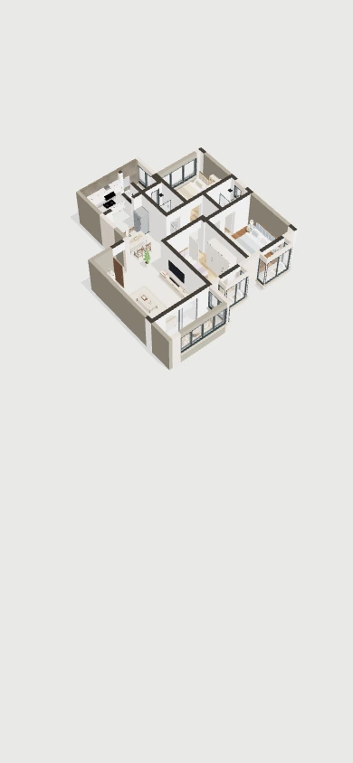 |
| 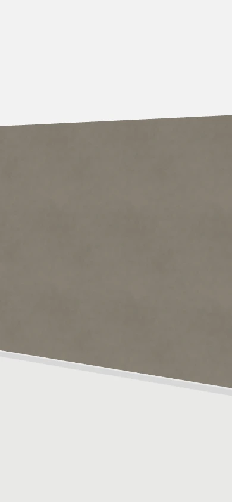 |  | 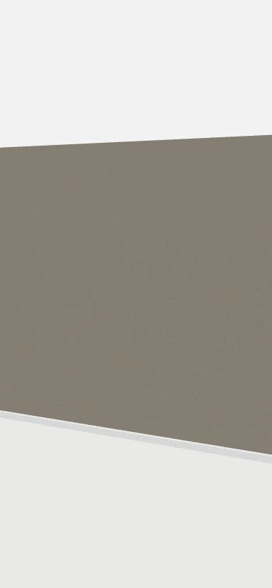 |

[Manifest movil](stucco/mobile/manifest.json)

## Limitaciones

- La muestra `rough_plaster_03` fue aprobada visualmente, pero **NO** toda F03 V2 ni todas las fachadas.
- **Falta fachada completa a escala humana** con ventanas F02, varios paños compatibles, esquinas y encuentros reales.
- Las capturas moviles de 390x844 no son adecuadas para validacion arquitectonica (vista cenital muy alejada o plano aislado); falta encuadre exterior legible y paisaje 844x390.
- Sin prueba en movil fisico.
- La memoria GPU es estimada.
- PASS de Chromium no acredita calidad arquitectonica.
- La proxima mision traslada el metodo PBR experimental a OTROS referentes materiales compatibles, no replica la textura de revoco.
- F04 y F05 no forman parte de esta entrega.
- No merge. No deploy. No activacion por defecto.
