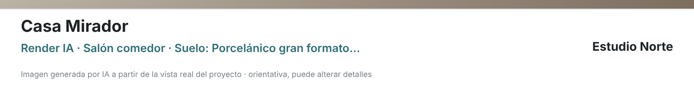
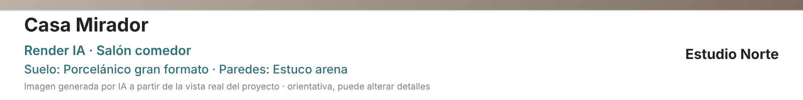

# RENDER AI D1 · PR-3 — IMG-01: acabados truncados en la imagen exportada

**Estado:** candidata en PR borrador. No está fusionada ni promocionada. No se ha hecho ninguna llamada al proveedor.

## Defecto y causa

Al descargar un render IA con alternativas de acabado, la banda de la imagen cortaba el texto. Por ejemplo, «Suelo: Porcelánico gran formato…» y desaparecían las paredes.

Había dos causas que se sumaban:
1. `FloorPlanDeliveryImage.content()` limita la línea `view` a **60 caracteres**. El render metía en ella «Render IA · estancia · Suelo: … · Paredes: …».
2. Las tres maquetaciones dibujan `view` en **una sola línea** con `fit()`, que recorta con «…».

## Corrección

- `content()` acepta un campo opcional **`detail`**, con un máximo de 140 caracteres. El Render IA pone ahí los acabados; la vista queda como «Render IA · estancia».
- **Banda** (la que usa la descarga del render): los acabados tienen su propia línea. Los datos de superficie solo se le añaden si caben enteros.
  - El render no envía superficie, así que ahí no se pierde nada.
  - El bloque de texto sube ligeramente para no pegarse a la nota.
- **Cabecera:** los acabados ocupan la línea de datos del pie y, si no caben, pasan a dos líneas.
- **Columna lateral:** los acabados se reparten en hasta tres líneas.
- **Sin `detail`, todas las imágenes se dibujan exactamente igual que antes.** Lo comprueba una prueba que compara, byte a byte, el PNG de cada formato y maquetación con la versión anterior del módulo:
  - formatos horizontal y vertical;
  - maquetaciones banda, cabecera y columna lateral;
  - con y sin marca.
  - La versión anterior se guarda como fixture en `tests/fixtures/delivery-image-before-img01.js`.

## Antes y después

Imagen horizontal de 1600 × 1000; recorte de la banda.

| Antes | Después |
|---|---|
|  |  |

## Pruebas

| Suite | Qué comprueba |
|---|---|
| `tests/delivery-image.test.cjs` | `detail` es opcional y está acotado; sin él, el contenido no cambia. |
| `tests/delivery-image-detail.browser.test.cjs` | **(1) Sin `detail`:** PNG idénticos a los anteriores en 5 combinaciones de formato y maquetación, con y sin marca. **(2) Con `detail`:** el texto completo de los acabados se dibuja sin «…» en las 5 combinaciones, con y sin marca y con y sin datos de superficie (20 casos). **(3)** El Render IA envía los acabados como `detail`. |
| Regresión local | Todas las pruebas puras, más `delivery-image`, `ai-render`, `project-views` y `professional-workspace` en el navegador. |

En CI, las dos suites de IMG-01 se han añadido a **Project-First regressions**.

La suite completa `delivery-image.browser`, con 3D, pertenece al workflow de estabilidad de Presentación. Ese workflow no se dispara con este archivo, así que se ha ejecutado en local.
